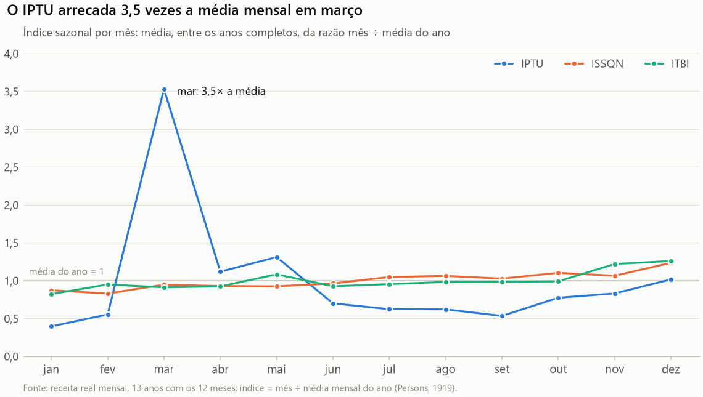
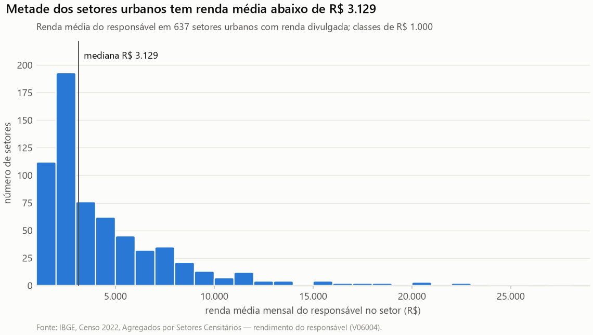

# Relatório de análise exploratória (E3) — Sprint 3

> Gerado por `python etl_sefin.py` (`pipeline/eda/relatorio.py`) em 2026-10-21, a partir de `data/pronto` da execução `20261021T065740-9b9054` (código `ea64aa6`). Não edite à mão: os números e as frases de leitura são recalculados a cada execução.

## 1. Introdução

A análise exploratória precede a modelagem porque é ela que mostra o que os dados podem e o que não podem sustentar. Tukey (1977) a descreve como trabalho de detetive, em que os dados são examinados de vários ângulos antes de qualquer hipótese ser confirmada, e Anscombe (1973) demonstrou que conjuntos com médias, variâncias e correlações idênticas podem ter formas completamente diferentes, diferença que só o gráfico revela. Por isso, este relatório combina estatísticas descritivas com gráficos de evolução, composição, distribuição e relação, e cada gráfico traz uma frase de leitura, que diz o que o leitor deve ver, e a tabela com os mesmos números.

O relatório separa com rigor o dado real do dado simulado, porque misturá-los transformaria uma premissa em achado. São reais a arrecadação (API da Prefeitura e extração NUCLEOGOV), o IPCA, o Censo 2022 e as malhas do IBGE e do GeoPalmas; é simulada a dívida de IPTU por imóvel, que a base pública não contém e que foi gerada sobre os setores reais com parâmetros declarados (ADR-003). Desse modo, todo gráfico simulado traz a marca SIMULADO e o aviso no título, e nenhuma frase de leitura de dado simulado é apresentada como descoberta.

## 2. Bases e qualidade dos dados

A confiabilidade da análise depende da qualidade da base que a alimenta, e por isso a qualidade foi verificada antes de qualquer gráfico. A execução 20261021T065740-9b9054 avaliou 38 regras e passou nas 33 de 33 impeditivas, entre elas a completude da coleta, a reconciliação entre registros lidos e gravados, a unicidade das chaves, a integridade referencial, a continuidade do IPCA e a calibração da simulação; assim, nenhuma tabela usada aqui foi publicada com falha conhecida. Wang e Strong (1996) definem qualidade como adequação ao uso, e não apenas como exatidão; por conseguinte, as restrições de uso também ficam registradas: 86 linhas da API ficaram fora da série (D-REC-01 e D-REC-05), 1 registro foi para a quarentena com o motivo, e 23 setores estão sob sigilo do IBGE.

| Camada | Arquivo | Linhas |
| --- | ---: | ---: |
| limpo | ipca_mensal.csv | 321 |
| limpo | quadras_geopalmas.csv | 283 |
| limpo | quarentena.csv | 1 |
| limpo | receita_api_arrecadacao.csv | 25.146 |
| limpo | receita_nucleogov.csv | 1.365 |
| limpo | renda_setores_censo2022.csv | 683 |
| limpo | setores_ibge.csv | 733 |
| pronto | base_analitica_creditos.csv.gz | 556.260 |
| pronto | cruzamento_setor_quadra.csv | 1.635 |
| pronto | inadimplencia_simulada_por_setor.csv | 733 |
| pronto | indicadores_receita_anual.csv | 48 |
| pronto | quadras_socioeconomia.csv | 283 |
| pronto | receita_tributaria.csv | 2.055 |
| pronto | sazonalidade_tributos.csv | 36 |
| pronto | setores_socioeconomia.csv | 733 |
| pronto | simulacao_imoveis.csv.gz | 111.252 |

## 3. Estatísticas descritivas

As estatísticas descritivas resumem cada variável, mas não substituem a visão da sua distribuição. Média e desvio-padrão descrevem bem dados simétricos; quando a assimetria é alta, como na renda e nos valores monetários, a mediana e os quartis representam melhor o caso típico, e só o gráfico mostra a forma completa (Anscombe, 1973). Por esse motivo, a tabela traz os quartis e o coeficiente de assimetria ao lado da média, e as seções seguintes mostram as distribuições inteiras.

As linhas marcadas como SIMULADO descrevem a base analítica sintética e servem para conferir a coerência da simulação, como valores positivos, atrasos plausíveis e saldo apenas nos créditos em aberto, e não para descrever Palmas.

| Variável | n | Média | Desvio | Mín. | Q1 | Mediana | Q3 | Máx. | Assimetria |
| --- | ---: | ---: | ---: | ---: | ---: | ---: | ---: | ---: | ---: |
| Arrecadação real anual — IPTU (R$ mi) | 15 | 102,4 | 33,4 | 42,9 | 86,9 | 104,5 | 118,5 | 164,7 | −0,29 |
| Arrecadação real anual — ISSQN (R$ mi) | 15 | 191,6 | 75,1 | 98,8 | 132,6 | 180,0 | 239,0 | 330,9 | 0,54 |
| Arrecadação real anual — ITBI (R$ mi) | 15 | 33,6 | 11,9 | 13,8 | 24,3 | 32,9 | 44,4 | 49,4 | −0,26 |
| Renda média do responsável por setor urbano (R$) | 637 | 4.613 | 3.851 | 1.116 | 2.173 | 3.129 | 5.699 | 28.165 | 2,51 |
| Densidade por setor urbano (hab./km²) | 637 | 4.516 | 4.407 | 14 | 1.800 | 3.759 | 5.806 | 42.976 | 3,37 |
| Moradores por setor urbano | 637 | 464 | 252 | 15 | 281 | 447 | 650 | 1.300 | 0,27 |
| SIMULADO — valor lançado por crédito (R$) | 556.260 | 964 | 1.186 | 18 | 338 | 600 | 1.123 | 41.383 | 5,11 |
| SIMULADO — dias de atraso dos inadimplentes | 183.566 | 649 | 565 | 1 | 176 | 508 | 978 | 1.969 | 0,83 |
| SIMULADO — saldo no corte dos créditos em aberto (R$) | 78.122 | 1.022 | 1.129 | 40 | 422 | 696 | 1.201 | 34.801 | 5,40 |

## 4. Evolução da arrecadação real

### Figura 1 — Desde 2019, o ISSQN cresceu 9,5% ao ano em termos reais; o IPTU recuou 2,9% ao ano

**Frase de leitura.** Na mesma fonte (NUCLEOGOV), entre 2019 e 2025, o ISSQN cresceu 9,5% ao ano em reais de setembro de 2026 e passou de 53% para 67% da arrecadação dos três tributos, enquanto o IPTU recuou 2,9% ao ano (R$ 139,9 mi em 2019, R$ 117,5 mi em 2025).

*Fonte: API REST da Prefeitura (2010–2017) e extração NUCLEOGOV (2019–2025); valores deflacionados pelo IPCA (BCB/SGS 433).*

Dados da figura (tabela)

| Ano | IPTU (R$ mi) | ISSQN (R$ mi) | ITBI (R$ mi) |
| --- | ---: | ---: | ---: |
| 2010 | 42,9 | 103,0 | 13,8 |
| 2011 | 44,6 | 98,8 | 16,2 |
| 2012 | 81,9 | 111,1 | 21,1 |
| 2013 | 66,2 | 115,0 | 24,6 |
| 2014 | 130,4 | 160,0 | 32,4 |
| 2015 | 114,8 | 162,7 | 27,4 |
| 2016 | 92,0 | 150,3 | 24,1 |
| 2017 | 164,7 | 200,7 | 37,5 |
| 2018 | — | — | — |
| 2019 | 139,9 | 191,5 | 32,9 |
| 2020 | 98,8 | 180,0 | 44,4 |
| 2021 | 104,5 | 225,9 | 43,7 |
| 2022 | 102,6 | 252,0 | 44,3 |
| 2023 | 119,5 | 280,3 | 46,6 |
| 2024 | 116,0 | 311,4 | 49,4 |
| 2025 | 117,5 | 330,9 | 46,0 |

A evolução real da arrecadação revela uma mudança de composição, e não apenas de nível. Como todos os valores foram deflacionados pelo IPCA para reais de setembro de 2026 (D-REC-03), a variação não é efeito da inflação; e, como a comparação fica dentro de uma única fonte (NUCLEOGOV, 2019 a 2025), também não é efeito da troca de fonte. Nesse período, o ISSQN cresceu 9,5% ao ano, enquanto o IPTU recuou 2,9% ao ano; por conseguinte, o imposto sobre serviços passou de 53% para 67% do que os três tributos arrecadam. Cleveland e McGill (1984) mostram que a posição sobre uma escala comum é a codificação lida com mais precisão; por esse motivo, as três séries dividem um único eixo, que começa em zero.

A série, entretanto, tem fragilidades que o gráfico expõe em vez de esconder. O ano de 2018 aparece como lacuna porque os totais da API eram cerca de 3,3 vezes os das contas-folha do NUCLEOGOV (D-REC-05), e a passagem de uma fonte para a outra é uma quebra de série que pode deslocar o nível dos valores (D-REC-01). Em particular, o IPTU de 2017 na API (R$ 164,7 mi) supera em 18% o maior ano do NUCLEOGOV; como os anos de 2016 a 2018 da API vêm em linhas anuais atualizadas em 2021, esse valor deve ser lido com cautela até ser conferido com o balanço do município. Desse modo, comparações dentro de cada trecho são mais seguras do que comparações entre os trechos.

## 5. Composição do IPTU

### Figura 2 — Até 48% do IPTU arrecadado num ano veio da dívida ativa (2019)

**Frase de leitura.** A dívida ativa (principal, multas e juros) respondeu por 47,7% do IPTU arrecadado em 2019, a maior parcela da série, e por 15,7% em 2025.

*Fonte: API REST da Prefeitura (2010–2017) e extração NUCLEOGOV (2019–2025); valores deflacionados pelo IPCA (BCB/SGS 433).*

Dados da figura (tabela)

| Ano | Exercício (R$ mi) | Dívida ativa (R$ mi) | Multas e juros da dívida ativa (R$ mi) | Ajustes (R$ mi) | Dívida ativa no IPTU |
| --- | ---: | ---: | ---: | ---: | ---: |
| 2010 | 25,3 | 14,4 | 3,2 | 0,0 | 41,1% |
| 2011 | 26,9 | 14,9 | 2,9 | 0,0 | 39,8% |
| 2012 | 46,6 | 31,7 | 3,5 | 0,0 | 43,0% |
| 2013 | 51,5 | 11,4 | 3,4 | 0,0 | 22,3% |
| 2014 | 96,3 | 26,6 | 7,6 | −0,1 | 26,2% |
| 2015 | 83,9 | 25,6 | 5,4 | −0,1 | 27,0% |
| 2016 | 75,7 | 12,1 | 5,3 | −1,1 | 18,7% |
| 2017 | 131,1 | 25,0 | 8,6 | 0,0 | 20,4% |
| 2019 | 73,2 | 55,2 | 11,4 | 0,0 | 47,7% |
| 2020 | 71,8 | 19,8 | 7,3 | 0,0 | 27,4% |
| 2021 | 71,3 | 23,9 | 9,3 | 0,0 | 31,8% |
| 2022 | 72,7 | 20,8 | 9,1 | 0,0 | 29,1% |
| 2023 | 78,6 | 26,8 | 14,1 | 0,0 | 34,2% |
| 2024 | 97,9 | 11,0 | 7,1 | 0,0 | 15,6% |
| 2025 | 99,0 | 13,3 | 5,1 | 0,0 | 15,7% |

A composição do IPTU mostra o peso da cobrança da dívida ativa na receita do imposto. Em 2019, 47,7% do IPTU arrecadado veio de créditos já inscritos, e não do lançamento do próprio ano; logo, a eficiência da cobrança afeta diretamente a receita, o que sustenta a priorização proposta na Opção D. A literatura sobre inadimplência do imposto predial chega à mesma conclusão por outro caminho: atrasos persistem e se concentram, de modo que a recuperação depende de ação dirigida (Alm et al., 2014; Chirico et al., 2019).

A queda recente da parcela, até 15,7% em 2025, admite duas leituras opostas, e a base pública não permite escolher entre elas. Ela pode indicar melhor adimplência no exercício ou menor esforço de cobrança dos créditos antigos; distinguir as duas exige o histórico por contribuinte, exatamente o dado que a Sefin ainda não forneceu (PA-12). Os ajustes, negativos e de no máximo R$ 1,1 mi por ano, ficam fora da pilha para não distorcer a soma e aparecem na tabela.

## 6. Sazonalidade

### Figura 3 — O IPTU arrecada 3,5 vezes a média mensal em março

**Frase de leitura.** O IPTU concentra a arrecadação em março (índice 3,53, isto é, 3,5 vezes a média mensal do ano); ISSQN e ITBI ficam entre 0,82 e 1,26 da média em todos os meses.

*Fonte: receita real mensal, 13 anos com os 12 meses; índice = mês ÷ média mensal do ano (Persons, 1919).*

Dados da figura (tabela)

| Mês | IPTU | ISSQN | ITBI |
| --- | ---: | ---: | ---: |
| jan | 0,40 | 0,87 | 0,82 |
| fev | 0,55 | 0,83 | 0,95 |
| mar | 3,53 | 0,95 | 0,91 |
| abr | 1,12 | 0,93 | 0,92 |
| mai | 1,31 | 0,92 | 1,08 |
| jun | 0,70 | 0,96 | 0,93 |
| jul | 0,62 | 1,05 | 0,95 |
| ago | 0,62 | 1,06 | 0,98 |
| set | 0,53 | 1,03 | 0,98 |
| out | 0,77 | 1,10 | 0,99 |
| nov | 0,83 | 1,06 | 1,22 |
| dez | 1,02 | 1,23 | 1,26 |

A sazonalidade da arrecadação é um fato observado, e não uma premissa, e por isso pode orientar a simulação. O índice de cada mês é a média, entre os 13 anos completos, da razão entre o valor do mês e a média mensal do ano, procedimento clássico de decomposição de séries econômicas (Persons, 1919). O pico do IPTU em março é compatível com o vencimento da cota única no início do ano, enquanto o ISSQN, imposto sobre o fluxo de serviços, cresce no fim do ano com a atividade econômica.

Essa regularidade tem consequência prática para o modelo da Sprint 4. A simulação fixou o vencimento em 10 de março, coerente com o pico observado, e o atributo indice_sazonal_mes_vencimento da base analítica herda o índice real do mês; assim, a única informação sazonal da base vem dos dados, e não da premissa.

## 7. Distribuição da renda dos setores

### Figura 4 — Metade dos setores urbanos tem renda média abaixo de R$ 3.129

**Frase de leitura.** Metade dos 637 setores urbanos com renda divulgada tem renda média do responsável abaixo de R$ 3.129; os 25% mais ricos passam de R$ 5.699, e o maior valor chega a R$ 28.165.

*Fonte: IBGE, Censo 2022, Agregados por Setores Censitários — rendimento do responsável (V06004).*

Dados da figura (tabela)

| Estatística | Renda média do responsável |
| --- | ---: |
| Mínimo | R$ 1.116 |
| 1º quartil | R$ 2.173 |
| Mediana | R$ 3.129 |
| Média | R$ 4.613 |
| 3º quartil | R$ 5.699 |
| Máximo | R$ 28.165 |

A renda dos setores urbanos é fortemente assimétrica, e essa forma condiciona toda a leitura territorial que se segue. A média (R$ 4.613) fica bem acima da mediana (R$ 3.129) porque poucos setores muito ricos puxam o valor para cima, com assimetria de 2,51; esse é o padrão típico de grandezas que se formam por efeitos multiplicativos, como a renda (Limpert et al., 2001). Por conseguinte, a mediana e os quartis descrevem melhor o setor típico, e o gráfico de relação usa escala logarítmica para a renda.

O histograma completo substitui o gráfico de barras de médias, que esconderia justamente essa assimetria (Weissgerber et al., 2015). Além disso, os setores sob sigilo do IBGE (23) ficam sem renda: nada foi imputado (D-CEN-01), porque estimar a renda onde o próprio IBGE a omitiu para proteger poucos domicílios criaria um dado que não existe.

## 8. Relação entre renda e inadimplência (simulada)

### Figura 5 — Na simulação, a inadimplência cai com a renda (ρ = −0,83) (dados simulados)

**Frase de leitura.** Na simulação, a inadimplência cai com a renda do setor (ρ de Spearman = −0,83): é o gradiente que o parâmetro β_renda = −0,5 impôs ao modelo, e não uma evidência sobre Palmas.

*Fonte: simulação ADR-003 sobre os setores reais do Censo 2022 (parâmetros versionados; dado SINTÉTICO, não observado).*

Dados da figura (tabela)

| Quintil de renda | Setores | Renda mediana | Inadimplência média |
| --- | ---: | ---: | ---: |
| 1 | 125 | R$ 1.783 | 47,9% |
| 2 | 124 | R$ 2.256 | 39,7% |
| 3 | 123 | R$ 3.099 | 32,3% |
| 4 | 124 | R$ 4.975 | 24,9% |
| 5 | 129 | R$ 8.779 | 14,7% |

A relação entre renda e inadimplência é a parte da análise que exige mais cautela, porque nos dados disponíveis ela é construída, e não observada. A base pública não traz dívida por contribuinte nem por local (PA-12); por isso, a inadimplência por imóvel foi simulada com um modelo logístico cuja direção segue a literatura, segundo a qual imóveis de menor valor e áreas mais pobres atrasam mais (Alm et al., 2014), e cuja intensidade é premissa declarada (ADR-003). Desse modo, a correlação do gráfico é circular: ela mede o parâmetro da simulação, e não o comportamento dos contribuintes.

O gráfico permanece no relatório por duas razões, e nenhuma delas é servir de achado. Primeiro, ele demonstra que o pipeline leva o dado do setor censitário até o crédito e de volta ao mapa; segundo, ele define o teste que os dados reais da Sefin terão de passar, pois a mesma figura, sem a marca SIMULADO, dirá se o gradiente existe em Palmas. Morris, White e Crowther (2019) recomendam exatamente esse uso de dados simulados: avaliar métodos com a verdade conhecida, nunca substituir a observação.

## 9. Mapas da renda e da inadimplência simulada por setor urbano

### Figura 6 — A renda média vai de R$ 2.155 (região SUL) a R$ 7.613 (região SUDOESTE)

**Frase de leitura.** A renda média dos responsáveis vai de R$ 2.155 na região SUL a R$ 7.613 na região SUDOESTE do GeoPalmas, e setores vizinhos têm rendas parecidas (I de Moran = 0,76 no logaritmo da renda, p ≤ 0,001, 627 setores): a renda forma blocos contíguos, e não um mosaico aleatório.

*Fonte: IBGE, Censo 2022, Agregados por Setores Censitários — rendimento do responsável (V06004).*

Dados da figura (tabela)

| Classe ou região | Renda (faixa da classe ou média da região) |
| --- | ---: |
| 1ª | R$ 1.116 a R$ 2.066 |
| 2ª | R$ 2.066 a R$ 2.552 |
| 3ª | R$ 2.552 a R$ 4.099 |
| 4ª | R$ 4.099 a R$ 6.616 |
| 5ª | R$ 6.616 a R$ 28.165 |
| Região SUL | R$ 2.155 |
| Região NOROESTE | R$ 3.138 |
| Região NORTE | R$ 4.391 |
| Região SUDESTE | R$ 5.451 |
| Região NORDESTE | R$ 5.698 |
| Região SUDOESTE | R$ 7.613 |

### Figura 7 — Inadimplência simulada maior na região SUL (42%) (dados simulados)

**Frase de leitura.** Na simulação, a inadimplência média vai de 20,7% na região SUDOESTE a 42,1% na região SUL do GeoPalmas, com autocorrelação espacial (I de Moran = 0,56, p ≤ 0,001) herdada da renda: é o desenho invertido do mapa de renda, como o modelo foi construído para produzir.

*Fonte: simulação ADR-003 sobre os setores reais do Censo 2022 (parâmetros versionados; dado SINTÉTICO, não observado).*

Dados da figura (tabela)

| Região do GeoPalmas | Inadimplência simulada média |
| --- | ---: |
| SUDOESTE | 20,7% |
| NORDESTE | 24,3% |
| SUDESTE | 26,5% |
| NORTE | 33,4% |
| NOROESTE | 34,8% |
| SUL | 42,1% |

Os dois mapas devem ser lidos juntos, e o segundo não pode ser lido sem o primeiro. O mapa de renda é dado real do Censo 2022 e mostra que a renda se distribui em blocos contíguos; o mapa de inadimplência é simulado a partir dessa mesma renda e, por construção, repete o seu desenho com o sinal invertido. Assim, a semelhança entre eles confirma o funcionamento da simulação, e não uma descoberta sobre a cobrança em Palmas.

A semelhança entre setores vizinhos foi medida, e não apenas vista. O I de Moran compara o valor de cada setor com a média dos seus vizinhos de borda (Moran, 1950): perto de zero, o mapa seria um mosaico aleatório; positivo, vizinhos se parecem. O valor-p vem de 999 permutações dos valores entre os setores, o que dispensa supor normalidade.

As escolhas de cartografia seguem a literatura para não fabricar padrões. As classes são quantis, com o mesmo número de setores em cada uma, método que Brewer e Pickle (2002) consideraram o mais legível para comparar mapas, e os cortes estão na legenda; setores sem valor aparecem em cinza, porque ausência não é zero. Além disso, o setor censitário é uma unidade de área, e não de cobrança: padrões por setor não valem para cada imóvel (Robinson, 1950) e mudariam com outro recorte territorial (Fotheringham e Wong, 1991). Por fim, setores com menos de 10 imóveis simulados ficam suprimidos, regra que os dados reais vão exigir para que nenhum contribuinte seja reconhecível (Sweeney, 2002).

## 10. Indicadores de gestão (valores reais)

Os indicadores condensam a análise em números comparáveis entre anos porque estão todos na mesma moeda, os reais de setembro de 2026. A arrecadação real, a variação real anual e a participação da dívida ativa são calculadas com o IPCA, e a variação só é publicada entre dois anos consecutivos completos, para que um ano parcial ou uma lacuna não pareçam queda. O desvio orçamentário compara o arrecadado com a previsão atualizada, em valores nominais, porque a previsão é feita na moeda do próprio ano; por isso ele só existe nos anos do NUCLEOGOV, a única fonte que publica a previsão.

A coluna de quebra de fonte impede que a troca da API para o NUCLEOGOV seja lida como mudança real da arrecadação (D-REC-01). Os mesmos valores estão em data/pronto/indicadores_receita_anual.csv e, no banco, em valor_indicador, com a data de corte e a cobertura de cada ano.

| Ano | Tributo | Fonte | Arrecadação real (R$ mi) | Variação real | Dívida ativa | Desvio orçamentário (R$ mi, nominal) | Quebra de fonte |
| --- | --- | --- | ---: | ---: | ---: | ---: | --- |
| 2010 | IPTU | API da Prefeitura | 42,9 | — | 41,0% | — |  |
| 2010 | ISSQN | API da Prefeitura | 103,0 | — | 5,0% | — |  |
| 2010 | ITBI | API da Prefeitura | 13,8 | — | 0,2% | — |  |
| 2011 | IPTU | API da Prefeitura | 44,6 | 4,0% | 39,8% | — |  |
| 2011 | ISSQN | API da Prefeitura | 98,8 | −4,0% | 7,4% | — |  |
| 2011 | ITBI | API da Prefeitura | 16,2 | 17,9% | 0,2% | — |  |
| 2012 | IPTU | API da Prefeitura | 81,9 | 83,5% | 43,0% | — |  |
| 2012 | ISSQN | API da Prefeitura | 111,1 | 12,4% | 5,8% | — |  |
| 2012 | ITBI | API da Prefeitura | 21,1 | 30,3% | 0,1% | — |  |
| 2013 | IPTU | API da Prefeitura | 66,2 | −19,1% | 22,3% | — |  |
| 2013 | ISSQN | API da Prefeitura | 115,0 | 3,5% | 2,8% | — |  |
| 2013 | ITBI | API da Prefeitura | 24,6 | 16,4% | 0,0% | — |  |
| 2014 | IPTU | API da Prefeitura | 130,4 | 96,8% | 26,2% | — |  |
| 2014 | ISSQN | API da Prefeitura | 160,0 | 39,2% | 4,6% | — |  |
| 2014 | ITBI | API da Prefeitura | 32,4 | 31,4% | 16,3% | — |  |
| 2015 | IPTU | API da Prefeitura | 114,8 | −11,9% | 27,0% | — |  |
| 2015 | ISSQN | API da Prefeitura | 162,7 | 1,7% | 4,9% | — |  |
| 2015 | ITBI | API da Prefeitura | 27,4 | −15,4% | 0,4% | — |  |
| 2016 | IPTU | API da Prefeitura | 92,0 | −19,9% | 18,9% | — |  |
| 2016 | ISSQN | API da Prefeitura | 150,3 | −7,6% | 1,4% | — |  |
| 2016 | ITBI | API da Prefeitura | 24,1 | −12,1% | 0,8% | — |  |
| 2017 | IPTU | API da Prefeitura | 164,7 | 79,1% | 20,4% | — |  |
| 2017 | ISSQN | API da Prefeitura | 200,7 | 33,5% | 4,9% | — |  |
| 2017 | ITBI | API da Prefeitura | 37,5 | 55,6% | 3,4% | — |  |
| 2019 | IPTU | NUCLEOGOV | 139,9 | — | 47,7% | 27,7 | sim |
| 2019 | ISSQN | NUCLEOGOV | 191,5 | — | 6,2% | 14,0 | sim |
| 2019 | ITBI | NUCLEOGOV | 32,9 | — | 4,3% | 4,0 | sim |
| 2020 | IPTU | NUCLEOGOV | 98,8 | −29,4% | 27,4% | 1,0 |  |
| 2020 | ISSQN | NUCLEOGOV | 180,0 | −6,0% | 5,8% | −2,2 |  |
| 2020 | ITBI | NUCLEOGOV | 44,4 | 34,9% | 2,9% | 10,5 |  |
| 2021 | IPTU | NUCLEOGOV | 104,5 | 5,8% | 31,8% | 6,9 |  |
| 2021 | ISSQN | NUCLEOGOV | 225,9 | 25,5% | 4,5% | 53,6 |  |
| 2021 | ITBI | NUCLEOGOV | 43,7 | −1,6% | 5,3% | 3,0 |  |
| 2022 | IPTU | NUCLEOGOV | 102,6 | −1,8% | 29,1% | 8,2 |  |
| 2022 | ISSQN | NUCLEOGOV | 252,0 | 11,6% | 3,0% | 42,0 |  |
| 2022 | ITBI | NUCLEOGOV | 44,3 | 1,5% | 3,8% | 2,2 |  |
| 2023 | IPTU | NUCLEOGOV | 119,5 | 16,4% | 34,2% | 17,2 |  |
| 2023 | ISSQN | NUCLEOGOV | 280,3 | 11,2% | 2,4% | 33,4 |  |
| 2023 | ITBI | NUCLEOGOV | 46,6 | 5,1% | 4,3% | 2,2 |  |
| 2024 | IPTU | NUCLEOGOV | 116,0 | −2,9% | 15,6% | 7,7 |  |
| 2024 | ISSQN | NUCLEOGOV | 311,4 | 11,1% | 0,8% | 36,8 |  |
| 2024 | ITBI | NUCLEOGOV | 49,4 | 6,1% | 2,3% | 5,9 |  |
| 2025 | IPTU | NUCLEOGOV | 117,5 | 1,3% | 15,7% | −1,0 |  |
| 2025 | ISSQN | NUCLEOGOV | 330,9 | 6,3% | 1,5% | 35,6 |  |
| 2025 | ITBI | NUCLEOGOV | 46,0 | −6,9% | 2,4% | −1,5 |  |

## 11. Atributos da base analítica (simulada)

Os atributos pedidos para a Sprint 3, tempo de inadimplência, sazonalidade e faixas de valor, estão na base analítica, uma linha por crédito simulado (556.260 créditos). As faixas de valor usam limites legíveis por um gestor, e não quantis, para que a mesma faixa signifique o mesmo valor em todo exercício; o tempo de inadimplência conta os dias entre o vencimento e o pagamento, ou até a data de corte quando não houve pagamento.

Esses atributos, contudo, não servem todos ao mesmo propósito, e a distinção evita vazamento de informação no modelo da Sprint 4. Dias de atraso, situação e saldo no corte só são conhecidos depois do vencimento; descrevem o estoque e ajudam a priorizar a cobrança, mas não podem prever a inadimplência no momento do lançamento (Kaufman et al., 2012). O dicionário da base analítica classifica cada coluna segundo esse critério.

| Faixa de valor | Créditos | Participação | Inadimplência |
| --- | ---: | ---: | ---: |
| 1000_A_2500 | 122.474 | 22,0% | 25,3% |
| 2500_A_5000 | 30.544 | 5,5% | 17,3% |
| 5000_A_10000 | 7.228 | 1,3% | 13,9% |
| 500_A_1000 | 162.256 | 29,2% | 33,4% |
| ACIMA_10000 | 1.076 | 0,2% | 9,2% |
| ATE_500 | 232.682 | 41,8% | 39,5% |

| Faixa de tempo de inadimplência | Créditos | Participação |
| --- | ---: | ---: |
| EM_DIA | 372.694 | 67,0% |
| ATE_1_ANO | 82.463 | 14,8% |
| 2_A_5_ANOS | 60.796 | 10,9% |
| 1_A_2_ANOS | 31.251 | 5,6% |
| MAIS_DE_5_ANOS | 9.056 | 1,6% |

## 12. Limitações e próximos passos

As conclusões desta análise têm alcance delimitado, e explicitar esse alcance faz parte da honestidade dos gráficos. Todo padrão territorial da inadimplência é consequência dos parâmetros da simulação e não pode ser apresentado como achado; os padrões por setor censitário não valem para cada imóvel (Robinson, 1950); e a série de arrecadação tem uma lacuna em 2018 e uma troca de fonte entre 2017 e 2019. Além disso, o valor de 2017 da API, mais alto do que todos os anos do NUCLEOGOV, ainda precisa ser conferido com o balanço do município.

Os próximos passos decorrem diretamente dessas limitações. A base de créditos da Sefin, pseudonimizada antes do armazenamento (LGPD), permitirá substituir a simulação pelo dado observado e refazer as figuras de relação e o mapa sem a marca SIMULADO; a conferência dos totais anuais com as declarações contábeis do município resolverá a dúvida sobre 2017; e o modelo da Sprint 4 deverá usar apenas os atributos conhecidos no lançamento.

## Referências

- Detroit Property Tax Delinquency: Social Contract in Crisis. 2014. DOI: [10.1177/152397211401400302](https://doi.org/10.1177/152397211401400302). *Conferência no Crossref pendente.*
- Graphs in Statistical Analysis. 1973. DOI: [10.1080/00031305.1973.10478966](https://doi.org/10.1080/00031305.1973.10478966). *Conferência no Crossref pendente.*
- Evaluation of Methods for Classifying Epidemiological Data on Choropleth Maps in Series. 2002. DOI: [10.1111/1467-8306.00310](https://doi.org/10.1111/1467-8306.00310). *Conferência no Crossref pendente.*
- Deterring Property Tax Delinquency in Philadelphia. 2019. DOI: [10.17310/ntj.2019.3.01](https://doi.org/10.17310/ntj.2019.3.01). *Conferência no Crossref pendente.*
- Graphical Perception: Theory, Experimentation, and Application to the Development of Graphical Methods. 1984. DOI: [10.1080/01621459.1984.10478080](https://doi.org/10.1080/01621459.1984.10478080). *Conferência no Crossref pendente.*
- The Modifiable Areal Unit Problem in Multivariate Statistical Analysis. 1991. DOI: [10.1068/a231025](https://doi.org/10.1068/a231025). *Conferência no Crossref pendente.*
- Leakage in data mining: Formulation, detection, and avoidance. 2012. DOI: [10.1145/2382577.2382579](https://doi.org/10.1145/2382577.2382579). *Conferência no Crossref pendente.*
- Log-normal Distributions across the Sciences: Keys and Clues. 2001. DOI: [10.1641/0006-3568(2001)051[0341:LNDATS]2.0.CO;2](https://doi.org/10.1641/0006-3568(2001)051[0341:LNDATS]2.0.CO;2). *Conferência no Crossref pendente.*
- Notes on Continuous Stochastic Phenomena. 1950. DOI: [10.1093/biomet/37.1-2.17](https://doi.org/10.1093/biomet/37.1-2.17). *Conferência no Crossref pendente.*
- Using simulation studies to evaluate statistical methods. 2019. DOI: [10.1002/sim.8086](https://doi.org/10.1002/sim.8086). *Conferência no Crossref pendente.*
- Indices of Business Conditions. 1919. DOI: [10.2307/1928754](https://doi.org/10.2307/1928754). *Conferência no Crossref pendente.*
- Ecological Correlations and the Behavior of Individuals. 1950. DOI: [10.2307/2087176](https://doi.org/10.2307/2087176). *Conferência no Crossref pendente.*
- k-anonymity: a model for protecting privacy. 2002. DOI: [10.1142/S0218488502001648](https://doi.org/10.1142/S0218488502001648). *Conferência no Crossref pendente.*
- TUKEY, John W. *Exploratory Data Analysis*. Reading: Addison-Wesley, 1977. Sem DOI.
- Beyond Accuracy: What Data Quality Means to Data Consumers. 1996. DOI: [10.1080/07421222.1996.11518099](https://doi.org/10.1080/07421222.1996.11518099). *Conferência no Crossref pendente.*
- Beyond Bar and Line Graphs: Time for a New Data Presentation Paradigm. 2015. DOI: [10.1371/journal.pbio.1002128](https://doi.org/10.1371/journal.pbio.1002128). *Conferência no Crossref pendente.*
