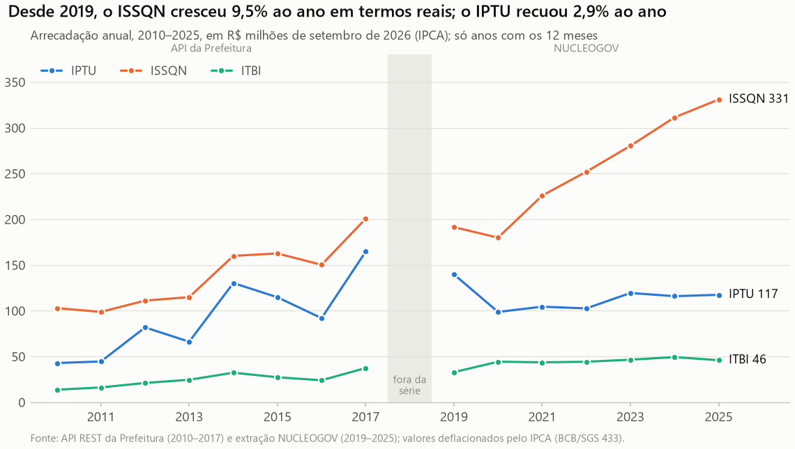
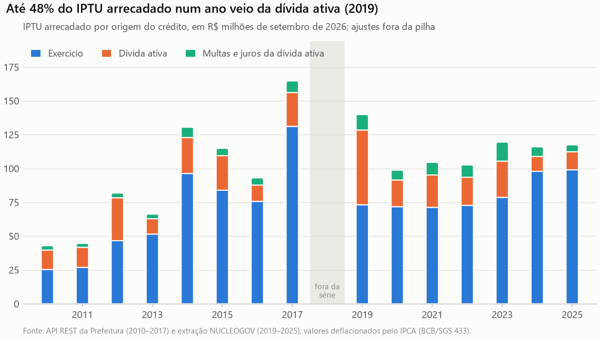
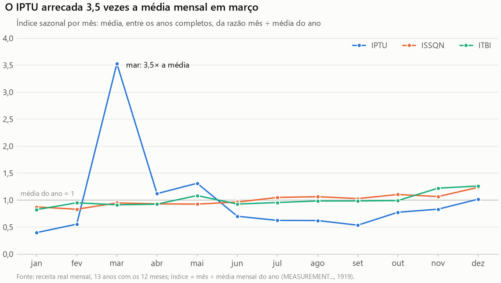
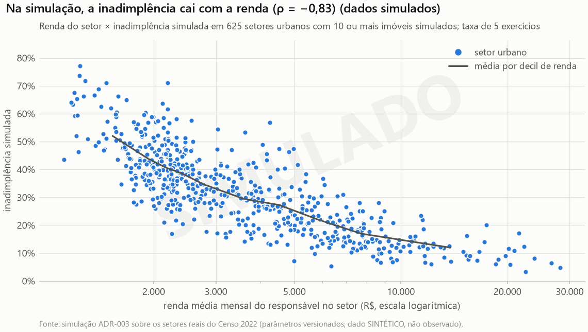
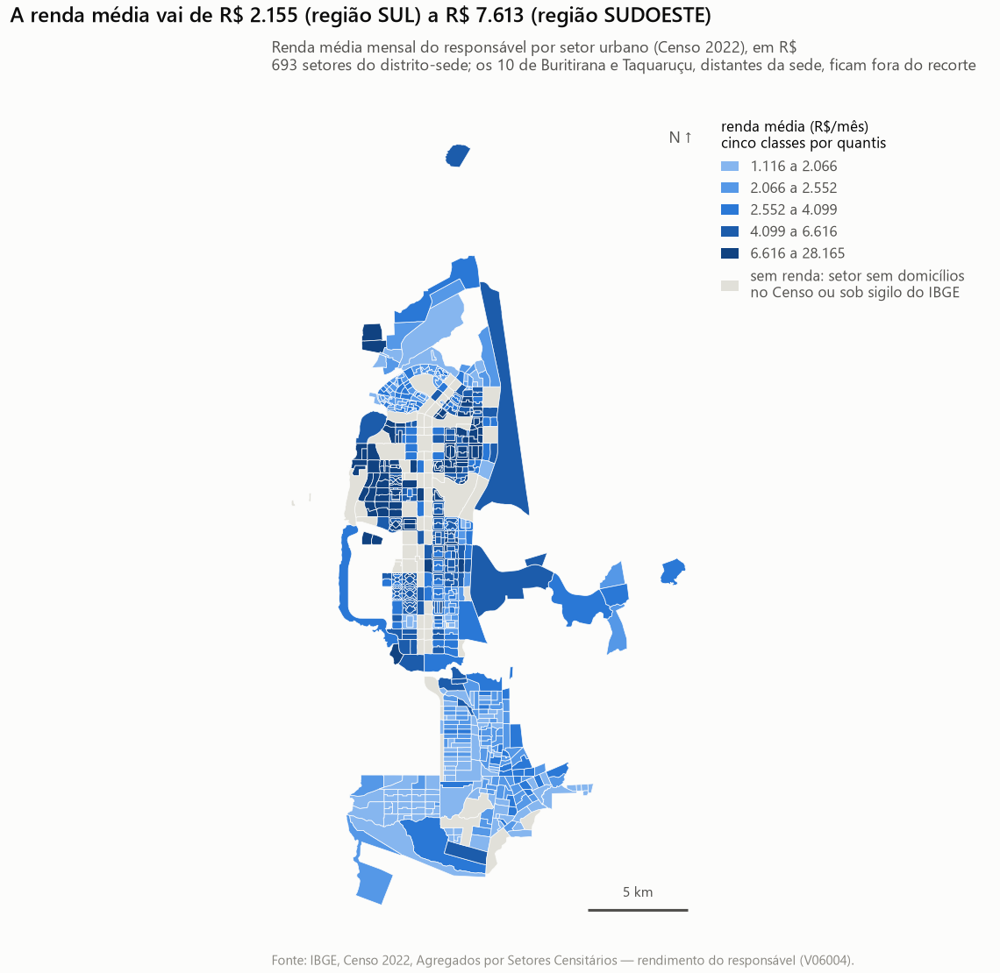
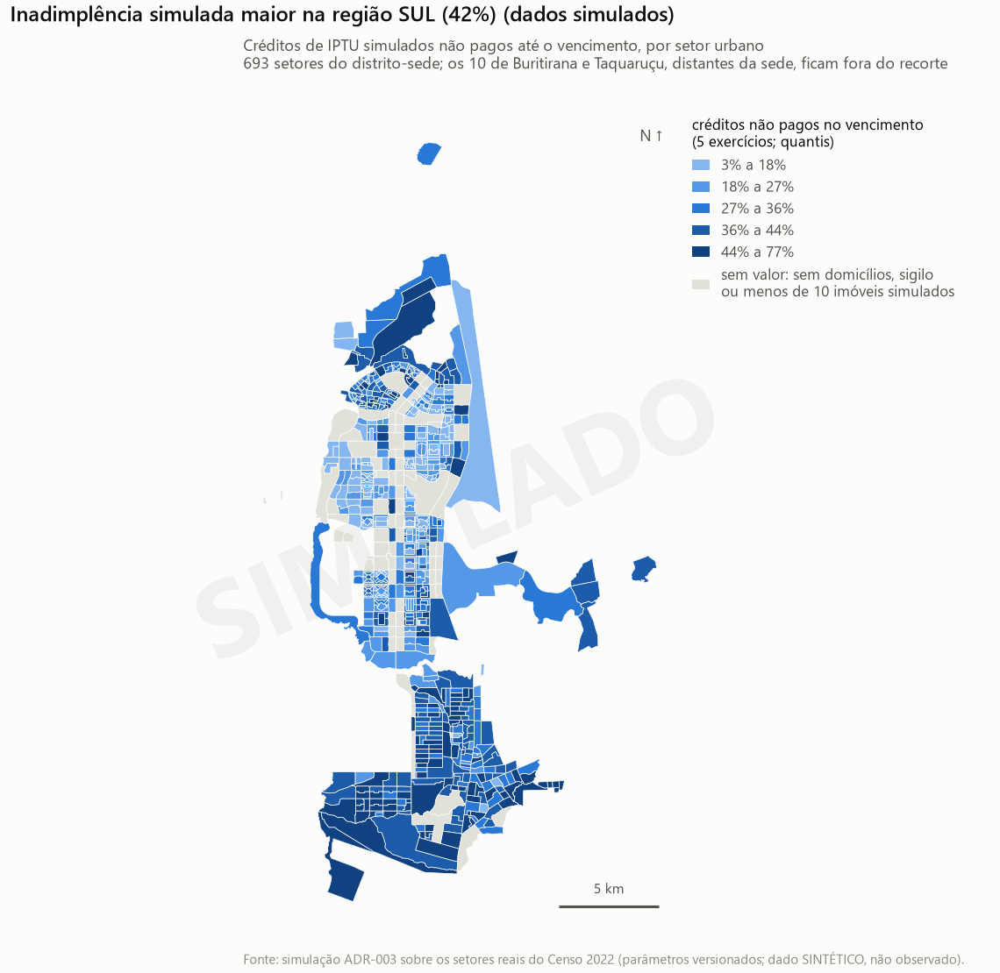

# Galeria de figuras — Sprint 3

> Gerado por `python etl_sefin.py` (`pipeline/eda/relatorio.py`) em 2026-10-26, a partir de `data/pronto` da execução `20261026T155511-c3ba7c` (código `8dee5ba`). Não edite à mão: os números e as frases de leitura são recalculados a cada execução.

7 figuras em PNG a 150 dpi (`docs/sprint3/figuras/`); a análise completa está em [EDA.md](EDA.md).

| # | Figura | Dado | Frase de leitura |
| --- | --- | --- | --- |
| 1 | [Desde 2019, o ISSQN cresceu 9,5% ao ano em termos reais; o IPTU recuou 2,9% ao ano](figuras/01_evolucao_arrecadacao_real.png) | real | Na mesma fonte (NUCLEOGOV), entre 2019 e 2025, o ISSQN cresceu 9,5% ao ano em reais de setembro de 2026 e passou de 53% para 67% da arrecadação dos três tributos, enquanto o IPTU recuou 2,9% ao ano (R$ 139,9 mi em 2019, R$ 117,5 mi em 2025). |
| 2 | [Até 48% do IPTU arrecadado num ano veio da dívida ativa (2019)](figuras/02_composicao_iptu.png) | real | A dívida ativa (principal, multas e juros) respondeu por 47,7% do IPTU arrecadado em 2019, a maior parcela da série, e por 15,7% em 2025. |
| 3 | [O IPTU arrecada 3,5 vezes a média mensal em março](figuras/03_sazonalidade.png) | real | O IPTU concentra a arrecadação em março (índice 3,53, isto é, 3,5 vezes a média mensal do ano); ISSQN e ITBI ficam entre 0,82 e 1,26 da média em todos os meses. |
| 4 | [Metade dos setores urbanos tem renda média abaixo de R$ 3.129](figuras/04_distribuicao_renda_setores.png) | real | Metade dos 637 setores urbanos com renda divulgada tem renda média do responsável abaixo de R$ 3.129; os 25% mais ricos passam de R$ 5.699, e o maior valor chega a R$ 28.165. |
| 5 | [Na simulação, a inadimplência cai com a renda (ρ = −0,83) (dados simulados)](figuras/05_relacao_renda_inadimplencia_simulada.png) | SIMULADO | Na simulação, a inadimplência cai com a renda do setor (ρ de Spearman = −0,83): é o gradiente que o parâmetro β_renda = −0,5 impôs ao modelo, e não uma evidência sobre Palmas. |
| 6 | [A renda média vai de R$ 2.155 (região SUL) a R$ 7.613 (região SUDOESTE)](figuras/06_mapa_renda_setores.png) | real | A renda média dos responsáveis vai de R$ 2.155 na região SUL a R$ 7.613 na região SUDOESTE do GeoPalmas, e setores vizinhos têm rendas parecidas (I de Moran = 0,76 no logaritmo da renda, p ≤ 0,001, 627 setores): a renda forma blocos contíguos, e não um mosaico aleatório. |
| 7 | [Inadimplência simulada maior na região SUL (42%) (dados simulados)](figuras/07_mapa_inadimplencia_simulada.png) | SIMULADO | Na simulação, a inadimplência média vai de 20,7% na região SUDOESTE a 42,1% na região SUL do GeoPalmas, com autocorrelação espacial (I de Moran = 0,56, p ≤ 0,001) herdada da renda: é o desenho invertido do mapa de renda, como o modelo foi construído para produzir. |

## 1. Desde 2019, o ISSQN cresceu 9,5% ao ano em termos reais; o IPTU recuou 2,9% ao ano

Na mesma fonte (NUCLEOGOV), entre 2019 e 2025, o ISSQN cresceu 9,5% ao ano em reais de setembro de 2026 e passou de 53% para 67% da arrecadação dos três tributos, enquanto o IPTU recuou 2,9% ao ano (R$ 139,9 mi em 2019, R$ 117,5 mi em 2025).

*Fonte: API REST da Prefeitura (2010–2017) e extração NUCLEOGOV (2019–2025); valores deflacionados pelo IPCA (BCB/SGS 433).*

## 2. Até 48% do IPTU arrecadado num ano veio da dívida ativa (2019)

A dívida ativa (principal, multas e juros) respondeu por 47,7% do IPTU arrecadado em 2019, a maior parcela da série, e por 15,7% em 2025.

*Fonte: API REST da Prefeitura (2010–2017) e extração NUCLEOGOV (2019–2025); valores deflacionados pelo IPCA (BCB/SGS 433).*

## 3. O IPTU arrecada 3,5 vezes a média mensal em março

O IPTU concentra a arrecadação em março (índice 3,53, isto é, 3,5 vezes a média mensal do ano); ISSQN e ITBI ficam entre 0,82 e 1,26 da média em todos os meses.

*Fonte: receita real mensal, 13 anos com os 12 meses; índice = mês ÷ média mensal do ano (MEASUREMENT..., 1919).*

## 4. Metade dos setores urbanos tem renda média abaixo de R$ 3.129

Metade dos 637 setores urbanos com renda divulgada tem renda média do responsável abaixo de R$ 3.129; os 25% mais ricos passam de R$ 5.699, e o maior valor chega a R$ 28.165.

*Fonte: IBGE, Censo 2022, Agregados por Setores Censitários — rendimento do responsável (V06004).*

## 5. Na simulação, a inadimplência cai com a renda (ρ = −0,83) (dados simulados)

Na simulação, a inadimplência cai com a renda do setor (ρ de Spearman = −0,83): é o gradiente que o parâmetro β_renda = −0,5 impôs ao modelo, e não uma evidência sobre Palmas.

*Fonte: simulação ADR-003 sobre os setores reais do Censo 2022 (parâmetros versionados; dado SINTÉTICO, não observado).*

## 6. A renda média vai de R$ 2.155 (região SUL) a R$ 7.613 (região SUDOESTE)

A renda média dos responsáveis vai de R$ 2.155 na região SUL a R$ 7.613 na região SUDOESTE do GeoPalmas, e setores vizinhos têm rendas parecidas (I de Moran = 0,76 no logaritmo da renda, p ≤ 0,001, 627 setores): a renda forma blocos contíguos, e não um mosaico aleatório.

*Fonte: IBGE, Censo 2022, Agregados por Setores Censitários — rendimento do responsável (V06004).*

## 7. Inadimplência simulada maior na região SUL (42%) (dados simulados)

Na simulação, a inadimplência média vai de 20,7% na região SUDOESTE a 42,1% na região SUL do GeoPalmas, com autocorrelação espacial (I de Moran = 0,56, p ≤ 0,001) herdada da renda: é o desenho invertido do mapa de renda, como o modelo foi construído para produzir.

*Fonte: simulação ADR-003 sobre os setores reais do Censo 2022 (parâmetros versionados; dado SINTÉTICO, não observado).*
