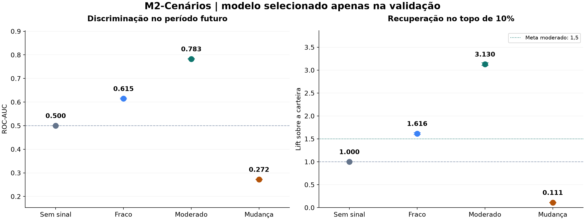
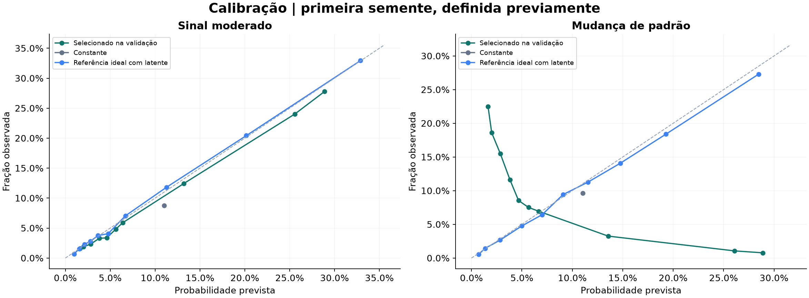
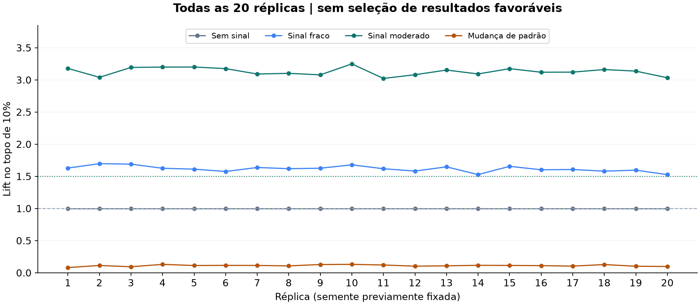

# M2-Cenários — resultado do experimento

**APROVADO NO CENÁRIO MODERADO**

O cenário moderado cumpriu todos os critérios previamente registrados. Foram executadas 20 réplicas em cada um dos quatro cenários, com escolha de modelo somente na validação. Os 412 arquivos da Sprint 4 permaneceram idênticos, verificados por SHA-256. Os resultados demonstram aprendizado de hipóteses simuladas; não validam previsão real de cobrança.

## Como isso funciona

| Etapa | O que acontece |
| --- | --- |
| 1. Simular | Uma regra declarada transforma históricos conhecidos em chances diferentes. Um sorteio produz a data de pagamento. |
| 2. Aprender | O modelo observa históricos e pagamentos passados. Ele estima seus próprios parâmetros; não recebe a fórmula nem os sorteios. |
| 3. Escolher | A validação compara constante, logística e boosting. O modelo é escolhido antes de medir o teste. |
| 4. Verificar | O teste usa um período futuro e imóveis reservados. Vinte sementes e o cenário de mudança expõem estabilidade e limites. |

Uma chance de 30% não garante pagamento: em situações equivalentes, aproximadamente 70% ainda não pagariam. A avaliação verifica frequência, ordenação e calibração em grupos. Leia também [a explicação detalhada](../COMO_FUNCIONA.md).

## Resultado principal: teste temporal na carteira

| Cenário | AUC média [IC95 da média] | Recuperação carteira | Recuperação top 10% | Lift [IC95 da média] | Ganho Brier relativo |
| --- | --- | --- | --- | --- | --- |
| Sem sinal | 0,500 [0,500; 0,500] | 11,98% | 11,98% | 1,000 [1,000; 1,000] | 0,00% |
| Sinal fraco | 0,615 [0,612; 0,617] | 11,75% | 18,99% | 1,616 [1,595; 1,638] | 1,78% |
| Sinal moderado | 0,783 [0,781; 0,785] | 8,63% | 27,00% | 3,130 [3,101; 3,159] | 10,86% |
| Mudança de padrão | 0,272 [0,271; 0,274] | 9,96% | 1,11% | 0,111 [0,105; 0,117] | -21,48% |

As taxas de recuperação mudam entre cenários por composição e sobrevivência; 12% é a média calibrada na primeira coorte de inscrição, não uma meta imposta ao teste.

## Critérios definidos antes do treino

| Critério | Observado | Resultado |
| --- | --- | --- |
| Lift médio no topo de 10% ≥1,5 | 3,130 | PASSOU |
| Limite inferior IC95 da média do lift >1 | 3,101 | PASSOU |
| Limite inferior IC95 do ganho de Brier >0 | 0,008492 | PASSOU |
| Réplicas com lift ≥1,5 e ganho positivo ≥18 | 20,000 | PASSOU |
| Erro absoluto médio de calibração ≤0,02 | 0,003698 | PASSOU |
| ECE10 médio ≤0,02 | 0,005311 | PASSOU |

20/20 réplicas do moderado atenderam simultaneamente lift ≥1,5 e ganho de Brier >0.

## Comparação de métodos e ablação

Com os seis atributos equivalentes aos originais, a logística obteve AUC média 0,712. Acrescentando os históricos observáveis na inscrição, obteve 0,783. Essa ablação permite separar o efeito de disponibilizar histórico do efeito de trocar o estimador. Todos os métodos dessa tabela foram avaliados nos mesmos rótulos regenerados de cada réplica.

| Método no cenário moderado | AUC | Lift@10% | Brier | ECE10 |
| --- | --- | --- | --- | --- |
| Constante | 0,500 | 1,000 | 0,079244 | 2,01% |
| Logística: seis atributos | 0,712 | 3,056 | 0,075499 | 3,14% |
| Logística + históricos | 0,783 | 3,130 | 0,070636 | 0,53% |
| Boosting + históricos | 0,774 | 3,100 | 0,070982 | 0,93% |
| Selecionado na validação | 0,783 | 3,130 | 0,070636 | 0,53% |
| Referência ideal com latente | 0,805 | 3,782 | 0,068879 | 0,25% |

## Imóveis não usados no desenvolvimento

| Teste em imóveis excluídos do desenvolvimento | AUC | Lift@10% | Brier skill | ECE10 |
| --- | --- | --- | --- | --- |
| Sem sinal | 0,500 | 1,000 | -0,00% | 0,22% |
| Sinal fraco | 0,617 | 1,607 | 1,79% | 1,03% |
| Sinal moderado | 0,782 | 3,121 | 10,68% | 0,74% |
| Mudança de padrão | 0,274 | 0,115 | -21,65% | 13,14% |

## Controles e limitações

Controle nulo: AUC média da logística 0,501 e lift 1,003. Controle aprovado. O M2 original tinha ROC-AUC 0,508 e prevalência 11,85% no seu próprio teste. O novo controle nulo usa novas trajetórias, sem reutilizar os rótulos antigos.

No cenário de mudança, o selecionado teve AUC média 0,272, lift 0,111 e Brier skill -21,48%. O resultado é publicado integralmente e não foi usado para reajustar o modelo ou o gerador.

No moderado, o ranking por probabilidade capturou em média 35,86% do principal pago; a regra de maior principal capturou 43,85%. Essas são prioridades por crédito, não por devedor. O objetivo primário é a chance de pagamento; maximizar reais recuperados é outro objetivo. Nenhum dos valores representa efeito causal de uma ação de cobrança.

O cadastro e as inscrições vêm de uma base individual já sintética. Pagamentos após a inscrição foram regenerados; portanto, a comparação com o M2 original é contextual, e não um ganho medido sobre os mesmos rótulos. Os coeficientes foram escolhidos como hipóteses didáticas antes do treinamento, não estimados em Palmas. Os ICs da média representam erro Monte Carlo sobre trajetórias condicionadas ao cadastro fixo; não são intervalos de generalização para outra população. O efeito latente foi ocultado dos modelos e mostrado apenas na referência ideal. O mecanismo gerador usa um logito linear nas variáveis do histórico, o que favorece a família logística; este estudo não demonstra que logística seja superior em mecanismos não lineares ou em dados reais. A mudança de padrão é um estresse severo com inversão de efeitos: sucesso no cenário estável não garante robustez nesse cenário.

## Metodologia e rastreabilidade

Treino em 29/06/2022 e 30/06/2023; validação em 01/07/2024; teste em 31/07/2025 com horizonte de 365 dias e corte em 31/07/2026. Os imóveis com ID divisível por cinco foram excluídos do desenvolvimento. Modelos: constante, logística e boosting com parâmetros fixos. A seleção minimiza Brier na validação, preferindo o mais simples quando a diferença é de até 0,0001. Não houve ajuste após o teste. Empates no topo recebem inclusão uniforme; o topo da constante representa uma seleção aleatória em expectativa. O relatório apresenta IC95 da média entre 20 réplicas por t de Student; os mínimos, máximos e desvios estão no CSV. Um bootstrap pareado de 1.000 imóveis por cenário, na primeira semente, complementa a avaliação.

As 16 verificações de invariantes passaram. Tempo total de execução: 9,9 minutos.

Tamanhos da primeira réplica moderada (exemplo predefinido):

| Partição | Linhas | Imóveis |
| --- | --- | --- |
| validacao | 39.813 | 29.518 |
| teste_carteira | 52.865 | 35.046 |
| teste_novos_imoveis | 13.123 | 8.786 |
| treino | 37.231 | 22.964 |

Arquivos de respaldo: `registro_antes_do_treino.json`, `verificacoes.json`, `integridade_origem.json`, `origem_antes.json`, `origem_depois.json`, `metricas_replicas.csv`, `resumo_estatistico.csv`, `bootstrap_primeira_semente.json`, `selecao/`, `predicoes/` e `exemplo_primeira_semente/`. O protocolo e o código executado estão na pasta superior. Nenhum pacote foi integrado à Sprint 4.

## Referências

- [Morris, White e Crowther (2019): planejamento e relato de simulações, ADEMP](https://pubmed.ncbi.nlm.nih.gov/30652356/)
- [Scikit-learn: separação entre treino, validação e teste](https://scikit-learn.org/stable/modules/cross_validation.html)
- [Scikit-learn: calibração e interpretação do Brier](https://scikit-learn.org/stable/modules/calibration.html)