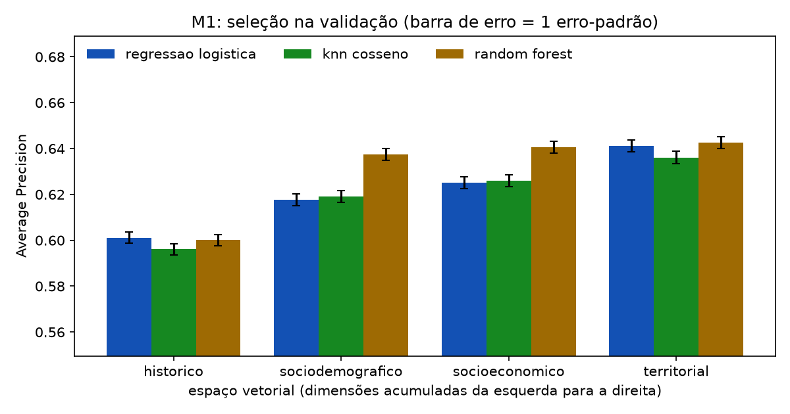
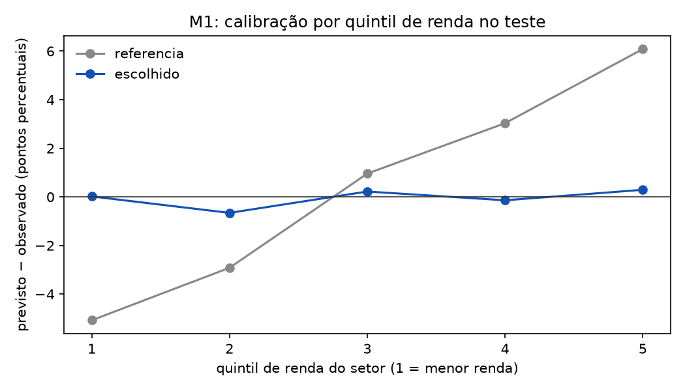

# Base vetorial para a previsão de inadimplência e de recuperabilidade do IPTU: normalização, similaridade cosseno e treino em múltiplas dimensões

Projeto Integrador 2 (BIINAR/UFT, 2026/2), Opção D, Grupo 1 — Sprint 4. Os créditos e os imóveis são sintéticos; os agregados de setor são dados públicos do IBGE. Execução de referência `{{execucao}}`, de {{data_execucao}}, sob o protocolo `{{protocolo_versao}}` (SHA-256 `{{protocolo_sha}}…`). Os números de resultado deste documento são preenchidos por `python scripts/gerar_doc_base_vetorial.py` a partir dos relatórios versionados em `reports/sprint4/base_vetorial`; o gerador interrompe a publicação se o texto deixar de corresponder a eles.

## Resumo

Este trabalho investiga se a representação de cada crédito de IPTU como um vetor de várias dimensões, guardado em um banco vetorial e comparado pela similaridade cosseno, torna mais específica a previsão dos dois modelos da Sprint 4: o de inadimplência no vencimento (M1) e o de recuperabilidade da dívida ativa em 365 dias (M2). O banco foi construído sobre a base sintética de {{n_creditos}} créditos e acrescenta ao histórico do imóvel dimensões do setor censitário: idade e alfabetização, do Censo 2022, além de renda, tamanho do domicílio, densidade e histórico fiscal agregado. A normalização é ajustada apenas no treino; a divisão é temporal e segue as proporções pedidas, {{m1_dev_pct}} e {{m1_teste_pct}} no M1 e {{m2_dev_pct}} e {{m2_teste_pct}} no M2; e doze combinações de espaço vetorial e técnica são comparadas na validação pela regra de um erro-padrão. No M1, o espaço de {{m1_dims_escolhido}} dimensões com Random Forest eleva a Average Precision no teste de {{m1_ap_ref}} para {{m1_ap_esc}}, com ganho pareado de {{m1_ganho}} (intervalo de 95% de {{m1_ganho_inf}} a {{m1_ganho_sup}}), e reduz o maior desvio de calibração por quintil de renda de {{m1_desvio_max_ref}} para {{m1_desvio_max_esc}} ponto percentual. Em contrapartida, a taxa de falsos positivos no quintil mais pobre sobe de {{m1_tfp_ref_q1}} para {{m1_tfp_esc_q1}}. No M2, nenhuma combinação supera o preditor constante (ROC-AUC de {{m2_roc_esc}}), porque a simulação não dá ao alvo relação com atributo algum. Conclui-se que o banco vetorial foi necessário para compor, normalizar, auditar e comparar as dimensões sob uma mesma régua; que o ganho de especificidade vem das dimensões acrescentadas; e que o uso do modelo na cobrança depende de dados reais e de uma decisão humana sobre equidade.

**Palavras-chave:** banco vetorial; similaridade cosseno; normalização; divisão temporal; proporção entre treino e teste; inadimplência tributária; proteção de dados.

## 1 Introdução

A Sprint 4 entregou dois modelos avaliados com rigor temporal, mas a previsão deles é pouco específica. O modelo de inadimplência no vencimento (M1) recebe cinco atributos do histórico do imóvel, e o de recuperabilidade da dívida ativa em 365 dias (M2), seis atributos do crédito. Com tão poucos atributos, créditos diferentes recebem a mesma descrição: no treino do M1, só {{m1_unicos_historico}} dos créditos têm um vetor de histórico que não se repete em outro crédito. Dois imóveis com o mesmo histórico recebem, portanto, a mesma probabilidade, ainda que um fique num setor de renda alta e moradores mais velhos e o outro num setor jovem e de renda baixa.

Um banco vetorial é a resposta técnica a esse problema, e seus termos precisam de definição. Vetor é a lista ordenada de números que descreve um crédito; dimensão é cada posição dessa lista, isto é, cada atributo; banco vetorial é o repositório que guarda os vetores com seus metadados e responde à pergunta "quais registros se parecem com este?". A semelhança é medida pelo cosseno do ângulo entre dois vetores, que vale 1 quando eles apontam na mesma direção e diminui à medida que se afastam. Como o cosseno só compara direções, os atributos precisam estar na mesma escala antes de virar vetor, e essa preparação se chama normalização.

A pergunta deste trabalho decorre daí: representar cada crédito como vetor de múltiplas dimensões, em um banco vetorial com busca por similaridade cosseno, torna a previsão mais específica sem violar a divisão temporal exigida no E1 nem a proteção de dados pessoais?

A tese defendida é que a resposta é sim para o M1 e não para o M2, por razões que os dados permitem medir. No M1, as dimensões de setor acrescentam informação que o histórico do imóvel não tem, e o ganho aparece na validação e se confirma no teste. No M2, a simulação aplica a mesma probabilidade de recuperação a toda dívida inscrita, e nenhuma representação cria sinal onde o dado não o contém. Nos dois casos, a especificidade tem um custo em equidade e em proteção de dados, que o banco precisa tornar visível.

O objetivo geral é implementar o banco vetorial e treinar sobre ele os modelos da sprint. Dele decorrem cinco objetivos específicos:

1. ampliar o vetor com idade, escolaridade e outras dimensões respaldadas pela literatura, usando apenas agregados públicos;
2. normalizar as dimensões com parâmetros ajustados só no treino;
3. dividir os dados em desenvolvimento e teste nas proporções 80/20 ou 70/30, sem quebrar a ordem temporal;
4. comparar, sob um protocolo declarado antes do treino, espaços vetoriais de tamanho crescente e três técnicas de classificação supervisionada;
5. tratar a Lei Geral de Proteção de Dados (LGPD) no próprio banco, para que nenhum identificador fique exposto.

O alcance das conclusões é limitado pela natureza dos dados. Os créditos e os imóveis são sintéticos, gerados na Sprint 3 sobre os setores censitários reais de Palmas; os resultados demonstram que o banco e o procedimento funcionam, não que idade ou escolaridade expliquem a inadimplência dos contribuintes de Palmas. O estudo também não altera o que já foi entregue: o protocolo 1.0.0, o pacote `models/sprint4/v1` e o painel continuam como estavam, e os dois resultados são publicados lado a lado.

O texto segue a ordem de uma dissertação. A seção 2 reúne o referencial teórico; a seção 3 descreve os dados, as dimensões, o banco, a divisão e a seleção; a seção 4 apresenta os resultados; a seção 5 os discute e justifica a adoção do banco vetorial; e a seção 6 conclui.

## 2 Referencial teórico

### 2.1 Vetor, normalização e similaridade cosseno

O modelo de espaço vetorial trata cada objeto como um ponto num espaço de atributos, e a semelhança entre dois objetos como uma relação geométrica. Salton, Wong e Yang (1975) propuseram o modelo para indexar documentos: cada documento vira um vetor de pesos de termos, e dois documentos são tanto mais parecidos quanto menor o ângulo entre seus vetores. O cosseno desse ângulo é o produto interno dos vetores dividido pelo produto de seus comprimentos; vale 1 para a mesma direção, 0 para direções perpendiculares e −1 para direções opostas. Quando os vetores são levados ao comprimento 1, o cosseno se reduz ao produto interno, que é a operação mais barata de calcular em grande quantidade.

O cosseno só tem sentido depois da normalização, porque atributos em escalas diferentes distorcem a direção do vetor. Um atributo medido em centenas de dias pesa mais no ângulo do que um indicador que vale 0 ou 1, sem que isso reflita importância alguma. A normalização usada aqui é a padronização: de cada atributo subtrai-se a média e divide-se o resultado pelo desvio-padrão, de modo que todos passem a ter média 0 e desvio 1. Singh e Singh (2020) compararam catorze métodos de normalização em 21 bases, com um classificador de vizinho mais próximo: a padronização ficou entre os melhores métodos, e o dado sem normalização, entre os piores.

O termo *embedding* designa a conversão de um dado que não é numérico, como um texto ou uma categoria, em vetor de números. Na base deste projeto, todos os atributos autorizados já são numéricos, e por isso não há modelo de *embedding* a treinar: o vetor de um crédito é o conjunto de seus atributos normalizados. A distinção importa para não atribuir ao banco uma capacidade que ele não tem. O banco organiza e compara os vetores; a informação está nas dimensões.

### 2.2 Vizinhos mais próximos e o efeito do número de dimensões

A classificação por vizinhos mais próximos decide o rótulo de um exemplo pelos exemplos mais parecidos com ele. Cover e Hart (1967) demonstraram que, com amostra suficientemente grande, a regra do vizinho mais próximo erra no máximo o dobro do melhor classificador possível, sem supor forma alguma para a relação entre os atributos e o rótulo. No banco vetorial, essa regra vira uma consulta: buscam-se os k créditos do treino de maior cosseno, e a fração de inadimplentes entre eles é a probabilidade estimada. A técnica é chamada k-NN, do inglês *k nearest neighbors*.

Acrescentar dimensões torna o vetor mais específico, mas só enquanto cada dimensão trouxer informação. Beyer et al. (1999) mostraram que, sob condições amplas, a distância ao vizinho mais próximo se aproxima da distância ao vizinho mais distante quando o número de dimensões cresce, e a noção de vizinho perde o sentido. Aggarwal, Hinneburg e Keim (2001) verificaram que a escolha da métrica altera a intensidade desse efeito. A consequência prática é que o ganho de cada grupo de dimensões precisa ser medido, e não presumido; por isso este trabalho compara espaços aninhados e mede o contraste entre a vizinhança e o acaso.

### 2.3 Busca exata e busca aproximada

A busca por similaridade pode ser exata ou aproximada, e a escolha depende do tamanho da base. A busca exata compara a consulta com todos os vetores; a aproximada percorre um índice e aceita perder alguns vizinhos em troca de velocidade. A biblioteca FAISS, descrita por Johnson, Douze e Jégou (2021), oferece as duas formas, e o índice HNSW, de Malkov e Yashunin (2020), é um dos mais usados na segunda. Com {{m1_dev_n}} vetores de {{m1_dims}} dimensões no caso maior, a busca exata dos 200 vizinhos de cada um dos 111.252 créditos do teste levou 56 segundos com o FAISS, cerca de meio milissegundo por consulta, num processador Intel Core i5-1235U de 12 núcleos lógicos; a mesma conta em NumPy levou 63 milissegundos por consulta. Com o FAISS, portanto, a busca exata cabe no tempo do experimento, e o índice aproximado foi dispensado: nenhum vizinho é perdido, e o resultado não depende de parâmetro de índice.

### 2.4 Proporção entre treino e teste

Não existe proporção entre treino e teste que seja ótima para todo problema, e a literatura é explícita nisso. Joseph (2022) abre seu artigo afirmando que não há orientação clara sobre quanto dado reservar a cada parte e demonstra que a razão ótima entre treino e teste é √p : 1, em que p é o número de parâmetros de um modelo de regressão linear que explique bem os dados. Dobbin e Simon (2011) mostram que a proporção ótima depende do tamanho da amostra e da acurácia alcançável, e que reservar dois terços dos casos ao treino fica perto do ótimo em bases de cem casos ou mais com sinal forte. Afendras e Markatou (2019) chegam a outro número por outro critério: para estimar o erro de generalização, numa classe ampla de funções de perda, o tamanho ótimo do treino é a metade da amostra.

Os estudos empíricos confirmam que a proporção importa e situam as divisões usuais numa faixa adequada. Xu e Goodacre (2018) verificaram, em bases simuladas, que treino grande demais ou pequeno demais prejudica a estimativa do desempenho e que o tamanho da base é o fator decisivo. Rácz, Bajusz e Héberger (2021) encontraram efeito significativo do tamanho da base e, em menor grau, da proporção de divisão sobre 25 medidas de desempenho. Nguyen et al. (2021) compararam nove proporções, de 10/90 a 90/10, e obtiveram o melhor desempenho com 70/30.

Dessas evidências decorre a regra adotada: 80/20 e 70/30 são convenções defensáveis, e a escolha entre elas se orienta pelo número de parâmetros e pelo tamanho da base. Pela regra de Joseph (2022), um modelo linear com as {{m1_dims}} dimensões do M1 e o intercepto tem p = {{m1_p}}, o que dá uma fração de teste de {{m1_joseph}}; para o M2, com p = {{m2_p}}, a fração é de {{m2_joseph}}. As duas ficam perto de 20%, o que recomenda a divisão 80/20 sempre que a ordem temporal a permitir.

Em dados com ordem temporal, a proporção não pode ser obtida por sorteio de linhas. Roberts et al. (2017) mostram que a validação aleatória superestima o desempenho quando os dados têm estrutura temporal e recomendam separar blocos inteiros; Bergmeir e Benítez (2012) defendem formas de validação em blocos para séries temporais. Como o E1 exige que o teste seja posterior ao treino, a proporção deste trabalho resulta da escolha de blocos temporais inteiros: decide-se quantos períodos entram no desenvolvimento, e a fração de teste é a consequência.

### 2.5 Idade, escolaridade e renda no cumprimento tributário

A escolha de idade e escolaridade como dimensões tem respaldo empírico, mas o efeito esperado é pequeno. Hofmann et al. (2017) reuniram 459 amostras de 111 países, com 614.286 respondentes, em quatro meta-análises sobre o cumprimento das obrigações tributárias: a correlação média com a idade foi de 0,12, com o sexo de 0,06, com a escolaridade de −0,02 e com a renda de −0,04. Os autores concluem que as características sociodemográficas têm pouco impacto, mas devem ser controladas. Richardson (2006), em comparação entre 45 países, encontrou menor evasão onde o nível geral de educação é mais alto.

Essas evidências dizem respeito a pessoas e a países, e as dimensões deste trabalho descrevem setores censitários. Robinson (1950) demonstrou que a correlação observada entre grupos não pode ser atribuída aos indivíduos que os compõem, erro conhecido como falácia ecológica. Uma idade mediana de 30 anos descreve o setor, não o contribuinte que mora nele. Por isso todas as dimensões desse tipo levam o sufixo `_setor`, e nenhuma conclusão deste texto se refere ao comportamento de uma pessoa.

### 2.6 Proteção de dados e equidade

A Lei Geral de Proteção de Dados (Lei nº 13.709/2018) fixa os conceitos que orientam o desenho do banco. Dado pessoal é a informação relacionada a pessoa natural identificada ou identificável (art. 5º, I); dado sensível é, entre outros, o que revela origem racial ou étnica (art. 5º, II); dado anonimizado é o que não permite identificar o titular com os meios técnicos razoáveis (art. 5º, III) e não é dado pessoal enquanto o processo não puder ser revertido (art. 12). A pseudonimização, definida no art. 13, § 4º, é mais fraca: o dado só perde a associação com o indivíduo enquanto uma informação adicional for mantida em separado. A lei veda ainda o tratamento para fins discriminatórios ilícitos ou abusivos (art. 6º, IX) e garante a revisão de decisões tomadas unicamente por tratamento automatizado (art. 20).

Um vetor de muitas dimensões dificilmente é anônimo, e isso decide como o banco deve ser classificado. Sweeney (2002) formalizou o k-anonimato, no qual cada registro divulgado é indistinguível de pelo menos k − 1 outros. Narayanan e Shmatikov (2008) reidentificaram assinantes numa base esparsa de muitas dimensões com pouca informação auxiliar, e Rocher, Hendrickx e de Montjoye (2019) estimaram que 15 atributos demográficos bastariam para reidentificar corretamente 99,98% dos americanos em qualquer base. Quanto mais específico o vetor, mais ele individualiza: o ganho preditivo e o risco de exposição crescem juntos.

A equidade entre grupos impõe uma segunda restrição, que nenhum algoritmo elimina. Mehrabi et al. (2022) sistematizam as fontes de viés e as definições de equidade em aprendizado de máquina. Chouldechova (2017) demonstra que os critérios de equidade não podem ser satisfeitos todos ao mesmo tempo quando a prevalência difere entre os grupos: um instrumento com o mesmo valor preditivo em todos os grupos terá, necessariamente, taxas de erro diferentes entre eles. Como a inadimplência simulada varia com a renda do setor, essa incompatibilidade aparece nos resultados.

## 3 Materiais e métodos

### 3.1 Dados

A base de créditos é a mesma do protocolo 1.0.0, vista do mesmo modo. São {{n_creditos}} créditos de IPTU de {{n_imoveis}} imóveis em cinco exercícios, de 2021 a 2025, gerados na Sprint 3 com semente fixa sobre os setores censitários de Palmas. Cada exemplo é um crédito fotografado numa data de decisão, chamada t0: os atributos só usam eventos ocorridos até t0, e o rótulo só entra no treino depois de observado. No M1, t0 é 1º de janeiro do exercício, e o rótulo diz se o crédito ficou sem pagamento até o vencimento; no M2, o rótulo diz se a dívida inscrita e aberta em t0 foi paga nos 365 dias seguintes. As fotografias são montadas pelo código de `pipeline/ml`, que não foi alterado.

Os agregados de idade e de alfabetização vêm do Censo Demográfico 2022 e foram obtidos em coleta única, em {{data_coleta}}. Os arquivos são os Agregados por Setores Censitários de demografia e de alfabetização e o dicionário de dados, baixados do servidor do IBGE em três requisições, com pausa entre elas e sem agendamento, como manda o manual de coleta da coordenação. O servidor não publica `robots.txt` (resposta 404 na coleta da Sprint 3 e de novo em 11/11/2026), e o script `scripts/coletar_censo_sociodemografia.py` repete o procedimento com tempo limite em cada requisição. O extrato de Palmas tem {{n_setores_palmas}} setores e fica versionado em `data/limpo/sociodemografia_setores_censo2022.csv`, com o SHA-256 de cada arquivo de origem (`{{sha_demografia}}…` e `{{sha_alfabetizacao}}…`); os arquivos brutos, de até 142 MB, ficam fora do repositório. Dos setores de Palmas, {{n_setores_base}} recebem imóveis simulados, e nenhum deles tem indicador ausente.

A escolaridade entra como alfabetização porque essa é a única medida de instrução que o Censo divulga por setor. O questionário do universo, aplicado a todos os domicílios, pergunta se a pessoa sabe ler e escrever; os anos de estudo vêm do questionário da amostra, que não tem resultado por setor censitário. A dimensão usada é a fração de pessoas de 15 anos ou mais que sabem ler e escrever. Nos setores com imóveis, a mediana dessa taxa é de {{alfa_p50}}, e a metade central dos setores fica entre {{alfa_p25}} e {{alfa_p75}}. A variação existe, mas é estreita, e essa é uma limitação conhecida da medida.

A idade entra por três indicadores calculados das contagens por faixa etária. A idade mediana do setor é obtida pela fórmula da mediana para dados agrupados, que interpola dentro da faixa em que se completa a metade da população; os outros dois indicadores são a fração de moradores de 0 a 14 anos e a de 60 anos ou mais. Quando o IBGE omite por sigilo a contagem de uma faixa, a diferença entre o total de moradores e a soma das faixas divulgadas é repartida em partes iguais entre as faixas omitidas, o que preserva o total e não grava célula alguma em arquivo. Nos setores com imóveis, a idade mediana tem mediana de {{idade_p50}} anos, com a metade central entre {{idade_p25}} e {{idade_p75}} anos.

### 3.2 Dimensões do vetor

O vetor de cada crédito reúne quatro grupos de dimensões, e cada grupo acrescenta informação de outra origem. O Quadro 1 lista as {{m1_dims}} dimensões do M1 e as {{m2_dims}} do M2. O grupo de histórico reescreve os atributos do protocolo 1.0.0; os grupos sociodemográfico e socioeconômico descrevem o setor censitário; e o grupo territorial resume o histórico fiscal do próprio setor.

**Quadro 1 — Dimensões do vetor, por grupo**

| Grupo | Dimensão | O que mede | Origem e transformação |
|---|---|---|---|
| Histórico (M1) | `inadimplente_exercicio_anterior` | se o crédito do exercício anterior ficou sem pagamento no vencimento | eventos do imóvel até t0; vale 0 ou 1 |
| Histórico (M1) | `taxa_inadimplencia_anterior` | fração dos exercícios anteriores com inadimplência | contagem dividida pelo número de exercícios anteriores |
| Histórico (M1) | `taxa_debitos_abertos` | fração dos exercícios anteriores ainda sem pagamento em t0 | contagem dividida pelo número de exercícios anteriores |
| Histórico (M1) | `log_valor_relativo_anterior` | valor do crédito anterior em relação à mediana do exercício | logaritmo |
| Histórico (M1) | `sem_historico` | imóvel sem exercício anterior na base (créditos de 2021) | indicador 0 ou 1 |
| Histórico (M2) | `log_idade_divida_dias`, `log_dias_desde_inscricao` | tempo desde o vencimento e desde a inscrição em dívida ativa | logaritmo de 1 + dias |
| Histórico (M2) | `log_valor_relativo_credito` | valor do crédito em relação à mediana do exercício | logaritmo |
| Histórico (M2) | `creditos_inscritos_abertos_imovel`, `inadimplencias_imovel_t0`, `inadimplente_ultimo_exercicio` | situação do imóvel em t0 | contagens e indicador, sem transformação |
| Sociodemográfico | `idade_mediana_setor` | idade mediana dos moradores do setor | Censo 2022, demografia; mediana de dados agrupados |
| Sociodemográfico | `proporcao_0_14_setor`, `proporcao_60_mais_setor` | fração de crianças e de idosos entre os moradores | Censo 2022, demografia |
| Sociodemográfico | `taxa_alfabetizacao_setor` | fração de pessoas de 15 anos ou mais que sabem ler e escrever | Censo 2022, alfabetização |
| Socioeconômico | `log_renda_setor` | rendimento médio mensal do responsável pelo domicílio | Censo 2022, coletado na Sprint 3; logaritmo |
| Socioeconômico | `moradores_por_domicilio_setor` | moradores divididos por responsáveis | Censo 2022, coletado na Sprint 3 |
| Socioeconômico | `log_densidade_setor` | habitantes por quilômetro quadrado | Censo 2022 e malha de setores; logaritmo |
| Territorial | `taxa_inadimplencia_setor_anterior` | fração dos créditos do setor vencidos antes de t0 e não pagos no vencimento | base de créditos; ausente em setor com menos de dez imóveis |

Os grupos formam quatro espaços aninhados, do mais simples ao mais específico. O espaço *histórico* contém só o primeiro grupo; o *sociodemográfico* acrescenta idade e alfabetização; o *socioeconômico* acrescenta renda, tamanho do domicílio e densidade; e o *territorial* acrescenta o histórico fiscal do setor. Como cada espaço contém o anterior, a diferença de desempenho entre dois espaços consecutivos mede a contribuição do grupo acrescentado.

Três tipos de informação ficaram fora do vetor por decisão de projeto. Cor ou raça e os recortes de povos indígenas e quilombolas são dado sensível na LGPD. O sexo é critério clássico de discriminação, e sua correlação com o cumprimento tributário é de apenas 0,06 em Hofmann et al. (2017). O código do setor, o identificador do crédito e o do imóvel são recusados pelo próprio código, que interrompe a execução se algum deles for declarado como dimensão.

### 3.3 Normalização

A normalização tem três passos, e cada um responde a um defeito medido nos dados. O primeiro transforma contagens acumuladas em taxas: o número de inadimplências anteriores cresce a cada exercício e, no teste, sai da faixa vista no treino; dividido pelo número de exercícios anteriores, passa a medir o mesmo comportamento em qualquer ano. O segundo aplica logaritmo aos valores assimétricos, transformação da família estudada por Box e Cox (1964): sem ele, um valor relativo que chega a 52 vezes a mediana dita sozinho a direção do vetor. O terceiro preenche os ausentes com a mediana e padroniza cada dimensão.

Os parâmetros da normalização são ajustados apenas no treino e ficam congelados. A mediana, a média e o desvio-padrão de cada dimensão são calculados nos exercícios de 2021 a 2023, no M1, e nas fotografias de treino, no M2, e aplicados sem alteração à validação, ao teste e a qualquer crédito novo. Ajustá-los com dados posteriores seria vazamento, isto é, uso de informação indisponível no momento da previsão (Kaufman et al., 2012). Na busca de hiperparâmetros, que avalia dobras internas do treino, a normalização é refeita dentro de cada dobra pelo mesmo motivo.

Para a busca por cosseno, cada vetor normalizado é dividido pelo próprio comprimento. O banco guarda o vetor padronizado, que serve à regressão logística e ao Random Forest, e a divisão pelo comprimento é feita no momento da busca; assim, as três técnicas leem os mesmos números. Um vetor com todas as dimensões na média do treino não tem direção e recebe similaridade zero com qualquer outro, em vez de provocar divisão por zero.

Um defeito de arredondamento, encontrado na primeira execução, mostra por que a normalização precisa de teste próprio. Numa dobra interna do M2, todas as dívidas tinham a mesma idade; o desvio-padrão calculado dessa coluna constante saiu em 1,8 × 10⁻¹⁵, e não em zero, e a divisão por ele levou a idade das dívidas da fotografia seguinte a valores da ordem de 10¹⁵. A regressão logística saturou, com erro de Brier de 0,88 naquela dobra. A correção trata como constante toda coluna cujo máximo é igual ao mínimo, e um teste de regressão reproduz o caso.

### 3.4 O banco vetorial

O banco vetorial é um conjunto de arquivos com manifesto, e não um servidor. Cada tarefa tem uma coleção com três arquivos de vetores em formato NumPy (treino, validação e teste, em números de 32 bits), um arquivo de metadados com uma linha por vetor e, na raiz, um manifesto em JSON com as dimensões, os espaços, os parâmetros da normalização, as contagens e o SHA-256 de cada arquivo. A leitura confere os hashes antes de abrir qualquer coleção, e um arquivo ausente ou alterado interrompe a execução. O banco não contém objeto serializado com `pickle` ou `joblib`: até a normalização é reconstruída do JSON, de modo que abrir o banco não executa código.

A consulta ao banco tem três operações. A primeira devolve os vetores de um conjunto nas dimensões de um espaço, e é ela que alimenta o treino. A segunda busca os k vizinhos de maior cosseno e, por padrão, procura só no treino, para que a vizinhança de um crédito nunca contenha créditos de período posterior ao dele. A terceira reconstrói a normalização, para vetorizar créditos novos. O motor da busca é o índice `IndexFlatIP` do FAISS, que calcula o produto interno exato; sem o FAISS instalado, a mesma conta é feita em NumPy, e um teste confere que os dois motores devolvem a mesma vizinhança.

A opção por arquivos locais, em vez de um serviço de banco vetorial, decorre do tamanho da base e da proteção de dados. Com menos de um milhão de vetores de poucas dimensões, um serviço dedicado acrescentaria operação sem acrescentar capacidade; e, com arquivos locais, nenhum vetor sai da máquina de quem executa. A interface do banco, porém, não depende do armazenamento, e a troca por um serviço ficaria restrita a um módulo.

### 3.5 Divisão temporal e proporção

A divisão respeita primeiro o tempo e depois a proporção. O conjunto de desenvolvimento reúne os períodos anteriores ao teste e se divide em treino, usado no ajuste e na busca de hiperparâmetros, e validação, usada na seleção do modelo e do limiar de decisão. O teste é sempre o período mais recente e só é consultado depois de todas as escolhas. Depois da seleção, o modelo escolhido é reajustado no desenvolvimento inteiro, para aproveitar todo dado anterior ao teste, e então medido uma única vez.

No M1, a proporção de 80/20 sai exata, porque os cinco exercícios têm o mesmo número de créditos. Os exercícios de 2021 a 2024 formam o desenvolvimento, com {{m1_dev_pct}} dos créditos, e o de 2025 forma o teste, com {{m1_teste_pct}}. Dentro do desenvolvimento, os exercícios de 2021 a 2023 são treino, e o de 2024 é validação.

No M2, a proporção de 70/30 exigiu fotografias trimestrais no treino, e o resultado é de {{m2_dev_pct}} para o desenvolvimento e {{m2_teste_pct}} para o teste. Com as fotografias anuais do protocolo 1.0.0, o teste ficava com 40% das linhas, porque a carteira de dívida ativa cresce a cada ano. O treino passou a ter cinco fotografias, de 29/06/2022 a 30/06/2023, todas com rótulo disponível antes da validação, de 01/07/2024; a validação e o teste não mudaram. O código interrompe a execução se a fração de teste sair do intervalo de 19% a 31%. A Tabela 1 resume as duas divisões.

**Tabela 1 — Divisão temporal e proporção de cada tarefa**

{{tabela_proporcao}}

A proporção do M2 deve ser lida com uma ressalva. As fotografias trimestrais observam, em boa parte, os mesmos créditos em datas diferentes, com janelas de rótulo sobrepostas, de modo que o número de linhas cresce mais do que a informação independente. A incerteza das métricas não é afetada, porque o bootstrap reamostra imóveis, e não linhas; mas a proporção de {{m2_dev_pct}} descreve linhas, e não imóveis.

### 3.6 Candidatos, busca de hiperparâmetros e seleção

Três técnicas de classificação supervisionada são treinadas em cada espaço, o que dá doze candidatos por tarefa. A regressão logística é a técnica escolhida no protocolo 1.0.0 e serve de elo com ele; o k-NN por cosseno é a técnica que usa a busca do banco; e o Random Forest (Breiman, 2001), um conjunto de árvores de decisão, é o candidato de maior capacidade. A referência mínima é o preditor constante, que atribui a todos os créditos a prevalência do treino.

A busca de hiperparâmetros usa só o treino, em dobras que respeitam o tempo. No M1, a primeira dobra ajusta em 2021 e avalia em 2022, e a segunda ajusta em 2021 e 2022 e avalia em 2023; no M2, a única dobra ajusta na fotografia de 29/06/2022 e avalia na de 30/06/2023. A grade é pequena e foi declarada antes do treino: três valores de regularização na regressão logística (C de 0,1, 1 e 10), três tamanhos de vizinhança no k-NN (50, 200 e 800) e duas profundidades no Random Forest (6 e 12), com 200 árvores e folhas de pelo menos 50 exemplos.

A seleção compara os doze candidatos na validação e aplica a regra de um erro-padrão. A métrica do M1 é a Average Precision, que resume a curva de precisão e recall e é mais informativa que a curva ROC quando as classes são desbalanceadas (Saito e Rehmsmeier, 2015); a do M2 é o erro de Brier, a média do quadrado da diferença entre a probabilidade prevista e o desfecho (Brier, 1950). O erro-padrão de cada métrica vem de um bootstrap de 200 reamostras de imóveis. Entre os candidatos que ficam a até um erro-padrão do melhor, vence o mais simples (Hastie, Tibshirani e Friedman, 2009), primeiro pelo espaço de menos dimensões e depois pela técnica de menor capacidade. A regra faz com que uma dimensão a mais só entre no modelo se pagar o próprio custo.

O limiar de decisão e a medição final seguem o protocolo anterior. O limiar é o que maximiza o F1, a média harmônica de precisão e recall, na validação. O teste é consultado uma vez, depois de fixados o espaço, a técnica, os hiperparâmetros e o limiar, como exigem Varma e Simon (2006) para que a estimativa do erro não seja contaminada pela seleção. O ganho do candidato escolhido é medido contra uma referência pareada: a regressão logística no espaço de histórico, que contém a mesma informação dos atributos do protocolo 1.0.0.

### 3.7 Proteção de dados no banco

A proteção de dados foi tratada como requisito do banco, e não como recomendação de uso. Cinco medidas estão implementadas e conferidas por teste:

- **Só agregados públicos de setor.** As dimensões novas descrevem o setor censitário com dados que o IBGE já divulga sob sigilo estatístico; nenhuma descreve uma pessoa.
- **Supressão de grupos pequenos.** O histórico fiscal agregado só é calculado para setores com pelo menos dez imóveis, o mesmo limite de supressão do painel. No treino do M1, {{m1_suprimidos_k}} créditos ficam com essa dimensão ausente por causa do limite.
- **Pseudonimização das chaves.** O banco não guarda o identificador do crédito nem o do imóvel: guarda pseudônimos calculados por HMAC-SHA-256 com um segredo que fica fora do banco, lido de uma variável de ambiente. Com o segredo padrão, que é público e só serve aos dados sintéticos, o manifesto registra o fato.
- **Minimização dos metadados.** O código do setor censitário não é gravado; ficam apenas o quintil de renda e a região, necessários à auditoria por subgrupo.
- **Medida de individualização.** O manifesto registra quantos vetores não se repetem, para que o risco de reidentificação seja um número, e não uma impressão.

Essas medidas não tornam o banco anônimo, e o texto não afirma isso. A normalização é invertível por quem tem o manifesto, e a maioria dos vetores é única. Com dados reais, o banco conteria dados pessoais pseudonimizados, sujeitos à LGPD. O uso de dados reais continua a exigir o que o E1 já apontava: relatório de impacto à proteção de dados, termo de cooperação e parecer do encarregado.

### 3.8 Verificação

O banco e o experimento são conferidos por testes automáticos e pelos controles de qualidade do repositório, executados em 11/11/2026 num ambiente Python 3.14.7 com scikit-learn 1.9.1. São 78 testes novos em `tests/vetorial`, que cobrem a leitura do Censo com sigilo, a normalização, a busca nos dois motores, a integridade do banco, a ausência de identificadores, a regra de seleção, a execução de ponta a ponta num mundo sintético pequeno e o gerador deste documento. Com eles, a suíte que não depende do MySQL tem 1.008 testes aprovados, e a cobertura de linhas e ramos é de 95,3% no total e de 100% em cada módulo de `pipeline/vetorial`.

Os controles estruturais do repositório continuam aprovados com o código novo. O `import-linter` mantém os doze contratos, entre eles o que proíbe `pipeline/vetorial` de acessar rede, banco relacional e os módulos de coleta; o Pyright não acusa erro no código de produção; a maior complexidade ciclomática do pacote é 10, a maior função tem 30 linhas, e o maior módulo, 220 linhas de código. As 32 obras citadas constam do catálogo de referências: as 30 que têm DOI foram conferidas no Crossref, e as duas restantes são fontes oficiais sem DOI.

A reprodutibilidade foi medida por duas execuções completas, em 10/11/2026. As duas gravaram o banco com os mesmos SHA-256 nos oito arquivos, produziram a mesma tabela de seleção do M1 e geraram os dois modelos com os mesmos bytes. Entre uma e outra houve só a correção do arredondamento descrita na seção 3.3, que alterou a busca interna do M2 sem alterar o modelo escolhido. Além disso, o treino recusa um banco cujos vetores não correspondam, bit a bit, às fotografias da execução, e `python base_vetorial.py conferir` recalcula o SHA-256 de cada arquivo contra o manifesto.

## 4 Resultados

### 4.1 O banco construído

O banco construído tem {{banco_linhas}} vetores em duas coleções e ocupa {{banco_mb}} MB. A coleção do M1 guarda {{m1_total}} vetores de {{m1_dims}} dimensões, e a do M2, {{m2_total}} vetores de {{m2_dims}} dimensões. No M1, {{m1_unicos_pct}} dos vetores não se repetem em nenhum outro crédito; no M2, {{m2_unicos_pct}}. Esse é o primeiro resultado de especificidade e também o primeiro alerta de proteção de dados: a grande maioria dos vetores individualiza um crédito.

### 4.2 Seleção na validação do M1

Na validação do M1, cada grupo de dimensões acrescentado melhora as três técnicas, e o ganho é maior que a incerteza. A Tabela 2 e a Figura 1 mostram a Average Precision de cada candidato no exercício de 2024. No espaço de histórico, a regressão logística alcança {{m1_val_historico_rl}}, e o Random Forest, {{m1_val_historico_rf}}, o patamar do protocolo 1.0.0. Com idade e alfabetização, a regressão logística sobe para {{m1_val_sociodemografico_rl}}, e o Random Forest, para {{m1_val_sociodemografico_rf}}. No espaço territorial, o mais completo, a logística chega a {{m1_val_territorial_rl}}, e o Random Forest, a {{m1_val_territorial_rf}}. O erro-padrão de cada medida é de cerca de {{m1_ep}}, de modo que a diferença entre o primeiro e o último espaço passa de dez erros-padrão.

**Tabela 2 — Seleção na validação do M1 (exercício de 2024)**

{{tabela_selecao_m1}}

A regra de um erro-padrão escolhe o espaço socioeconômico, de {{m1_dims_escolhido}} dimensões, com Random Forest. O melhor candidato é o Random Forest no espaço territorial ({{m1_val_territorial_rf}}), e ficam a até um erro-padrão dele o Random Forest no espaço socioeconômico ({{m1_val_socioeconomico_rf}}) e a regressão logística no espaço territorial ({{m1_val_territorial_rl}}). Pela ordem de parcimônia declarada, que prefere o espaço de menos dimensões, o escolhido é o primeiro dos três. A 13ª dimensão não pagou o próprio custo para o Random Forest, embora seja decisiva para a regressão logística, como se discute na seção 5.5.

A busca por similaridade torna-se competitiva à medida que o vetor ganha dimensões, sem chegar a vencer. No espaço de histórico, o k-NN por cosseno fica {{m1_knn_abaixo_historico}} abaixo da regressão logística; nos espaços sociodemográfico e socioeconômico, empata com ela, com diferença menor que um erro-padrão; e no espaço territorial volta a ficar abaixo. Em nenhum espaço o k-NN alcança o Random Forest.

### 4.3 Desempenho do M1 no teste

No teste de 2025, o modelo escolhido confirma o ganho medido na validação. A Tabela 3 compara o candidato escolhido, reajustado nos exercícios de 2021 a 2024, com a referência pareada e com o resultado publicado do pacote v1. A Average Precision passa de {{m1_ap_ref}} para {{m1_ap_esc}}, com intervalo de 95% de {{m1_ap_ic_inf}} a {{m1_ap_ic_sup}}; o ganho pareado é de {{m1_ganho}}, com intervalo de {{m1_ganho_inf}} a {{m1_ganho_sup}}, que não inclui o zero. A área sob a curva ROC passa de {{m1_roc_ref}} para {{m1_roc_esc}}, e o erro de Brier cai de {{m1_brier_ref}} para {{m1_brier_esc}}.

**Tabela 3 — Desempenho do M1 no teste (exercício de 2025, 111.252 créditos)**

{{tabela_teste_m1}}

As métricas de decisão mudam menos do que as de probabilidade, e a razão está no limiar. No limiar que maximiza o F1 na validação, o modelo escolhido tem recall de {{m1_recall_esc}} contra {{m1_recall_ref}} da referência e precisão de {{m1_precisao_esc}} contra {{m1_precisao_ref}}; o F1 sobe de {{m1_f1_ref}} para {{m1_f1_esc}}, e a acurácia fica praticamente igual, {{m1_acuracia_esc}} contra {{m1_acuracia_ref}}. O ganho aparece melhor na ordenação: entre os 10% de créditos com maior probabilidade prevista, {{m1_topo10}} ficam de fato inadimplentes, para uma prevalência de {{m1_prevalencia_teste}} no teste.

A referência pareada reproduz o pacote v1, o que isola a origem do ganho. A regressão logística no espaço de histórico alcança {{m1_ap_ref}} no teste, e o pacote v1 publicou {{m1_ap_v1}} com os atributos originais. A transformação de contagens em taxas preservou, portanto, a informação do protocolo 1.0.0, e a diferença de {{m1_ganho}} vem das dimensões acrescentadas.

### 4.4 Especificidade e contraste da vizinhança

O vetor fica mais específico com as dimensões de setor, e a vizinhança continua distinta do acaso. A Tabela 4 mostra, para cada espaço do M1, a fração de créditos do treino com vetor único, o cosseno médio entre um crédito da validação e seu 50º vizinho no treino e o cosseno médio entre esse crédito e um crédito sorteado. A fração de vetores únicos sobe de {{m1_unicos_historico}} para {{m1_unicos_escolhido}} quando entram as dimensões de setor. O cosseno com o 50º vizinho cai de {{m1_cos_historico}} para {{m1_cos_territorial}}: os vizinhos ficam menos idênticos, porque há mais em que diferir, mas continuam muito acima do cosseno com um crédito ao acaso, que fica perto de zero. O efeito descrito por Beyer et al. (1999) não se manifesta com {{m1_dims}} dimensões.

**Tabela 4 — Especificidade e contraste da vizinhança no M1**

{{tabela_contraste_m1}}

### 4.5 Calibração e erros por quintil de renda

As dimensões de setor corrigem a calibração por faixa de renda, que era o defeito conhecido do modelo anterior. Calibração é a concordância entre a probabilidade prevista e a frequência observada. A Tabela 5 compara, por quintil de renda do setor, a probabilidade média prevista com a taxa de inadimplência observada no teste. A referência subestima a inadimplência do quintil mais pobre em {{m1_desvio_ref_q1}} pontos percentuais e superestima a do mais rico em {{m1_desvio_ref_q5}}; no modelo escolhido, o maior desvio é de {{m1_desvio_max_esc}} ponto percentual (Figura 2).

**Tabela 5 — Calibração e taxas de erro do M1 por quintil de renda do setor, no teste**

{{tabela_quintis_m1}}

A correção tem uma contrapartida nas taxas de erro, e ela recai sobre os setores mais pobres. No quintil de menor renda, a fração de créditos apontados como prováveis inadimplentes sobe de {{m1_apontados_ref_q1}} para {{m1_apontados_esc_q1}}, e a taxa de falsos positivos, isto é, a fração dos que pagaram em dia e mesmo assim foram apontados, sobe de {{m1_tfp_ref_q1}} para {{m1_tfp_esc_q1}}. No quintil de maior renda ocorre o inverso: a taxa de falsos positivos cai de {{m1_tfp_ref_q5}} para {{m1_tfp_esc_q5}}, e a de falsos negativos sobe de {{m1_tfn_ref_q5}} para {{m1_tfn_esc_q5}}. O modelo ficou mais fiel à frequência de cada grupo e, por isso mesmo, mais desigual nos erros que comete em cada um.

### 4.6 Resultado do M2

No M2, nenhum dos doze candidatos supera o preditor constante, em nenhum espaço. Na validação, o erro de Brier dos doze fica entre {{m2_brier_val_min}} e {{m2_brier_val_max}}, para {{m2_brier_val_constante}} do preditor constante, e todos cabem em um erro-padrão; a regra escolhe então o mais simples, a regressão logística no espaço de histórico. No teste, o modelo escolhido tem Brier de {{m2_brier_esc}}, contra {{m2_brier_constante}} do preditor constante, e área sob a curva ROC de {{m2_roc_esc}}; entre os doze candidatos, a área vai de {{m2_roc_min}} a {{m2_roc_max}}. Um valor de 0,50 corresponde a ordenar os créditos ao acaso.

**Tabela 6 — Os doze candidatos do M2 (o escolhido em negrito)**

{{tabela_m2}}

O resultado repete o achado do protocolo 1.0.0 e tem a mesma causa. O gerador da Sprint 3 aplica a toda dívida inscrita a mesma probabilidade anual de recuperação, de {{prob_recuperacao}}, sem relação com atributo algum do crédito, do imóvel ou do setor. Mais dimensões tornam o vetor do M2 mais específico, pois todos os seus vetores são únicos; mas especificidade sem relação com o alvo não é previsão.

## 5 Discussão

### 5.1 De onde vem o ganho do M1

O ganho do M1 vem de informação sobre o setor, e a simulação explica por que essa informação existe. No gerador da Sprint 3, o logaritmo da chance de inadimplência de um imóvel soma três parcelas: a renda padronizada do setor, com coeficiente de {{beta_renda}}; a inadimplência do próprio imóvel no exercício anterior, com coeficiente de {{beta_historico}}; e um efeito próprio de cada setor, sorteado com desvio-padrão de {{desvio_setor}}. O protocolo 1.0.0 só dava ao modelo a segunda parcela. As dimensões de setor dão acesso às outras duas.

A forma como cada técnica aproveita as dimensões confirma essa leitura. A regressão logística, que soma efeitos lineares, ganha {{m1_rl_ganho_sociodemografico}} com idade e alfabetização, que se correlacionam com a renda entre os setores (correlação de postos de {{corr_idade_renda}} e de {{corr_alfa_renda}}), mais {{m1_rl_ganho_socioeconomico}} com a própria renda e outros {{m1_rl_ganho_territorial}} com a taxa de inadimplência passada do setor, que estima diretamente a propensão de cada um. O Random Forest captura quase tudo já no espaço sociodemográfico ({{m1_val_sociodemografico_rf}}), porque quatro medidas contínuas bastam para distinguir um setor de outro. Para ele, idade e alfabetização funcionam como endereço do setor, e não como causa.

Disso se segue o que o resultado autoriza a dizer. Ele mostra que o banco e o protocolo detectam e aproveitam um sinal territorial quando ele existe. Não mostra que moradores mais velhos ou mais alfabetizados paguem melhor o IPTU em Palmas: a relação entre renda e inadimplência foi posta na simulação como premissa, e idade e alfabetização entram no resultado por estarem correlacionadas com a renda nos setores reais.

### 5.2 Observação: por que o banco vetorial foi necessário

O banco vetorial foi implementado porque a previsão precisava tornar-se mais específica, e a especificidade depende de descrever cada crédito por múltiplas dimensões ao mesmo tempo. Com os cinco atributos do protocolo 1.0.0, menos da metade dos créditos do M1 tinha um vetor só seu ({{m1_unicos_historico}}). Com as {{m1_dims_escolhido}} dimensões do espaço escolhido, {{m1_unicos_escolhido}} dos créditos têm vetor próprio, e a Average Precision no teste sobe de {{m1_ap_ref}} para {{m1_ap_esc}}.

É verdade que parte desse resultado não depende de um banco vetorial. O ganho preditivo vem das dimensões acrescentadas, e o modelo escolhido, um Random Forest, lê os vetores do banco sem usar a busca por vizinhos; uma tabela comum, com as mesmas colunas, levaria esse modelo ao mesmo número.

O banco foi necessário, ainda assim, por quatro funções que o resultado exigiu e que uma tabela solta não cumpre:

1. **Uma só normalização, registrada e auditável.** As dimensões vêm de quatro origens e chegam em escalas incompatíveis: indicadores, taxas, logaritmos, anos de idade e moradores por domicílio. O banco as põe na mesma escala com parâmetros ajustados no treino e gravados no manifesto, de modo que qualquer leitor confere com que régua cada número foi medido.
2. **Espaços comparados com os mesmos números.** Como o banco guarda o vetor completo e trata cada espaço como um subconjunto de dimensões, os doze candidatos de cada tarefa leem exatamente os mesmos valores. É isso que permite atribuir a diferença entre dois espaços ao grupo de dimensões acrescentado, e não a uma diferença de preparo.
3. **Similaridade como medida e como explicação.** A busca por cosseno fornece o candidato k-NN, a medida de contraste da Tabela 4 e o comando `python base_vetorial.py consultar`, que mostra, para um crédito, os créditos passados mais parecidos e o que aconteceu com eles. Essa explicação por casos semelhantes é a que um analista consegue conferir.
4. **Integridade e proteção de dados no mesmo lugar.** O treino recusa um banco cujos vetores não correspondam, bit a bit, às fotografias da execução; cada arquivo tem hash no manifesto; e os identificadores entram no banco já como pseudônimos.

A adoção do banco se justifica, portanto, pelo que ele garante ao redor da previsão. Sem ele haveria mais dimensões, mas não haveria como demonstrar que foram normalizadas sem vazamento, comparadas em condições iguais e guardadas sem expor identificadores.

### 5.3 O que idade e escolaridade permitem afirmar

As duas dimensões pedidas entraram no vetor, mas com alcance mais modesto do que o nome sugere. A escolaridade é medida pela alfabetização, que em Palmas varia pouco entre os setores; a idade é a do conjunto dos moradores, e não a do responsável pelo imóvel. As duas descrevem a vizinhança, com a ressalva de Robinson (1950). E a literatura já previa efeito pequeno: nas meta-análises de Hofmann et al. (2017), a correlação do cumprimento tributário com a idade é de 0,12, e com a escolaridade, de −0,02. Com dados reais, o esperado é que essas dimensões contribuam pouco por si mesmas e mais como descrição do setor.

### 5.4 O custo em equidade

O ganho de calibração e a piora das taxas de erro no quintil mais pobre são duas faces do mesmo resultado, como previsto por Chouldechova (2017). A inadimplência simulada é de {{m1_prev_q1}} no quintil de menor renda e de {{m1_prev_q5}} no de maior renda. Um modelo fiel a essas frequências aponta mais créditos nos setores pobres e, entre eles, mais contribuintes que pagariam em dia.

Essa consequência muda a natureza da decisão sobre o uso do modelo. O protocolo 1.0.0 deixou renda, setor e região fora dos atributos justamente para não usar a renda como critério de cobrança; o espaço escolhido aqui a reintroduz por meio de agregados de setor. A LGPD veda o tratamento para fins discriminatórios ilícitos ou abusivos e garante a revisão de decisões automatizadas. Cabe à gestão tributária e ao encarregado de dados, e não ao algoritmo, decidir se a prioridade de cobrança pode depender do setor onde o imóvel está. Por isso o painel da Sprint 4 continua ligado ao pacote v1, e o pacote vetorial é publicado como evidência para essa decisão.

### 5.5 A regra de parcimônia e sua alternativa

A ordem de parcimônia foi declarada antes do treino, e uma ordem diferente escolheria outro candidato de desempenho praticamente igual. A regra adotada prefere o espaço de menos dimensões e por isso escolheu o Random Forest com {{m1_dims_escolhido}} dimensões. Se preferisse primeiro a técnica mais simples, escolheria a regressão logística no espaço territorial, de {{m1_dims}} dimensões, que alcança {{m1_val_territorial_rl}} na validação e {{m1_ap_teste_territorial_rl}} no teste, contra {{m1_val_socioeconomico_rf}} e {{m1_ap_esc}} do escolhido. A logística tem a vantagem de ser um modelo de {{m1_p}} coeficientes, que um auditor lê por inteiro; o Random Forest, a de dispensar a 13ª dimensão. Trocar a regra depois de ver o resultado seria escolher com o resultado na mão, e por isso a alternativa fica registrada para o próximo protocolo.

### 5.6 Limites

Seis limites condicionam a leitura dos resultados:

- **Dados sintéticos.** As métricas medem o banco e o procedimento, não o comportamento dos contribuintes de Palmas.
- **Datas de publicação do Censo.** As dimensões do Censo descrevem 2022 e são tratadas como características fixas do setor. Os arquivos de demografia e de alfabetização têm data de 12/11/2024, anterior ao t0 do teste (01/01/2025) e posterior ao t0 do treino e da validação; a versão do arquivo de renda coletada na Sprint 3 tem data de 08/05/2026. Não há vazamento do rótulo, porque nenhuma dessas medidas é consequência do pagamento, mas a avaliação pressupõe que a descrição do setor já fosse conhecida.
- **Teste já consultado.** O exercício de 2025 foi usado uma vez na avaliação do protocolo 1.0.0. As escolhas deste estudo não o consultaram, mas a medição deixa de ser a primeira sobre esses dados.
- **Proporção do M2.** A proporção de {{m2_dev_pct}} foi obtida com fotografias trimestrais sobrepostas e descreve linhas, não imóveis.
- **Motor de busca.** Os números do k-NN foram obtidos com o FAISS. Com o motor em NumPy, vetores empatados podem ser escolhidos em outra ordem, o que altera a vizinhança de créditos com muitos vizinhos idênticos.
- **Painel não integrado.** O pacote vetorial não alimenta o painel, pela razão exposta na seção 5.4.

## 6 Conclusão

A pergunta inicial recebe resposta afirmativa para o M1 e negativa para o M2. No M1, representar cada crédito por {{m1_dims_escolhido}} dimensões torna a previsão mais específica: a Average Precision no teste sobe de {{m1_ap_ref}} para {{m1_ap_esc}}, com intervalo de confiança que exclui o zero, e a calibração por faixa de renda passa a errar menos de um ponto percentual. No M2, nenhum espaço vetorial supera o preditor constante, porque a simulação não relaciona a recuperação a atributo algum.

Os cinco objetivos específicos foram cumpridos com as ressalvas declaradas. O vetor recebeu idade e alfabetização, além de renda, domicílio, densidade e histórico fiscal do setor, todos agregados públicos. A normalização é ajustada só no treino. A divisão ficou em 80/20 no M1 e em {{m2_dev_pct}} e {{m2_teste_pct}} no M2, sem quebrar a ordem temporal. Doze candidatos por tarefa foram comparados sob um protocolo declarado antes do treino. E o banco guarda pseudônimos, suprime grupos pequenos e mede a própria capacidade de individualizar.

A contribuição do banco vetorial está em sustentar a previsão, mais do que em produzi-la. O ganho vem das dimensões; o banco é o que permite afirmar que elas foram normalizadas sem vazamento, comparadas em condições iguais e guardadas sem identificadores, além de oferecer a explicação por créditos semelhantes.

Três passos decorrem do resultado. O primeiro é repetir o estudo com dados reais autorizados, único modo de saber se o sinal territorial existe fora da simulação. O segundo é a análise de equidade prevista para a Sprint 5, que deve decidir, com a gestão e o encarregado de dados, se agregados de setor podem orientar a cobrança. O terceiro é um protocolo vetorial 2.0, declarado antes de qualquer resultado novo, que reveja a ordem de parcimônia e dê ao M2 atributos de cobrança, como contato, parcelamento e ação fiscal, sem os quais não há o que aprender.

## Referências

{{referencias}}
