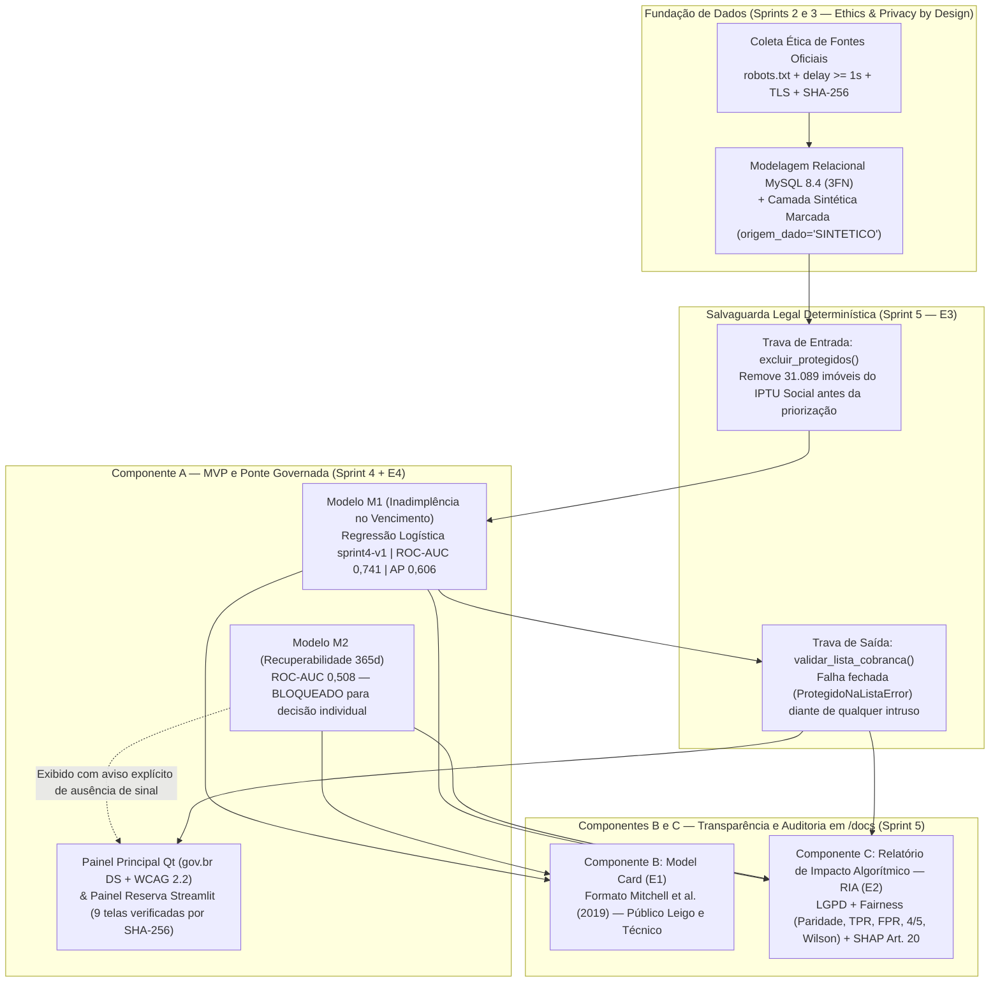
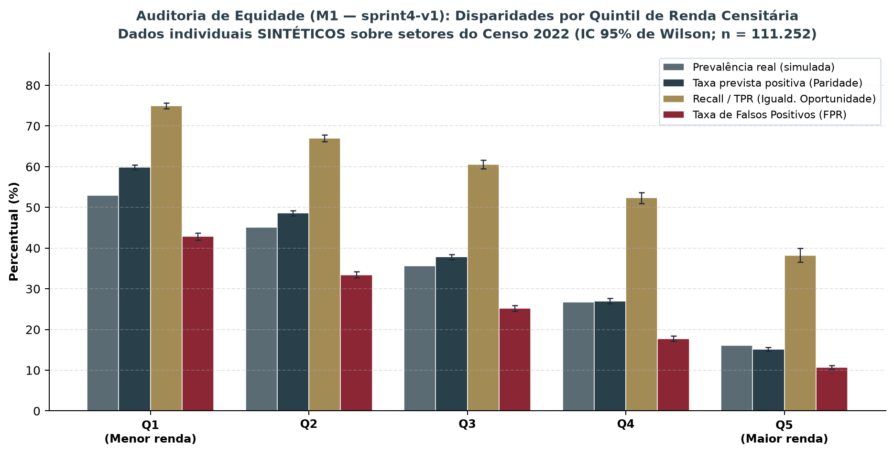
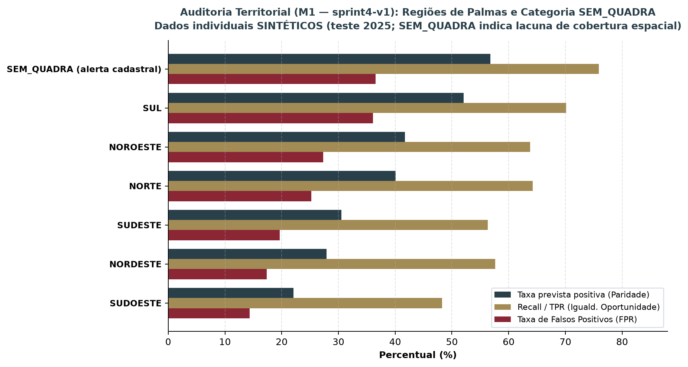

# E4 — Portfólio Revisado: Ética Digital, Governança Pública e Consolidação Sociotécnica

**Universidade Federal do Tocantins (UFT) — Bacharelado Interdisciplinar em Inteligência Artificial (BIINAR)**  
**Eixo II — Projeto Integrador: Sistema de Inteligência Tributária — Sefin Palmas/TO (Opção D) | 2026/2**  
**Sprint 5 — Governança e Ética (Módulo 7: Ética em Dados, Impactos Sociais e LGPD)**  
**Equipe:** Grupo 1 (5 integrantes) | **Repositório Oficial:** [`Guilherme-RCM/projeto-integrador-eixoII-GRUPO1-`](https://github.com/Guilherme-RCM/projeto-integrador-eixoII-GRUPO1-)  
**Versão Consolidada do Portfólio:** 1.0 — 25/11/2026

> [!IMPORTANT]
> **Escopo Experimental e Limite Operacional:** **Toda a base individual avaliada neste portfólio possui natureza estritamente sintética e finalidade exclusivamente acadêmica.** No plano geral, dados simulados permitem auditar pipelines computacionais sem expor informações fiscais de pessoas naturais protegidas pelo sigilo tributário e pela LGPD. Especificamente neste projeto, os `556.260` créditos e `111.252` imóveis (2021–2025), bem como os `31.089` registros da camada de proteção do IPTU Social, ostentam a marca explícita `origem_dado = 'SINTETICO'` sobre agregados públicos do IBGE (Censo 2022), do GeoPalmas e do portal NUCLEOGOV. Por conseguinte, nenhuma métrica aqui reportada autoriza cobrança real, inscrição em dívida ativa, protesto ou execução fiscal contra contribuintes de Palmas.

---

## 1. Introdução: Da Ética Digital Estratégica à Governança Algorítmica no Estado Democrático de Direito

### 1.1 O Axioma Reitor da Ética Digital e o Paradoxo dos Dados como Ativos Estratégicos

**A ética digital constitui o conjunto estruturado de princípios normativos e salvaguardas práticas que submetem as decisões mediadas por algoritmos à dignidade da pessoa humana.** Em termos conceituais amplos, toda operação executada em ambientes computacionais projeta consequências tangíveis sobre a vida física, patrimonial e social dos cidadãos, razão pela qual se impõe o axioma segundo o qual *"nem tudo que é tecnologicamente possível é eticamente aceitável: a tecnologia deve servir ao desenvolvimento humano, e não o contrário"* (BRITO, *Aula 01 — Ética Digital e a Gestão Estratégica de Dados*, 2026, slides 3 e 24). No ordenamento jurídico brasileiro, esse imperativo ético converteu-se em comando constitucional vinculante com a promulgação da Emenda Constitucional nº 115/2022 (CF/88, art. 5º, LXXIX) e o julgamento histórico da ADI 6387/DF pelo Supremo Tribunal Federal, que consagraram a proteção de dados pessoais e a autodeterminação informativa como direitos fundamentais autônomos (SARLET, 2020; DONEDA, 2006). Especificamente na esfera regulatória, essa tutela é operacionalizada pela conjugação entre o Marco Civil da Internet (Lei nº 12.965/2014, atualizado pelos Decretos nº 12.975/2026 e nº 12.976/2026) e a Lei Geral de Proteção de Dados Pessoais — LGPD (Lei nº 13.709/2018), sob fiscalização da Agência Nacional de Proteção de Dados — ANPD (Decreto nº 10.474/2020; MP nº 1.317/2025). Desse modo, projetar inteligência artificial para o fisco municipal exige tratar a conformidade ético-legal como requisito constitutivo de engenharia (*Ethics and Privacy by Design*), e jamais como formalidade burocrática posterior.

**A qualificação contemporânea dos dados como ativos estratégicos encerra um paradoxo crítico quando dissociada de governança e integridade informacional.** Sob a ótica da gestão moderna, organizações públicas e privadas passaram a tratar bases de dados como matéria-prima essencial para otimizar processos, reduzir custos e sustentar produtos analíticos baseados em escores e relatórios preditivos (*Aula 01*, slides 10–12). Entretanto, diferentemente de ativos patrimoniais físicos registrados em balanço, os dados são intangíveis, dinâmicos e estritamente dependentes da fidedignidade do contexto em que foram coletados (*Aula 01*, slide 11). Quando modelos preditivos operam sobre cadastros desestruturados, defasados ou não auditados, eles não apenas perdem eficácia analítica, mas passam a automatizar inconsistências invisíveis que acarretam graves riscos jurídicos, financeiros e reputacionais (*Aula 01*, slides 10 e 13). Aplicada diretamente ao Sistema de Inteligência Tributária de Palmas, essa lição demonstra que um escore de inadimplência ou recuperabilidade destituído de controle de qualidade cadastral e de auditoria de equidade deixa de ser ativo estratégico para tornar-se passivo institucional.

### 1.2 Assimetria Estatal, Monopólio Público e a Superação da Visão Tecnocrática pelo Valor Público

**A adoção de sistemas automatizados pela Administração Pública diferencia-se estruturalmente do mercado privado em razão da assimetria de poder e da compulsoriedade da relação entre Estado e cidadão.** Em relações de consumo privadas, a autonomia da vontade permite, ao menos em tese, recusar um serviço digital ou migrar para outro fornecedor concorrente. Em contrapartida, no âmbito estatal vigora o monopólio institucional e a obrigatoriedade legal: o contribuinte não escolhe fornecer seus dados cadastrais ao fisco municipal nem dispõe de "outra prefeitura" à qual recorrer diante de uma classificação algorítmica injusta (*Aula 09 — Ética em Dados e Políticas Públicas*, Bloco 1, slide 4). Sob essa assimetria fática, a doutrina especializada demonstra que o consentimento individual (LGPD, art. 7º, I, e art. 11, I) perde seu atributo de liberdade genuína perante o Poder Público, vinculando a Administração estritamente à finalidade pública legalmente instituída, à impessoalidade, à publicidade e ao dever de motivação explícita dos atos administrativos (CF/88, art. 37, *caput*; Lei nº 9.784/1999, art. 50, I; LGPD, art. 23; BIONI, 2021; MENDES, 2020). Logo, a legitimidade de qualquer algoritmo fazendário depende de freios institucionais muito mais rigorosos do que aqueles exigidos de aplicações comerciais.

**A governança ética de políticas públicas exige substituir a visão tecnocrática de eficiência isolada pela concepção substantiva de Valor Público.** Na perspectiva estritamente tecnocrática, o sucesso de um modelo preditivo resume-se à velocidade de processamento, à economia orçamentária imediata e à maximização de métricas estatísticas globais (*Aula 09*, slide 5). Todavia, na gestão pública democrática, uma ferramenta que amplie a arrecadação potencial às custas de expor desproporcionalmente famílias hipossuficientes ou titulares de isenção legal a abordagens fiscais indevidas fracassa em sua missão constitucional (*Aula 09*, slides 4 e 5). No caso específico da dívida ativa de IPTU de Palmas, a realização do Valor Público impõe equilibrar a eficiência arrecadatória da Secretaria Municipal de Finanças (Sefin) com três garantias inafastáveis: a exclusão determinística dos beneficiários do **IPTU Social** (idosos, aposentados, pensionistas e pessoas com deficiência de baixa renda), a contenção de falsos positivos em territórios vulneráveis e a preservação integral do contraditório e da ampla defesa (CF/88, art. 5º, LV). Conclui-se, assim, que a métrica de mérito de uma IA governamental não é apenas o quanto ela acerta em média, mas quem suporta o custo concreto dos seus erros.

### 1.3 Os Quatro Pilares da Governança Pública, Soberania Digital e *Accountability* Tridimensional

**A solidez institucional de um sistema público de inteligência artificial repousa sobre a articulação integrada entre os quatro pilares da governança ética de dados, a soberania digital e os mecanismos tridimensionais de prestação de contas (*accountability*).** Em plano teórico geral, a transparência digital obriga o ente estatal a tornar inteligíveis seus fluxos de dados e critérios decisórios sem "letras miúdas", ao passo que a *accountability* exige responsabilidade ativa — isto é, comprovar documental e tecnicamente a adoção de salvaguardas e sujeitar-se aos controles **Vertical** (sociedade civil e cidadãos), **Horizontal** (Tribunais de Contas, Ministério Público, controladorias e ANPD) e **Societal** (imprensa, academia e organizações sociais) (*Aula 01*, slides 17–20). Paralelamente, a fronteira regulatória internacional — representada pela Recomendação da UNESCO (2021), pelo *NIST AI RMF 1.0* (2023), pelo *AI Act* europeu (Regulamento UE 2024/1689, que classifica como Alto Risco sistemas estatais incidentes sobre serviços e benefícios públicos) e pelos marcos de **Soberania Digital e de IA** (Comissão Europeia, *SEALs*, 2025–2026) — converge para os quatro pilares sistematizados na *Aula 09* (slide 7): soberania e segurança, qualidade das bases, responsabilização e participação social. No escopo específico do Projeto Integrador II, esses referenciais materializam-se nos controles arquiteturais sintetizados no quadro a seguir.

| Pilar da Governança Pública (*Aula 09*, slide 7) | Fundamento Normativo e Científico | Materialização Específica no Portfólio do Grupo 1 (PI2 — Palmas) |
|---|---|---|
| **1. Soberania e Segurança da Informação** | LGPD, arts. 6º (VII, VIII), 37, 39 e 46; Soberania operacional, de dados, tecnológica e de IA | Arquitetura 100% aberta e executável localmente (*on-premise*) em Python, MySQL 8.4, scikit-learn, Qt/PySide6 e Streamlit, eliminando *vendor lock-in*; verificação criptográfica **SHA-256** do pacote `sprint4-v1`, do lote publicado e do conjunto protegido antes de exibir qualquer indicador. |
| **2. Qualidade e Integridade das Bases** | LGPD, arts. 6º, V (exatidão/atualização) e 18, III (retificação); prevenção de vazamento temporal | Fotografias temporais estritas em $t_0$ sem uso de eventos futuros (KAUFMAN et al., 2012); documentação explícita dos `23` setores censitários sob sigilo estatístico do IBGE e marcação automática da categoria `SEM_QUADRA` (`5.078` créditos) para saneamento cadastral administrativo. |
| **3. Responsabilização (*Accountability*)** | CF/88, art. 37, § 6º; LGPD, arts. 5º (VI–VIII), 6º, X, 23, 38, 39, 41 e 42; Res. CD/ANPD nº 18/2024 | Identificação da Sefin Palmas como **Controladora** (vedada a transferência de responsabilidade decisória ao software); bloqueio formal e programático do modelo **M2** (`ROC-AUC = 0,508`) para decisões individuais; supervisão humana obrigatória e previsão do canal do Encarregado (DPO). |
| **4. Participação e Controle Social** | CF/88, art. 5º, XXXIII e LV; Lei nº 9.784/1999, art. 50, I; LGPD, arts. 6º, VI, 9º e 20 | Disponibilização pública em [`/docs`](README.md) do **Model Card** (E1) e do **RIA** (E2) com auditoria desagregada, decomposição **SHAP**, tradução em linguagem simples e exigência de canal presencial gratuito na ponta. |

### 1.4 O Mito da Neutralidade, Variáveis *Proxy*, Impossibilidade Matemática e Inclusão sem Estigma

**A exclusão de variáveis socioeconômicas diretas do contrato de entrada de um modelo não assegura neutralidade algorítmica nem impede a discriminação indireta no território.** De acordo com a teoria estatística e jurídica da equidade algorítmica, conjuntos de dados refletem desigualdades históricas e espaciais que permanecem codificadas de maneira redundante em atributos aparentemente neutros — fenômeno consagrado na literatura como *redlining* indireto e problema das variáveis *proxy* (*Aula 04*; *Aula 09*, slide 13; PEDRESCHI et al., 2008; DWORK et al., 2012; HAJIAN; DOMINGO-FERRER, 2013; BAROCAS; SELBST, 2016). Ademais, toda modelagem preditiva envolve uma distância crítica entre o construto substantivo que a política pública pretende aferir e o rótulo histórico efetivamente observado nos registros (OBERMEYER et al., 2019; FRIEDLER et al., 2021; JACOBS; WALLACH, 2021; SURESH; GUTTAG, 2021). Especificamente no modelo **M1** (`sprint4-v1`), embora `renda_media`, `quintil_renda`, `cd_setor` e `regiao` estejam banidos da matriz preditora (`feature_contract.json`), os atributos `inadimplente_exercicio_anterior` e `valor_relativo_anterior` capturam indiretamente a estratificação socioeconômica dos setores censitários de Palmas. Assim, a auditoria ética precisa examinar empiricamente os resultados desagregados da decisão, jamais se contentando com a "cegueira formal" das colunas de entrada.

**A existência de taxas-base desiguais entre estratos socioeconômicos impõe limites matemáticos incontornáveis que obrigam a deslocar a mitigação para a política de uso administrativo.** Conforme demonstrado algebricamente por Chouldechova (2017) e Kleinberg et al. (2017), qualquer classificador Imperfeito submetido à identidade exata
$$\text{FPR}_g = \frac{p_g}{1 - p_g} \cdot \frac{1 - \text{PPV}_g}{\text{PPV}_g} \cdot \text{TPR}_g$$
está impedido de equalizar simultaneamente o valor preditivo positivo ($\text{PPV}$), a taxa de verdadeiros positivos ($\text{TPR}$, critério de igualdade de oportunidade de HARDT et al., 2016) e a taxa de falsos positivos ($\text{FPR}$) quando a prevalência real $p_g$ difere entre grupos (*Aula 04*, Nível 5b). No conjunto sintético de teste de 2025 ($n = 111.252$), o parâmetro gerador $\beta_{\text{renda}} = -0,5$ produziu prevalência de `52,93%` no primeiro quintil (`Q1`, menor renda) contra `16,14%` no quinto quintil (`Q5`, maior renda), fazendo com que o M1 registrasse `42,86%` de falsos positivos em `Q1` frente a `10,69%` em `Q5` (`4,01×` mais alarmes falsos sobre adimplentes do estrato mais vulnerável). Como a adoção arbitrária de limiares distintos por faixa de renda sem lei específica criaria tratamento tributário díspar juridicamente vulnerável (CORBETT-DAVIES et al., 2017; LIPTON et al., 2018), a salvaguarda legítima consiste em vedar qualquer efeito punitivo automático do escore, convertendo-o estritamente em insumo para orientação preventiva e regularização assistida.

**A efetividade dos direitos fundamentais perante decisões algorítmicas depende tanto da contenção do estigma institucional quanto da superação ativa das três dimensões da exclusão digital.** Sob o enfoque sociológico de Link e Phelan (2001), rótulos institucionais de "alto risco" que circulam fora de equipes técnicas preparadas desencadeiam estereotipagem, separação e perda de direitos; paralelamente, o modelo de Helsper (2012) comprova que a exclusão digital espelha a exclusão socioeconômica nas dimensões de **infraestrutura de conexão**, **letramento digital/funcional** e **acesso a canais presenciais** (*Aula 09*, slides 14 e 19–23). Quando um órgão público condiciona a explicação ou a contestação de um alerta algorítmico ao uso exclusivo de aplicativos móveis, biometria ou linguagem tecnocrática, ele esvazia materialmente o direito fundamental à proteção de dados e inverte o ônus da prova contra idosos, pessoas com deficiência e famílias de baixa renda (SARLET, 2020). Por essa razão, este portfólio incorpora a **Regra de Ouro da Inclusão** (*Aula 09*, slide 14): toda sinalização do sistema submete-se à finalidade fechada de apoio, exige tradução para linguagem simples (WACHTER et al., 2017; SELBST; POWLES, 2017) e assegura atendimento presencial gratuito no balcão fazendário com resposta fundamentada em até 15 dias (LGPD, arts. 18, § 5º, 19, II, e 20).

### 1.5 Padrão Redacional, Estrutura Lógica Dedutiva e Acessibilidade Comunicacional do Portfólio

**A organização textual deste portfólio adota deliberadamente a estrutura dedutiva do parágrafo-padrão da prosa científica em língua portuguesa como instrumento de transparência cognitiva e auditabilidade.** Na tradição clássica da retórica e da linguística textual brasileira sistematizada por Othon Moacyr Garcia (*Comunicação em Prosa Moderna*, 2010), Ingedore Villaça Koch (*A Coesão Textual*, 2010; KOCH; TRAVAGLIA, *A Coerência Textual*, 2011) e Irandé Antunes (*Lutar com Palavras*, 2005), a clareza do pensamento científico exige que cada parágrafo constitua uma unidade lógica coesa governada por um **tópico frasal explícito** (ideia-núcleo enunciada logo na abertura), desdobrada progressivamente **do genérico ao específico** por operadores coesivos referenciais e sequenciais, até culminar na evidência empírica e no fecho conclusivo. No âmbito da governança digital, essa disciplina redacional converge diretamente com o dever jurídico de informação clara, adequada e ostensiva (LGPD, arts. 6º, VI, 9º e 20, § 1º) e com o critério avaliativo do edital que exige documentos simultaneamente rigorosos para especialistas e acessíveis ao público leigo. Assim, tanto um cidadão ou gestor público (que apreende de imediato a tese central nos tópicos frasais em destaque) quanto um auditor técnico da banca ou de órgão de controle (que examina as fórmulas, hashes e intervalos estatísticos nos períodos específicos subsequentes) percorrem o portfólio sem ambiguidade interpretativa.

---

## 2. Arquitetura Integrada dos Três Componentes em `/docs`

**A estrutura física e documental deste repositório consolida os três componentes exigidos pelo entregável E4 — MVP, Model Card e Relatório de Impacto Algorítmico — em uma arquitetura rastreável ponta a ponta no diretório `/docs`.** Em nível sistêmico, um portfólio de Inteligência Artificial governamental só é auditável quando os artefatos de engenharia de dados, os modelos serializados, os testes de proteção legal e os relatórios de impacto compartilham as mesmas definições, versões e somas de verificação (RAJI et al., 2020; MITCHELL et al., 2019; GEBRU et al., 2021). Especificamente nesta entrega, o fluxo integra a fundação de coleta ética e banco relacional em 3FN das Sprints 2 e 3, os modelos `sprint4-v1` e painéis Qt/Streamlit da Sprint 4 (**Componente A**), o **Model Card** completo em formato Mitchell et al. (**Componente B — E1**), o **Relatório de Impacto Algorítmico** com análise SHAP (**Componente C — E2**) e a dupla trava determinística do **IPTU Social** (**E3**), conectados programaticamente pela ponte [`codigo/pipeline_governado_e4.py`](../codigo/pipeline_governado_e4.py). O diagrama a seguir explicita o encadeamento técnico e normativo entre todos os módulos do portfólio.

| Componente Oficial do Portfólio | Documento Consolidado em `/docs` | Código, Dados e Testes Verificáveis | Situação Verificada |
|---|---|---|---|
| **Componente A — MVP (Sistema e Painéis)** | [`MVP_SISTEMA_INTELIGENCIA_TRIBUTARIA.md`](MVP_SISTEMA_INTELIGENCIA_TRIBUTARIA.md) e capturas em [`figuras/mvp/`](figuras/mvp/) | [`../codigo/pipeline_governado_e4.py`](../codigo/pipeline_governado_e4.py) e metadados em [`dados_auditoria/`](dados_auditoria/) | Conciliado em centavos e protegido por SHA-256 |
| **Componente B — Model Card (E1 — Peso 30%)** | [`MODEL_CARD.md`](MODEL_CARD.md) e PDF oficial preservado [`Model_Card_E1_Versao_Oficial.pdf`](Model_Card_E1_Versao_Oficial.pdf) | [`dados_auditoria/metadata_sprint4_v1.json`](dados_auditoria/metadata_sprint4_v1.json), [`feature_contract_sprint4_v1.json`](dados_auditoria/feature_contract_sprint4_v1.json) e [`metrics_sprint4_v1.json`](dados_auditoria/metrics_sprint4_v1.json) | Completo, revisado e acessível a leigos e técnicos |
| **Componente C — Relatório de Impacto Algorítmico (E2 — Peso 55%)** | [`RELATORIO_IMPACTO_ALGORITMICO.md`](RELATORIO_IMPACTO_ALGORITMICO.md) e gráficos [`figuras/shap_summary_m1.png`](figuras/shap_summary_m1.png), [`shap_waterfall_m1.png`](figuras/shap_waterfall_m1.png), [`fairness_quintis_m1.png`](figuras/fairness_quintis_m1.png) e [`fairness_regioes_m1.png`](figuras/fairness_regioes_m1.png) | [`../codigo/analise_shap_m1.py`](../codigo/analise_shap_m1.py), [`../codigo/auditoria_fairness_e4.py`](../codigo/auditoria_fairness_e4.py) e [`dados_auditoria/auditoria_fairness_e4.csv`](dados_auditoria/auditoria_fairness_e4.csv) | 4 seções revisadas + integração E3 + IC 95% Wilson |
| **Salvaguarda Legal — IPTU Social (E3 — Peso 15%)** | [`PROTECAO_IPTU_SOCIAL_E3.md`](PROTECAO_IPTU_SOCIAL_E3.md) | [`../codigo/gerar_protegidos_iptu_social.py`](../codigo/gerar_protegidos_iptu_social.py), [`../codigo/protecao_iptu_social.py`](../codigo/protecao_iptu_social.py) e [`../tests/test_protecao_iptu_social.py`](../tests/test_protecao_iptu_social.py) | `31.089` protegidos excluídos (`5/5` testes E3 aprovados) |
| **Governança e Auditoria Automatizada (E4)** | Este documento, [`ADRs_SPRINT5.md`](ADRs_SPRINT5.md), [`DIARIO_DE_BORDO.md`](DIARIO_DE_BORDO.md) e [`README.md`](README.md) | [`../codigo/verificar_portfolio_e4.py`](../codigo/verificar_portfolio_e4.py) e [`../tests/test_portfolio_governado_e4.py`](../tests/test_portfolio_governado_e4.py) | `12/12` controles e `12/12` testes `pytest` aprovados |

---

## 3. Aplicação dos Protocolos de Políticas Públicas ao Caso Sefin Palmas

### 3.1 Submissão às "5 Perguntas Obrigatórias Antes de Contratar ou Usar IA" (*Aula 09*, Slide 17)

**A avaliação preventiva de necessidade, legalidade, equidade, supervisão humana e contestabilidade constitui filtro eliminatório antes de qualquer implantação governamental de inteligência artificial.** Conforme estabelecido no roteiro prático de políticas públicas do Módulo 7 (*Aula 09*, Bloco 3, slide 17), a Administração não deve perguntar apenas se um modelo funciona tecnicamente, mas se o seu emprego resiste a cinco indagações institucionais obrigatórias. Aplicado especificamente aos dois modelos do pacote `sprint4-v1`, esse crivo produz diagnósticos distintos e complementares: enquanto aprova o **M1** exclusivamente como ferramenta auxiliar de planejamento educativo sob fortes salvaguardas, reprova peremptoriamente o uso decisório individual do **M2**. Os fundamentos detalhados de cada resposta encontram-se sistematizados abaixo:

1. **Necessidade (*"A IA é realmente a melhor solução ou um ajuste no processo administrativo resolveria o problema com menor risco?"*):** **A necessidade técnica verifica-se parcialmente apenas para a triagem preventiva do M1, sendo inexistente para o modelo M2 na configuração atual.** Em termos gerais, o princípio da proporcionalidade administrativa veda introduzir complexidade algorítmica onde regras contábeis determinísticas alcançam igual ou melhor resultado (*Aula 09*, slides 10 e 17). No caso concreto do **M2** (recuperabilidade em 365 dias), seu desempenho (`ROC-AUC = 0,508`; `Brier = 0,104446` contra `0,104451` do preditor constante) comprova que a ordenação administrativa direta por saldo em aberto, risco prescricional e exclusão legal de isentos é superior e mais transparente; já no **M1** (`ROC-AUC = 0,741`; `AP = 0,606`), o ganho preditivo sobre o *baseline* justifica tão somente ações preventivas de comunicação amigável antes do vencimento.
2. **Base Legal e Dados (*"Temos base legal na LGPD e dados representativos, atualizados e auditados para treinar o modelo?"*):** **A base atual atende integralmente à pesquisa acadêmica com dados sintéticos, mas exige formalização jurídica e saneamento cadastral antes de qualquer operação real.** No regime da LGPD aplicável ao Poder Público (arts. 7º, II e III, e 23), o tratamento de históricos fiscais reais demanda previsão legal específica, publicidade ativa das hipóteses de uso e elaboração prévia de Relatório de Impacto à Proteção de Dados Pessoais — RIPD (art. 38). Especificamente nos insumos territoriais examinados, a auditoria identificou `23` setores censitários sem informação de renda por sigilo estatístico do IBGE e `5.078` créditos de teste na categoria `SEM_QUADRA`, demonstrando que uma implantação futura exigiria saneamento cadastral prévio para não penalizar áreas com menor cobertura cartográfica.
3. **Equidade (*"Testamos se o sistema apresenta taxas de erro diferentes por faixa de renda ou região geográfica?"*):** **Os testes formais de equidade foram integralmente executados e revelaram disparidades expressivas que impedem o uso coercitivo do escore.** Conforme exigido pelo edital, aplicaram-se as métricas de paridade demográfica, igualdade de oportunidade ($\text{TPR}$) e taxa de falsos positivos ($\text{FPR}$) cruzadas por quintil de renda censitária e por região administrativa de Palmas. No teste congelado de 2025, o **M1** apresentou diferença de `44,72 p.p.` na taxa de seleção positiva entre `Q1` (`59,86%`) e `Q5` (`15,13%`), diferença de `36,73 p.p.` em $\text{TPR}$ e diferença de `32,17 p.p.` em $\text{FPR}$ (`42,86%` contra `10,69%`), violando a regra prática dos quatro quintos (`0,253 < 0,80`) e exigindo travas rigorosas de finalidade.
4. **Humano no Comando (*"Há garantia de que nenhuma negativa ou punição ocorrerá sem revisão humana qualificada?"*):** **O sistema institui bloqueio normativo e programático contra qualquer decisão punitiva ou restritiva tomada isoladamente pela máquina.** Na literatura de governança pública, a supervisão humana efetiva (*Human-in-the-Loop*) requer que o servidor público disponha de capacitação, tempo e autonomia funcional para divergir do algoritmo, recusando o papel de mero "carimbador" de escores (*Aula 09*, slide 11). Em [`codigo/pipeline_governado_e4.py`](../codigo/pipeline_governado_e4.py), essa diretriz é imposta por código: tentativas de parametrizar o fluxo para protesto, inscrição ou execução automática disparam `GovernancaBloqueioError`, e todos os registros elegíveis recebem o atributo obrigatório `revisao_humana_obrigatoria = True`.
5. **Porta de Saída (*"Existe um canal rápido, presencial e gratuito para o cidadão contestar uma decisão algorítmica?"*):** **A arquitetura vincula toda comunicação preventiva à oferta obrigatória de canal híbrido, presencial e gratuito de revisão e retificação cadastral.** Para que os direitos previstos nos artigos 18, 19 e 20 da LGPD não se convertam em privilégio exclusivo de contribuintes hiperconectados, o protocolo exige que o atendimento presencial da Sefin / Resolve Palmas receba pedidos orais ou escritos sem exigir aplicativo ou biometria, forneça número de protocolo imediato, atualize dados defasados na origem e emita resposta fundamentada em até **15 dias** sem qualquer custo (LGPD, arts. 18, § 5º, e 19, II).

### 3.2 Protocolo de Triagem Auditável e Inclusiva em Quatro Camadas (*Aula 09*, Slide 20)

**A proteção concreta dos direitos fundamentais no ciclo operacional da cobrança tributária realiza-se por uma arquitetura sequencial de quatro camadas de defesa.** Inspirado diretamente no *Protocolo de Triagem Auditável e Inclusiva* desenvolvido no estudo de caso da *Aula 09* (Bloco 4, slide 20) e implementado em [`codigo/pipeline_governado_e4.py`](../codigo/pipeline_governado_e4.py), esse desenho garante que falhas cadastrais, isenções legais e assimetrias estatísticas sejam interceptadas antes de produzirem efeitos externos. Especificamente, cada camada cumpre uma função técnica verificável por testes automatizados:

- **Camada 1 — Auditoria Prévia e Falha Fechada (*Fail-Closed*):** **A primeira barreira impede que o pipeline opere sobre insumos cadastrais corrompidos ou sem a base de proteção social carregada.** Antes de qualquer ordenação, `auditar_insumos_cadastrais()` verifica a unicidade da chave `(id_imovel, exercicio)`, valida o intervalo das probabilidades `[0, 1]`, bloqueia a execução com `GovernancaBloqueioError` caso o conjunto do IPTU Social esteja vazio ou ausente e sinaliza os imóveis `SEM_QUADRA` (`requer_saneamento_cadastral = True`) para conferência administrativa prévia (LGPD, art. 6º, V).
- **Camada 2 — Dupla Trava do IPTU Social e Veto Punitivo:** **A segunda barreira remove deterministicamente todos os imóveis protegidos e interdita usos coercitivos ou modelos sem sinal discriminativo.** Na entrada, `excluir_protegidos()` retira os `31.089` imóveis sintéticos do IPTU Social antes da geração do ranking; no processamento, bloqueia-se o uso individual do M2 (`m2_supera_referencia = False`) e restringe-se o M1 a apoio educativo; na saída, `validar_lista_cobranca()` audita a lista final e dispara `ProtegidoNaListaError` diante de qualquer intruso.
- **Camada 3 — Dupla Explicabilidade (Técnica e Cidadã):** **A terceira barreira converte a matemática interna do modelo logístico em motivação administrativa compreensível e acionável pelo contribuinte.** Para auditores e órgãos de controle, preservam-se as contribuições aditivas exatas do `LinearExplainer` SHAP em *log-odds* (`analise_shap_m1.py`); para o cidadão, `gerar_explicacao_cidada_art20()` traduz os fatores positivos predominantes em linguagem simples, explicita tratar-se de estimativa auxiliar sujeita a conferência humana e informa os meios gratuitos de retificação e comprovação de isenção.
- **Camada 4 — Revisão Assistida, Rastreabilidade SHA-256 e Controle Contínuo:** **A quarta barreira assegura prestação de contas perene mediante certificado criptográfico de execução e monitoramento periódico de disparidades.** Cada execução emite um objeto imutável `AtestadoGovernanca` contendo o hash `SHA-256` canônico do conjunto protegido (`sha256_conjunto_protegido`), as contagens exatas de créditos recebidos, excluídos e elegíveis, a confirmação de zero intrusos na saída e o vínculo expresso com o canal presencial gratuito de 15 dias e auditorias regulares de equidade.

---

## 4. Auditoria de Coerência Inter-Entregáveis e Consolidações do Portfólio Revisado

### 4.1 Reconciliação Documental e Técnica entre Sprint 4, E1, E2 e E3

**A revisão integradora do E4 eliminou todas as pendências de interface entre os entregáveis individuais da equipe, assegurando consistência absoluta em `/docs` sem alterar os artefatos originais.** Em projetos colaborativos divididos em frentes paralelas, é natural que documentos redigidos simultaneamente registrem cautelas mútuas — como o PDF oficial do E1 aguardar a confirmação do código do E3 e do SHAP, ou o texto preliminar do E2 recomendar a conferência da direção dos quintis no dicionário da simulação. Para resolver essas interfaces com transparência científica, a curadoria do E4 preservou intactos o PDF oficial ([`Model_Card_E1_Versao_Oficial.pdf`](Model_Card_E1_Versao_Oficial.pdf)) e os scripts originais, ao mesmo tempo em que verificou nos metadados e códigos-fonte da Sprint 4 cada informação pendente para consolidar [`MODEL_CARD.md`](MODEL_CARD.md), [`RELATORIO_IMPACTO_ALGORITMICO.md`](RELATORIO_IMPACTO_ALGORITMICO.md) e [`MVP_SISTEMA_INTELIGENCIA_TRIBUTARIA.md`](MVP_SISTEMA_INTELIGENCIA_TRIBUTARIA.md). O quadro abaixo documenta as seis reconciliações realizadas.

| Item Auditado no E4 | Estado nos Artefatos Preliminares | Evidência Verificada e Consolidação em `/docs` |
|---|---|---|
| **1. Direção Socioeconômica dos Quintis (`Q1`–`Q5`)** | O E1 indicava `Q1 = menor renda` e `Q5 = maior renda`; o E2 cautelosamente aguardava confirmação documental da codificação. | Confirmado em [`metadata_sprint4_v1.json`](dados_auditoria/metadata_sprint4_v1.json) (`beta_renda = -0.5` e `elasticidade_valor_renda = 1.0`): **Q1 representa os setores de menor renda** (maior prevalência simulada: `52,93%`) e **Q5 os de maior renda** (`16,14%`). |
| **2. Fórmulas das Variáveis Relativas (M1 e M2)** | O PDF do E1 (Seção 4) assinalava que `valor_relativo_anterior` e `valor_relativo_credito` dependiam de confirmação no código. | Confirmado no código `SPRINT-4/E1/codigo/dados.py` (linhas 105–107 e 148–153): razão entre `valor_principal_centavos` do imóvel e a **mediana municipal** dos créditos do respectivo exercício conhecidos antes de $t_0$. |
| **3. Integração Cruzada do IPTU Social (E3 → E1 e E2)** | O PDF do E1 não atestava a conclusão do E3, e o RIA ainda não continha as notas específicas de `TEXTOS_PARA_E1_E2.md`. | Integrado formalmente na Seção 3 e Seção 11 de [`MODEL_CARD.md`](MODEL_CARD.md) e nas Seções 6.2 e 8 de [`RELATORIO_IMPACTO_ALGORITMICO.md`](RELATORIO_IMPACTO_ALGORITMICO.md), detalhando as duas travas, a semente `20261125`, os `31.089` imóveis protegidos (`27,94%`) e os `5` testes `pytest`. |
| **4. Evidência Visual e Técnica do SHAP (E2 → E1)** | O PDF do E1 (Seção 9) aguardava confirmação sobre qual método de interpretabilidade fora efetivamente executado. | Consolidado em ambos os documentos com a execução de [`codigo/analise_shap_m1.py`](../codigo/analise_shap_m1.py) (`LinearExplainer`, SHAP `0.54.1`) e incorporação de [`figuras/shap_summary_m1.png`](figuras/shap_summary_m1.png) e [`figuras/shap_waterfall_m1.png`](figuras/shap_waterfall_m1.png). |
| **5. Intervalos de Confiança, Regra dos 4/5 e Chouldechova** | O RIA apontava a ausência de intervalos de confiança para as disparidades como limitação a suprir em revisão futura. | Suprido por [`codigo/auditoria_fairness_e4.py`](../codigo/auditoria_fairness_e4.py): cálculo dos **IC 95% de Wilson** (BROWN et al., 2001), **Regra dos 4/5** (`0,253` nos quintis; `0,424` nas regiões) e verificação exata da **identidade de Chouldechova** (`erro máx. = 0,00e+00`) em [`auditoria_fairness_e4.csv`](dados_auditoria/auditoria_fairness_e4.csv). |
| **6. Troca em Casos Reais (M1) e Faixas de Calibração (M2)** | Pontos críticos de leitura operacional exigidos pelo guia avaliativo da banca. | Incorporados em [`MODEL_CARD.md`](MODEL_CARD.md) e [`MVP_SISTEMA_INTELIGENCIA_TRIBUTARIA.md`](MVP_SISTEMA_INTELIGENCIA_TRIBUTARIA.md): na validação de 2024, o limiar `0,306856` vs. `0,50` captura **+1.150 inadimplentes** ao custo de **+1.967 falsos positivos**; no M2, **100% da carteira** cai na **Faixa Baixa (`< 0,33`)**, com zero casos nas faixas Média e Alta. |

### 4.2 Síntese Quantitativa da Auditoria Estendida de Equidade (M1 — Teste 2025, $n = 111.252$)

**A análise estatística com intervalos de confiança de Wilson comprova que as disparidades de seleção e de erro do modelo M1 entre quintis de renda e regiões são sistemáticas e estatisticamente significativas.** Em auditorias de *fairness*, a simples comparação pontual de proporções pode induzir alarmes falsos em subgrupos pequenos, motivo pelo qual a literatura recomenda reportar intervalos binomiais de 95% pelo método de Wilson (BROWN; CAI; DASGUPTA, 2001; ROTH et al., 2006) conjuntamente à razão de impacto adverso de 80% (FELDMAN et al., 2015). Aplicado aos `111.252` créditos do teste congelado de 2025 por [`codigo/auditoria_fairness_e4.py`](../codigo/auditoria_fairness_e4.py), esse procedimento revela que os intervalos de 95% dos cinco quintis de renda jamais se tocam em nenhuma das métricas auditadas: o estrato de menor renda (`Q1`) sofre taxa de classificação positiva de `59,86%` `[59,25%; 60,46%]` contra `15,13%` `[14,64%; 15,65%]` em `Q5`, ao passo que a taxa de falsos positivos atinge `42,86%` `[41,97%; 43,76%]` em `Q1` contra `10,69%` `[10,22%; 11,17%]` em `Q5`. Os gráficos e a tabela consolidada a seguir expõem integralmente esses resultados.

| Quintil de Renda Censitária | $n$ | Prevalência Simulada | Taxa Prevista Positiva [IC 95% Wilson] | Recall / TPR [IC 95% Wilson] | FPR [IC 95% Wilson] | Precisão / PPV | Exposição vs. Q5 |
|---|---:|---:|---:|---:|---:|---:|---:|
| **Q1 (Menor renda)** | 24.866 | 52,93% | **59,86%** [59,25%; 60,46%] | **74,97%** [74,23%; 75,70%] | **42,86%** [41,97%; 43,76%] | 66,29% | **3,96×** |
| **Q2** | 25.459 | 45,15% | **48,60%** [47,98%; 49,21%] | **67,01%** [66,15%; 67,87%] | **33,44%** [32,66%; 34,22%] | 62,26% | 3,21× |
| **Q3** | 21.673 | 35,67% | **37,85%** [37,21%; 38,50%] | **60,56%** [59,47%; 61,65%] | **25,25%** [24,54%; 25,98%] | 57,08% | 2,50× |
| **Q4** | 19.940 | 26,75% | **27,03%** [26,42%; 27,65%] | **52,36%** [51,02%; 53,70%] | **17,78%** [17,17%; 18,41%] | 51,82% | 1,79× |
| **Q5 (Maior renda)** | 19.314 | 16,14% | **15,13%** [14,64%; 15,65%] | **38,24%** [36,55%; 39,96%] | **10,69%** [10,22%; 11,17%] | 40,78% | 1,00× (ref.) |

---

## 5. A Régua da Banca: Prontidão Institucional e Roteiro de Defesa Oral

**Diante da pergunta-síntese da banca examinadora — *"Este sistema poderia ser entregue à Sefin amanhã?"* —, o posicionamento técnico e ético do Grupo 1 distingue rigorosamente a prontidão da arquitetura auditável da proibição de operação imediata sobre dados sintéticos.** Em engenharia de sistemas públicos de Alto Risco, maturidade profissional não significa prometer implantação irrestrita, mas conhecer e travar com precisão as fronteiras de validade do próprio artefato (MITCHELL et al., 2019; NIST, 2023). Como **plataforma de engenharia, transparência e governança em homologação**, o sistema está integralmente pronto: possui coleta ética automatizada, modelagem relacional em 3FN, separação temporal à prova de vazamento, interfaces Qt (gov.br DS / WCAG 2.2) e Streamlit conciliadas ao centavo, dupla trava automatizada do IPTU Social e documentação completa de impacto algorítmico. Entretanto, para **produzir efeitos administrativos reais sobre contribuintes de Palmas**, a entrada em operação permanece condicionada a cinco requisitos institucionais inegociáveis: (1) substituição da base sintética por dados fiscais reais sob base legal formalizada (LGPD, arts. 7º, II/III, e 23); (2) aprovação do RIPD (art. 38) e publicação ostensiva do Encarregado/DPO (art. 41 e Res. CD/ANPD nº 18/2024); (3) acoplamento das travas do E3 ao cadastro oficial de isenções da Lei Complementar Municipal nº 285/2013; (4) manutenção do veto decisório ao modelo M2 até revalidação com dados reais de recuperação; e (5) ativação do fluxo de supervisão humana e do balcão presencial gratuito de revisão em até 15 dias.

| Bloco da Defesa (15–20 min) | Tempo | Eixo Argumentativo e Demonstração Prática | Documento de Referência em `/docs` |
|---|---:|---|---|
| **1. Problema e Ética Digital** | 3 min | Assimetria Estado-contribuinte, Valor Público vs. Visão Tecnocrática e tutela dos vulneráveis do IPTU Social. | Seção 1 deste documento |
| **2. Pipeline e Modelos (`sprint4-v1`)** | 4 min | Coleta ética (`robots.txt`, atraso, TLS), MySQL 3FN, fotografias em $t_0$, desempenho do M1 (`ROC-AUC 0,741`) e diagnóstico honesto da ausência de sinal no M2 (`ROC-AUC 0,508`). | [`MVP_SISTEMA_INTELIGENCIA_TRIBUTARIA.md`](MVP_SISTEMA_INTELIGENCIA_TRIBUTARIA.md) e [`MODEL_CARD.md`](MODEL_CARD.md) |
| **3. Demo ao Vivo (MVP + Travas E3)** | 5 min | Navegação no painel Qt/Streamlit (Resumo, Ranking, Mapa com supressão `< 10` imóveis, Projeção conciliada em R$ 60,12 mi / R$ 6,95 mi) + execução ao vivo do `pytest` barrando imóveis do IPTU Social. | [`PROTECAO_IPTU_SOCIAL_E3.md`](PROTECAO_IPTU_SOCIAL_E3.md) e [`figuras/mvp/`](figuras/mvp/) |
| **4. Fairness, LGPD e SHAP (Art. 20)** | 5 min | Disparidades entre `Q1` e `Q5`, identidade de Chouldechova, decomposição SHAP global e individual (`73,8%`), notificação em linguagem simples e canal presencial gratuito. | [`RELATORIO_IMPACTO_ALGORITMICO.md`](RELATORIO_IMPACTO_ALGORITMICO.md) |
| **5. Veredito e Sabatina** | 3 min | Resposta fundamentada à régua da banca e execução de [`verificar_portfolio_e4.py`](../codigo/verificar_portfolio_e4.py) (`12/12` controles aprovados). | [`README.md`](README.md) |

---

## 6. Referências Normativas, Científicas e Metodológicas

### 6.1 Fontes Constitucionais, Legais e Regulatórias
- **BRASIL.** *Constituição da República Federativa do Brasil de 1988*. Arts. 5º, XXXIII, LV e LXXIX (incluído pela Emenda Constitucional nº 115/2022), 37, *caput* e § 6º, e 150, II.
- **BRASIL.** *Lei nº 9.784, de 29 de janeiro de 1999*. Regula o processo administrativo no âmbito da Administração Pública Federal (art. 50, I — dever de motivação).
- **BRASIL.** *Lei nº 12.965, de 23 de abril de 2014* (Marco Civil da Internet), atualizada pelos Decretos nº 12.975/2026 e nº 12.976/2026.
- **BRASIL.** *Lei nº 13.709, de 14 de agosto de 2018* (Lei Geral de Proteção de Dados Pessoais — LGPD), arts. 5º, 6º, 7º, 9º, 11, 12, 16, 18, 19, 20, 23, 26, 37, 38, 39, 41, 42, 46 e 52; e Medida Provisória nº 1.317/2025 (Agência Nacional de Proteção de Dados — ANPD).
- **BRASIL.** *Lei nº 14.533, de 11 de janeiro de 2023* (Política Nacional de Educação Digital).
- **BRASIL. Supremo Tribunal Federal.** *ADI 6387 MC-Ref/DF*, Rel. Min. Rosa Weber, Plenário, j. 07/05/2020.
- **ANPD.** *Guia Orientativo: Tratamento de Dados Pessoais pelo Poder Público* (2023) e *Resolução CD/ANPD nº 18/2024* (Atuação do Encarregado).
- **NIST.** *Artificial Intelligence Risk Management Framework (AI RMF 1.0)*. NIST AI 100-1, 2023. DOI: `10.6028/NIST.AI.100-1`.
- **UNESCO.** *Recomendação sobre a Ética da Inteligência Artificial*. Paris: UNESCO, 2021.
- **UNIÃO EUROPEIA.** *Regulamento (UE) 2024/1689 (Artificial Intelligence Act)*, 2024, e *Cloud Sovereignty Framework (SEAL-0 a SEAL-4)*, Comissão Europeia, 2025–2026.

### 6.2 Literatura de Governança Digital, LGPD, *Fairness* e Interpretabilidade
- **BAROCAS, Solon; SELBST, Andrew D.** Big Data's Disparate Impact. *California Law Review*, v. 104, n. 3, p. 671–732, 2016. DOI: `10.15779/Z38BG31`.
- **BIONI, Bruno Ricardo.** *Proteção de Dados Pessoais: a função e os limites do consentimento*. 2. ed. São Paulo: Forense, 2021.
- **BROWN, Lawrence D.; CAI, T. Tony; DASGUPTA, Anirban.** Interval Estimation for a Binomial Proportion. *Statistical Science*, v. 16, n. 2, p. 101–133, 2001. DOI: `10.1214/ss/1009213286`.
- **BUOLAMWINI, Joy; GEBRU, Timnit.** Gender Shades: Intersectional Accuracy Disparities in Commercial Gender Classification. *Proceedings of Machine Learning Research*, v. 81, p. 77–91, 2018.
- **CHOULDECHOVA, Alexandra.** Fair Prediction with Disparate Impact: A Study of Bias in Recidivism Prediction Instruments. *Big Data*, v. 5, n. 2, p. 153–163, 2017. DOI: `10.1089/big.2016.0047`.
- **CORBETT-DAVIES, Sam; PIERSON, Emma; FELLER, Avi; GOEL, Sharad; HUQ, Aziz.** Algorithmic Decision Making and the Cost of Fairness. *Proceedings of the 23rd ACM SIGKDD*, p. 797–806, 2017. DOI: `10.1145/3097983.3098095`.
- **CRAWFORD, Kate.** *The Atlas of AI*. New Haven: Yale University Press, 2021.
- **DONEDA, Danilo.** *Da privacidade à proteção de dados pessoais*. Rio de Janeiro: Renovar, 2006.
- **DWORK, Cynthia et al.** Fairness Through Awareness. *Proceedings of ITCS*, p. 214–226, 2012. DOI: `10.1145/2090236.2090255`.
- **FELDMAN, Michael et al.** Certifying and Removing Disparate Impact. *Proceedings of the 21st ACM SIGKDD*, p. 259–268, 2015. DOI: `10.1145/2783258.2783311`.
- **FRIEDLER, Sorelle A.; SCHEIDEGGER, Carlos; VENKATASUBRAMANIAN, Suresh.** The (Im)possibility of Fairness. *Communications of the ACM*, v. 64, n. 4, p. 136–143, 2021. DOI: `10.1145/3433949`.
- **GEBRU, Timnit et al.** Datasheets for Datasets. *Communications of the ACM*, v. 64, n. 12, p. 86–92, 2021. DOI: `10.1145/3458723`.
- **HAJIAN, Sara; DOMINGO-FERRER, Josep.** A Methodology for Direct and Indirect Discrimination Prevention in Data Mining. *IEEE TKDE*, v. 25, n. 7, p. 1445–1459, 2013. DOI: `10.1109/TKDE.2012.72`.
- **HARDT, Moritz; PRICE, Eric; SREBRO, Nathan.** Equality of Opportunity in Supervised Learning. *NeurIPS*, v. 29, 2016. DOI: `10.48550/arXiv.1610.02413`.
- **HELSPER, Ellen Johanna.** A Corresponding Fields Model for the Links Between Social and Digital Exclusion. *Communication Theory*, v. 22, n. 4, p. 403–426, 2012. DOI: `10.1111/j.1468-2885.2012.01416.x`.
- **JACOBS, Abigail Z.; WALLACH, Hanna.** Measurement and Fairness. *Proceedings of ACM FAccT*, p. 375–385, 2021. DOI: `10.1145/3442188.3445901`.
- **KAPOOR, Sayash; NARAYANAN, Arvind.** Leakage and the Reproducibility Crisis in Machine-Learning-Based Science. *Patterns*, v. 4, n. 9, 2023. DOI: `10.1016/j.patter.2023.100804`.
- **KAUFMAN, Shachar; ROSSET, Saharon; PERLICH, Claudia; STITELMAN, Ori.** Leakage in Data Mining: Formulation, Detection, and Avoidance. *ACM TKDD*, v. 6, n. 4, 2012. DOI: `10.1145/2382577.2382579`.
- **KLEINBERG, Jon; MULLAINATHAN, Sendhil; RAGHAVAN, Manish.** Inherent Trade-Offs in the Fair Determination of Risk Scores. *LIPIcs (ITCS 2017)*, v. 67, art. 43, 2017. DOI: `10.4230/LIPIcs.ITCS.2017.43`.
- **LEONARDI, Marcel.** *Tutela da Privacidade na Internet*. São Paulo: Saraiva, 2012.
- **LINK, Bruce G.; PHELAN, Jo C.** Conceptualizing Stigma. *Annual Review of Sociology*, v. 27, p. 363–385, 2001. DOI: `10.1146/annurev.soc.27.1.363`.
- **LIPTON, Zachary C.; CHOULDECHOVA, Alexandra; MCAULEY, Julian.** Does Mitigating ML's Impact Disparity Require Treatment Disparity? *NeurIPS*, v. 31, 2018. DOI: `10.48550/arXiv.1711.07076`.
- **LUNDBERG, Scott M.; LEE, Su-In.** A Unified Approach to Interpreting Model Predictions. *NeurIPS*, v. 30, 2017. DOI: `10.48550/arXiv.1705.07874`.
- **MEHRABI, Ninareh et al.** A Survey on Bias and Fairness in Machine Learning. *ACM Computing Surveys*, v. 54, n. 6, 2022. DOI: `10.1145/3457607`.
- **MENDES, Laura Schertel; DONEDA, Danilo.** A proteção de dados entre a liberdade e a dignidade humana. *Revista Brasileira de Direito Civil*, v. 24, p. 19–38, 2020.
- **MITCHELL, Margaret et al.** Model Cards for Model Reporting. *Proceedings of ACM FAT\**, p. 220–229, 2019. DOI: `10.1145/3287560.3287596`.
- **OBERMEYER, Ziad et al.** Dissecting Racial Bias in an Algorithm Used to Manage the Health of Populations. *Science*, v. 366, n. 6464, p. 447–453, 2019. DOI: `10.1126/science.aax2342`.
- **PEDRESCHI, Dino; RUGGIERI, Salvatore; TURINI, Franco.** Discrimination-Aware Data Mining. *Proceedings of ACM SIGKDD*, p. 560–568, 2008. DOI: `10.1145/1401890.1401959`.
- **RAJI, Inioluwa Deborah et al.** Closing the AI Accountability Gap. *Proceedings of ACM FAT\**, p. 33–44, 2020. DOI: `10.1145/3351095.3372873`.
- **ROTH, Philip L.; BOBKO, Philip; SWITZER, Fred S.** Modeling the Behavior of the 4/5ths Rule for Determining Adverse Impact. *Journal of Applied Psychology*, v. 91, n. 3, p. 507–522, 2006. DOI: `10.1037/0021-9010.91.3.507`.
- **SARLET, Ingo Wolfgang.** Proteção de dados pessoais como direito fundamental na Constituição Federal brasileira de 1988. *Revista Brasileira de Direitos Fundamentais & Justiça*, v. 14, n. 42, p. 179–218, 2020. DOI: `10.30899/dfj.v14i42.875`.
- **SELBST, Andrew D.; POWLES, Julia.** Meaningful Information and the Right to Explanation. *International Data Privacy Law*, v. 7, n. 4, p. 233–242, 2017. DOI: `10.1093/idpl/ipx022`.
- **SILVA, Roseli Rêgo Santos Cunha; SILVA, Neide Costa da.** A visão dos tribunais sobre a revisão das decisões automatizadas à luz do art. 20 da LGPD. *Revista Vertentes do Direito (UFT)*, v. 10, n. 2, p. 584–612, 2023. DOI: `10.20873/uft.2359-0106.2023.v10n2.p584-612`.
- **SURESH, Harini; GUTTAG, John.** A Framework for Understanding Sources of Harm throughout the Machine Learning Life Cycle. *EAAMO '21*, p. 1–9, 2021. DOI: `10.1145/3465416.3483305`.
- **WACHTER, Sandra; MITTELSTADT, Brent; RUSSELL, Chris.** Counterfactual Explanations Without Opening the Black Box. *Harvard Journal of Law & Technology*, v. 31, n. 2, 2018. DOI: `10.2139/ssrn.3063289`.

### 6.3 Referencial Acadêmico de Construção Lógica do Texto e Material Didático do Módulo 7
- **ANTUNES, Irandé.** *Lutar com Palavras: coesão e coerência*. São Paulo: Parábola Editorial, 2005.
- **GARCIA, Othon Moacyr.** *Comunicação em Prosa Moderna: aprenda a escrever, aprendendo a pensar*. 27. ed. Rio de Janeiro: Editora FGV, 2010.
- **KOCH, Ingedore Villaça.** *A Coesão Textual*. 22. ed. São Paulo: Contexto, 2010.
- **KOCH, Ingedore Villaça; TRAVAGLIA, Luiz Carlos.** *A Coerência Textual*. 18. ed. São Paulo: Contexto, 2011.
- **BRITO, George R.** *Aula 01 — Ética Digital e a Gestão Estratégica de Dados: Responsabilidade, Transparência e Impactos Sociais na Era da Informação*. Palmas: BIINAR/UFT, 2026.
- **BIINAR/UFT.** *Aula 03 — LGPD Aplicada à IA*, *Aula 04 — Desafio do Viés Algorítmico* e *Aula 09 — Ética em Dados e Políticas Públicas*. Palmas: BIINAR/UFT, nov. 2026.
