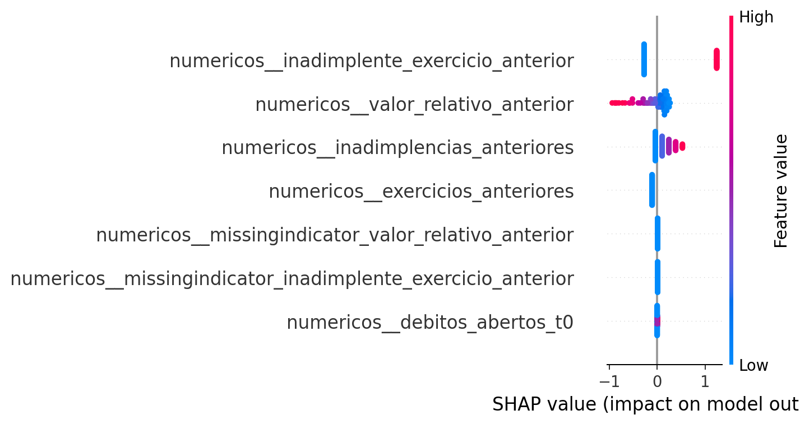

# Model Card — E1: Sistema de Inteligência Tributária (`sprint4-v1`)

**Universidade Federal do Tocantins (UFT) — BIINAR — Eixo II — Projeto Integrador (2026/2)**  
**Equipe:** Grupo 1 | **Padrão de Referência:** Mitchell et al. (2019), *Model Cards for Model Reporting*  
**Versão Consolidada em `/docs`:** 1.1 — 25/11/2026 (Consolidação E4 a partir de [`Model_Card_E1_Versao_Oficial.pdf`](Model_Card_E1_Versao_Oficial.pdf))

> [!NOTE]
> **Leitura Rápida para Cidadãos e Gestores (Camada em Linguagem Simples):** **Este documento apresenta com transparência o que os modelos de Inteligência Artificial do projeto fazem, onde eles erram e quais limites protegem o cidadão.** De modo geral, um *Model Card* funciona como a "bula técnica e ética" de um algoritmo, impedindo que previsões matemáticas sejam usadas fora de sua finalidade segura. Especificamente neste projeto acadêmico da UFT, todos os imóveis e dívidas analisados são **simulados (sintéticos)**: o modelo **M1** estima o risco de atraso no vencimento apenas para apoiar avisos educativos sob supervisão de servidores públicos, enquanto o modelo **M2** não obteve precisão útil e **não deve ser usado para ordenar contribuintes**. Além disso, imóveis enquadrados no **IPTU Social** (idosos, aposentados, pensionistas e pessoas com deficiência de baixa renda) são **bloqueados por duas travas no código** para jamais sofrerem cobrança preditiva.

---

## 1. Identificação e Detalhes do Modelo

**O pacote `sprint4-v1` reúne dois modelos estatísticos independentes projetados para responder a perguntas distintas do ciclo administrativo tributário.** Na engenharia de aprendizado de máquina, separar tarefas com populações, instantes de observação e horizontes temporais diferentes evita erros metodológicos graves — como confundir a probabilidade de atraso no vencimento com o inverso da probabilidade de quitação de uma dívida já inscrita. No escopo específico do **Sistema de Inteligência Tributária (Opção D — Sefin Palmas)**, o pacote oficial `sprint4-v1` (treinado em Python `3.14.7` e `scikit-learn 1.9.1`, semente `20261107`, protocolo `1.0.0`) encapsula dois pipelines com imputação pela mediana do treino, indicadores binários de ausência, padronização e regressão logística, verificados criptograficamente por somas **SHA-256** ([`metadata_sprint4_v1.json`](dados_auditoria/metadata_sprint4_v1.json)). Cumpre ressaltar que o repositório da equipe registra em separado um experimento exploratório denominado Base Vetorial (`vetorial-v1`), cujos resultados permanecem isolados e não se misturam com as métricas oficiais deste cartão.

| Atributo Técnico | Modelo M1 — Inadimplência no Vencimento | Modelo M2 — Recuperabilidade em 365 Dias |
|---|---|---|
| **Pergunta respondida** | O crédito lançado no exercício ficará sem pagamento até o vencimento (`10/03`)? | O crédito já inscrito em dívida ativa e aberto em $t_0$ será pago integralmente em até `365` dias? |
| **Família e hiperparâmetros** | Regressão Logística (`modelo__C = 10.0`), selecionada pela regra de 1 erro-padrão | Regressão Logística (`modelo__C = 0.1`), selecionada pela regra de 1 erro-padrão |
| **Referência temporal ($t_0$)** | `1º de janeiro` do exercício (premissa explícita da simulação) | Data da fotografia da carteira de dívida ativa aberta |
| **Divisão temporal (sem vazamento)** | Treino: `2021–2023` · Validação: `2024` · Teste congelado: `2025` | Treino: `2022-06-29` e `2023-06-30` · Validação: `2024-07-01` · Teste: `2025-07-31` |
| **Limiar de classificação** | `0,306856` (definido por F1 máximo na validação de 2024) | `0,102281` (definido na validação; **modelo bloqueado para uso individual**) |
| **Arquivo e SHA-256 oficial** | `inadimplencia.joblib` (`5533b49c4e8a...`) | `recuperabilidade.joblib` (`c139f6ca128e...`) |

---

## 2. Uso Pretendido

**Os modelos documentados destinam-se exclusivamente ao apoio analítico interno em ambiente acadêmico e demonstrativo, subordinando qualquer encaminhamento futuro à decisão humana fundamentada.** No contexto geral da Administração Pública, ferramentas preditivas podem auxiliar o planejamento institucional desde que não usurpem a competência legal do agente público nem suprimam o devido processo administrativo (CF/88, arts. 5º, LV, e 37; LGPD, art. 20). Em termos específicos, o **M1** foi concebido para alimentar mapas territoriais agregados de risco e apoiar o desenho de **ações preventivas e educativas** antes do vencimento (como envio de lembretes, orientação sobre calendário fiscal e divulgação de parcelamentos ou isenções). Quanto ao **M2**, embora concebido originalmente para estimar retorno agregado da carteira inscrita, seu desempenho empírico no teste congelado (`ROC-AUC = 0,508`) restringe sua exibição no painel apenas como demonstração transparente de ausência de sinal discriminativo, sem orientar priorização individual. Logo, em nenhuma hipótese as estimativas numéricas deste pacote constituem decisão administrativa definitiva.

---

## 3. Usos Proibidos ou Inadequados

**A utilização dos escores preditivos para medidas coercitivas automáticas, restrição de direitos ou cobrança contra beneficiários do IPTU Social é terminantemente proibida.** Sob os marcos da Ética Digital e da LGPD (arts. 6º, IX, e 20), empregar probabilidades estatísticas fora do seu domínio de validade ou contra populações legalmente protegidas configura desvio de finalidade e ilícito regulatório. Consolidando as diretrizes do documento oficial do E1 com a implementação verificada do entregável **E3** ([`PROTECAO_IPTU_SOCIAL_E3.md`](PROTECAO_IPTU_SOCIAL_E3.md)), ficam expressamente vedados os seguintes usos:

- **Proibição de cobrança sobre o IPTU Social (Integração E3):** o sistema **não pode** ser utilizado para pontuar, priorizar ou direcionar ações de cobrança contra imóveis protegidos pelo **IPTU Social** (**idosos, aposentados, pensionistas e pessoas com deficiência de baixa renda**); essa exclusão é executada fora do modelo por duas travas determinísticas em [`codigo/protecao_iptu_social.py`](../codigo/protecao_iptu_social.py) — `excluir_protegidos()` antes da pontuação e `validar_lista_cobranca()` sobre a lista final — comprovadas por suíte automatizada (`pytest`) que falha imediatamente caso algum protegido apareça;
- **Proibição de sanção ou coerção automática:** é vedado converter escores em inscrição automática em dívida ativa, protesto extrajudicial, ajuizamento de execução fiscal, bloqueio patrimonial ou negativa de certidão sem instrução administrativa própria e revisão humana qualificada;
- **Proibição de uso decisório individual do M2:** é vedado utilizar o escore do M2 para ranquear ou diferenciar contribuintes individualmente enquanto o modelo não superar um preditor constante em validação independente sobre dados reais;
- **Proibição de operação sem saneamento cadastral:** é vedado utilizar previsões geradas sobre registros desatualizados ou sem verificação prévia de pagamentos recentes e pedidos de isenção em andamento.

---

## 4. Fatores e Variáveis Relevantes

**Os contratos de entrada dos modelos M1 e M2 restringem-se estritamente a variáveis históricas de crédito conhecidas até a data de referência $t_0$, excluindo atributos diretos de renda e localização.** De acordo com o princípio da minimização de dados da LGPD (art. 6º, III) e a prevenção contra vazamento temporal, cada modelo aceita exclusivamente uma lista fechada de colunas numéricas (`float64`) na ordem definida em [`feature_contract_sprint4_v1.json`](dados_auditoria/feature_contract_sprint4_v1.json), recusando colunas extras ou identificadores. Durante a curadoria do **E4**, as fórmulas exatas das variáveis relativas pendentes de confirmação na versão preliminar foram verificadas diretamente no código-fonte da Sprint 4 (`SPRINT-4/E1/codigo/dados.py`, linhas 100–113 e 146–158). As duas tabelas a seguir descrevem cada atributo em linguagem acessível e especificam sua regra exata de cálculo.

### 4.1 Variáveis de Entrada do M1 — Inadimplência (`5` atributos)

| Variável no Contrato | Explicação em Linguagem Simples | Regra Técnica Confirmada em `dados.py` (apenas eventos vencidos `< t0`) |
|---|---|---|
| `inadimplente_exercicio_anterior` | Indica se o imóvel ficou sem pagamento até o vencimento no ano anterior (`0` = não, `1` = sim; ausente no 1º ano observado). | Valor de `inadimplente` do mesmo `id_imovel` em `exercicio - 1` (imputado pela mediana do treino com indicador de ausência quando inexistente). |
| `inadimplencias_anteriores` | Quantidade acumulada de anos anteriores em que houve atraso no vencimento. | Soma de `inadimplente` nos créditos do imóvel com `data_vencimento < t0`. |
| `exercicios_anteriores` | Quantidade de anos anteriores registrados para aquele imóvel no histórico. | Contagem de exercícios do imóvel com `data_vencimento < t0`. |
| `debitos_abertos_t0` | Quantidade de débitos de anos anteriores que ainda permaneciam sem pagamento na data $t_0$. | Soma dos créditos anteriores do imóvel sem pagamento conhecido até $t_0$ (`data_pagamento` nula ou `> t0`). |
| `valor_relativo_anterior` | Tamanho relativo do IPTU do imóvel no ano anterior comparado ao imóvel mediano da cidade. | Razão `valor_principal_centavos(exercício - 1) / mediana_municipal(valor_principal_centavos em exercício - 1 antes de t0)`. |

### 4.2 Variáveis de Entrada do M2 — Recuperabilidade (`6` atributos)

| Variável no Contrato | Explicação em Linguagem Simples | Regra Técnica Confirmada em `dados.py` (carteira inscrita e aberta em `t0`) |
|---|---|---|
| `idade_divida_dias` | Tempo decorrido, em dias, desde o vencimento original do tributo até a data de análise. | Diferença `(t0 - data_vencimento).days`. |
| `dias_desde_inscricao` | Tempo decorrido, em dias, desde a inscrição formal do débito em dívida ativa. | Diferença `(t0 - data_inscricao).days`. |
| `valor_relativo_credito` | Tamanho relativo do débito inscrito em comparação com a mediana dos lançamentos daquele exercício. | Razão `valor_principal_centavos / mediana_municipal(valor_principal_centavos do respectivo exercício)`. |
| `creditos_inscritos_abertos_imovel` | Total de débitos inscritos em dívida ativa e simultaneamente abertos para o mesmo imóvel em $t_0$. | Contagem de créditos na carteira aberta agrupada por `id_imovel`. |
| `inadimplencias_imovel_t0` | Histórico acumulado de vencimentos não pagos daquele imóvel antes de $t_0$. | Soma histórica de `inadimplente` do imóvel para `data_vencimento < t0`. |
| `inadimplente_ultimo_exercicio` | Indica se o lançamento mais recente já vencido do imóvel teve atraso. | Valor de `inadimplente` no último crédito vencido antes de $t_0$. |

> **Distinção entre variáveis preditoras e variáveis de auditoria:** `renda_media`, `quintil_renda`, `cd_setor` e `regiao` **não integram** os contratos preditivos do M1 nem do M2 em `sprint4-v1`; elas são retidas separadamente apenas para auditar equidade por subgrupo na Sprint 5. Todavia, `valor_relativo_anterior` e `valor_relativo_credito` correlacionam-se fortemente com a renda censitária (`elasticidade_valor_renda = 1.0`), atuando como variáveis *proxy*.

---

## 5. Dados de Treinamento, Origem Sintética e Sub-Representações

**A base analítica combina agregados territoriais públicos e oficiais de Palmas com registros individuais integralmente simulados, exigindo cautela estrita quanto à representatividade e à generalização externa.** Em experimentos acadêmicos sobre finanças públicas, a geração sintética ancorada em dados censitários reais permite validar pipelines completos sem violar o sigilo fiscal (CTN, art. 198) nem tratar dados pessoais de munícipes reais. Especificamente neste projeto, a simulação da Sprint 3 (`assinatura e66099c7d0c8`, semente `20261027`, taxa-alvo base de inadimplência `33%`) gerou `556.260` créditos distribuídos em `111.252` imóveis nos exercícios de `2021` a `2025` sobre a malha do Censo Demográfico 2022 (IBGE) e do GeoPalmas ([`metadata_sprint4_v1.json`](dados_auditoria/metadata_sprint4_v1.json)). Apesar do grande volume numérico, a auditoria de representatividade identificou lacunas territoriais importantes — como os `23` setores censitários sem renda divulgada por regra de sigilo estatístico do IBGE e os `5,8%` de domicílios fora da cobertura de quadras do GeoPalmas (que originam a categoria `SEM_QUADRA`) — sistematizadas na tabela abaixo.

| Dimensão da Base Auditada | Valor Verificado nos Artefatos Oficiais | Impacto sobre Representatividade e Governança |
|---|---|---|
| **Imóveis simulados (`origem_dado = 'SINTETICO'`)** | `111.252` imóveis | Não correspondem a pessoas naturais reais; impedem uso operacional direto sem retreino em base real autorizada. |
| **Créditos simulados (2021–2025)** | `556.260` créditos (`111.252 × 5` exercícios) | No teste congelado de 2025, a prevalência observada do M1 foi de `36,71%` (`40.838` positivos). |
| **Setores censitários (IBGE Censo 2022)** | `733` setores em Palmas (`635` polígonos ativos no lote do painel) | Setores com menos de `10` imóveis sofrem supressão visual no mapa para prevenir reidentificação territorial. |
| **Setores sem informação de renda** | `23` setores censitários | Omissão legítima por sigilo estatístico do IBGE; requer atenção contra viés de representação em áreas rurais ou pouco adensadas. |
| **Cobertura de quadras (GeoPalmas)** | `94,2%` dos domicílios (`5.078` créditos no teste em `SEM_QUADRA`) | A categoria `SEM_QUADRA` reflete lacuna cartográfica/cadastral e exibe FPR elevada (`36,55%`), exigindo saneamento administrativo. |
| **Camada sintética do IPTU Social (E3)** | `31.089` imóveis protegidos (`27,94%`, semente `20261125`) | Premissa simulada apartada (`14%` idosos, `10%` aposentados, `4%` pensionistas, `3%` PcD baixa renda) para testar o bloqueio. |

---

## 6. Métricas e Resultados Gerais no Conjunto de Teste Congelado

**Os resultados globais no conjunto de teste congelado demonstram capacidade discriminativa moderada no modelo M1 e ausência completa de ganho preditivo útil no modelo M2.** Na avaliação rigorosa de classificadores probabilísticos, métricas de limiar fixo (acurácia, precisão, recall e F1) devem ser lidas em conjunto com métricas de ordenação e calibração (*Average Precision*, ROC-AUC e escore de Brier) confrontadas com um preditor trivial (*Dummy*) ([`metrics_sprint4_v1.json`](dados_auditoria/metrics_sprint4_v1.json)). No teste de `2025` do **M1** ($n = 111.252$, prevalência `36,71%`), a regressão logística alcançou `ROC-AUC = 0,741`, `AP = 0,606` (contra `0,367` do preditor constante) e redução de `19,1%` no erro quadrático de probabilidade (Brier `0,1909` contra `0,2359`). Em contrapartida, no teste de `2025-07-31` do **M2** ($n = 64.017$, prevalência `11,85%`), o modelo obteve `ROC-AUC = 0,508` e `Brier = 0,104446` (virtualmente idêntico ao constante `0,104451`), porque a simulação da Sprint 3 aplicou probabilidade anual uniforme de recuperação (`12%`) a toda dívida inscrita. Assim, o recall aparente de `99,4%` do M2 decorre apenas de classificar `99,3%` da carteira como positiva (`56.032` falsos positivos), confirmando sua inaptidão operacional.

| Métrica no Teste Congelado | M1 — Inadimplência (`n = 111.252`) | Referência Constante M1 | M2 — Recuperabilidade (`n = 64.017`) | Referência Constante M2 |
|---|---:|---:|---:|---:|
| **Acurácia** | `71,11%` | `63,29%` | `12,40%` | `88,15%` (classe majoritária) |
| **Precisão (PPV)** | `59,94%` | `36,71%` | `11,86%` | `11,85%` |
| **Recall (Sensibilidade / TPR)** | `64,25%` | `100,00%` (trivial) | `99,38%` | `100,00%` (trivial) |
| **F1-Score** | `0,6202` | `0,5370` | `0,2119` | `0,2119` |
| **Average Precision (AP)** | `0,6061` [IC95%: `0,601–0,611`] | `0,3671` | `0,1225` | `0,1185` |
| **ROC-AUC** | `0,7406` | `0,5000` | `0,5079` | `0,5000` |
| **Escore de Brier (menor é melhor)** | `0,1909` (ganho de `19,1%`) | `0,2359` | `0,104446` (ganho `0,00%`) | `0,104451` |
| **Matriz de Confusão `[[VN, FP], [FN, VP]]`** | `[[52.879, 17.535], [14.601, 26.237]]` | — | `[[400, 56.032], [47, 7.538]]` | — |

### Leitura Operacional da Troca de Limiar (M1) e das Faixas de Recuperabilidade (M2)

**A tradução das métricas estatísticas em contagens concretas de casos esclarece para a administração fazendária o custo real de cada decisão técnica.** Conforme recomendado nas boas práticas de comunicação para gestores públicos, variações decimais de F1 só ganham sentido administrativo quando expressas no volume de contribuintes impactados: na validação de 2024 do **M1**, a redução do limiar padrão (`0,50`) para o limiar ótimo (`0,306856`) permitiu identificar **`+1.150` créditos inadimplentes adicionais** (`FN` caiu de `16.352` para `15.202`), ao custo de gerar **`+1.967` alarmes falsos adicionais** (`FP` subiu de `13.868` para `15.835`), troca aceitável exclusivamente para ações educativas de baixo impacto. Por sua vez, a avaliação do **M2** nas três faixas operacionais exigidas pelo protocolo (`Baixa < 0,33`; `Média 0,33–0,66`; `Alta ≥ 0,66`) demonstra que **`100%` dos créditos do teste (`64.017`) e `100%` dos devedores do lote (`52.510`) concentram-se na Faixa Baixa** (probabilidade média prevista de `11,74%` contra taxa observada de `11,85%`), com **zero registros** nas faixas Média e Alta.

---

## 7. Avaliação por Subgrupos e Análise de Equidade (*Fairness*)

**A desagregação das métricas de desempenho por quintil de renda censitária e por região geográfica evidencia disparidades substanciais nas taxas de seleção positiva, sensibilidade e falsos positivos do modelo M1.** Conforme verificado nos parâmetros de simulação de [`metadata_sprint4_v1.json`](dados_auditoria/metadata_sprint4_v1.json) (`beta_renda = -0.5`), o código **`Q1` identifica o menor quintil de renda censitária** e **`Q5` o maior quintil de renda**. Aplicando os testes formais de **paridade demográfica** (taxa prevista positiva), **igualdade de oportunidade** ($\text{TPR}$/recall) e **taxa de falsos positivos** ($\text{FPR}$), acompanhados dos intervalos de confiança de 95% de Wilson calculados em [`codigo/auditoria_fairness_e4.py`](../codigo/auditoria_fairness_e4.py), observa-se que o M1 sinaliza `3,96 vezes` mais imóveis em `Q1` (`59,86%`) do que em `Q5` (`15,13%`) e comete `4,01 vezes` mais falsos positivos sobre adimplentes de menor renda (`42,86%` contra `10,69%`). No modelo **M2**, todos os quintis e regiões exibem taxas de falsos positivos entre `93,63%` e `99,95%` e `ROC-AUC` em torno de `0,50`, confirmando que ele marca quase toda a carteira indistintamente.

### 7.1 Métricas Desagregadas do M1 por Quintil de Renda (`n = 111.252`)

| Quintil de Renda (Censo 2022) | $n$ | Prevalência Real | Paridade Demográfica (Taxa Positiva) | Igualdade de Oportunidade (Recall / TPR) | Taxa de Falsos Positivos (FPR) | Precisão | ROC-AUC |
|---|---:|---:|---:|---:|---:|---:|---:|
| **Q1 — Menor renda** | `24.866` | `52,93%` | `59,86%` [59,25–60,46%] | `74,97%` [74,23–75,70%] | **`42,86%`** [41,97–43,76%] | `66,29%` | `0,698` |
| **Q2** | `25.459` | `45,15%` | `48,60%` [47,98–49,21%] | `67,01%` [66,15–67,87%] | **`33,44%`** [32,66–34,22%] | `62,26%` | `0,690` |
| **Q3** | `21.673` | `35,67%` | `37,85%` [37,21–38,50%] | `60,56%` [59,47–61,65%] | **`25,25%`** [24,54–25,98%] | `57,08%` | `0,690` |
| **Q4** | `19.940` | `26,75%` | `27,03%` [26,42–27,65%] | `52,36%` [51,02–53,70%] | **`17,78%`** [17,17–18,41%] | `51,82%` | `0,681` |
| **Q5 — Maior renda** | `19.314` | `16,14%` | `15,13%` [14,64–15,65%] | `38,24%` [36,55–39,96%] | **`10,69%`** [10,22–11,17%] | `40,78%` | `0,657` |
| **Amplitude (`Q1 − Q5`) / Regra 4/5** | — | `+36,79 p.p.` | **`+44,72 p.p.`** (`Q5/Q1 = 0,253`) | **`+36,73 p.p.`** | **`+32,17 p.p.`** (`4,01×`) | `+25,51 p.p.` | `+0,041` |

### 7.2 Métricas Desagregadas do M1 por Região de Palmas e Categoria Cadastral

| Região / Categoria | $n$ | Prevalência Real | Taxa Prevista Positiva | Recall / TPR | Taxa de Falsos Positivos (FPR) | Precisão | ROC-AUC |
|---|---:|---:|---:|---:|---:|---:|---:|
| **SUL** | `38.958` | `46,95%` | `52,06%` | `70,11%` | `36,10%` | `63,22%` | `0,700` |
| **NOROESTE** | `13.552` | `39,36%` | `41,69%` | `63,82%` | `27,33%` | `60,25%` | `0,709` |
| **NORTE** | `1.077` | `38,16%` | `40,11%` | `64,23%` | `25,23%` | `61,11%` | `0,766` |
| **SUDESTE** | `27.122` | `29,68%` | `30,53%` | `56,35%` | `19,63%` | `54,78%` | `0,721` |
| **NORDESTE** | `10.737` | `26,06%` | `27,88%` | `57,65%` | `17,38%` | `53,89%` | `0,747` |
| **SUDOESTE** | `14.728` | `22,70%` | `22,06%` | `48,28%` | `14,36%` | `49,68%` | `0,698` |
| **`SEM_QUADRA` (lacuna cadastral)** | `5.078` | `51,46%` | `56,81%` | `75,93%` | `36,55%` | `68,77%` | `0,731` |

---

## 8. Análise de Vieses e Riscos Identificados

**Os riscos éticos mapeados no sistema decorrem da combinação entre reprodução de padrões históricos, codificação indireta de renda por variáveis *proxy*, lacunas de cobertura espacial e assimetria de prevalências.** Em auditoria sociotécnica, encontrar e discutir um viés com rigor analítico protege a Administração contra implantações danosas, ao passo que ocultá-lo inviabiliza a governança responsável. De maneira específica, a consolidação deste Model Card destaca seis vetores de risco devidamente medidos:

1. **Viés histórico e rigidez comportamental:** como o M1 depende fortemente do histórico passado (`inadimplente_exercicio_anterior` e `inadimplencias_anteriores`), o modelo tende a perpetuar a marca de risco sobre contribuintes que já regularizaram sua capacidade financeira atual.
2. **Defasagem temporal cadastral:** compensações bancárias em trânsito, processos administrativos de revisão de lançamento ou pedidos recentes de isenção não refletidos em $t_0$ geram falsos positivos injustos se não houver conferência humana prévia.
3. **Variáveis *proxy* e discriminação indireta:** embora renda e CEP/setor estejam fora do modelo, `valor_relativo_anterior` e o próprio histórico de atraso espelham a desigualdade socioeconômica territorial (BAROCAS; SELBST, 2016; PEDRESCHI et al., 2008).
4. **Assimetria inevitável de falsos positivos (Identidade de Chouldechova):** devido à diferença acentuada de prevalência entre `Q1` (`52,93%`) e `Q5` (`16,14%`), o limiar único impõe `42,86%` de falsos positivos aos contribuintes adimplentes de `Q1` (CHOULDECHOVA, 2017), tornando inaceitável qualquer sanção automática.
5. **Sub-representação e qualidade cadastral (`SEM_QUADRA` e sigilo censitário):** os `5.078` registros sem associação a quadras do GeoPalmas concentram `36,55%` de falsos positivos, demonstrando que falhas de georreferenciamento degradam a equidade territorial.
6. **Inaptidão discriminativa do M2:** utilizar o M2 atual induziria decisões arbitrárias sob aparência de objetividade matemática (`ROC-AUC = 0,508`).

---

## 9. Explicabilidade, Transparência e Supervisão Humana

**A interpretabilidade técnica do modelo M1 é assegurada por decomposição linear SHAP auditável, obrigatoriamente complementada por tradução em linguagem cidadã e supervisão humana efetiva.** Confirmando o item pendente na versão preliminar do E1, a equipe executou e documentou em [`codigo/analise_shap_m1.py`](../codigo/analise_shap_m1.py) a técnica **SHAP (*SHapley Additive exPlanations*)** com `LinearExplainer` (SHAP `0.54.1` sobre `scikit-learn 1.9.1`), utilizando `100` registros de referência do treino (`2021–2023`) e explicando `100` registros do teste congelado de `2025`. Na escala de *log-odds* do modelo, os três atributos com maior importância média absoluta foram `inadimplente_exercicio_anterior` (`0,6305`), `valor_relativo_anterior` (`0,2088`) e `inadimplencias_anteriores` (`0,1629`), e o exemplo individual auditado ([`figuras/shap_waterfall_m1.png`](figuras/shap_waterfall_m1.png)) partiu do valor-base `-0,918` até `+1,035` *log-odds* (probabilidade estimada de **`73,8%`**, acima do limiar de `30,69%`). Como valores em *log-odds* não são autoexplicativos para o público leigo, a ponte [`codigo/pipeline_governado_e4.py`](../codigo/pipeline_governado_e4.py) converte essas contribuições em aviso informativo claro e submete toda sinalização à revisão obrigatória de agente público com autonomia para divergir do algoritmo.

---

## 10. Recomendações de Uso, Contestação e Correção de Dados

**A eventual transição futura deste protótipo para o ambiente institucional da Prefeitura de Palmas exige homologação jurídica, canais híbridos de contestação gratuita e rastreabilidade integral de retificações.** Nos termos dos artigos 18, 19, II, 20, 23, 38 e 41 da LGPD, o titular dos dados tem direito inalienável à confirmação do tratamento, à correção imediata de registros incompletos ou desatualizados, à explicação clara dos critérios automatizados e à revisão da sinalização sem barreiras tecnológicas excludentes. Para tanto, estabelecem-se as seguintes salvaguardas operacionais:

1. **Homologação e RIPD prévios:** não empregar os modelos em operação real sem base de dados oficial autorizada, validação temporal prospectiva, Relatório de Impacto à Proteção de Dados Pessoais (RIPD) e designação pública do Encarregado (DPO).
2. **Rito de correção cadastral com recálculo auditável:** sempre que o contribuinte comprovar quitação, erro de lançamento ou enquadramento no IPTU Social, o registro deve ser retificado na base de origem (LGPD, art. 18, III), cancelando imediatamente o alerta, auditando se a falha afetou outros imóveis do mesmo lote e preservando trilha de auditoria.
3. **Atendimento presencial e digital gratuito (Regra de Ouro da Inclusão):** qualquer pedido de explicação, correção ou revisão deve poder ser protocolado presencialmente no balcão da Sefin / Resolve Palmas ou por via digital, sem exigência de aplicativo ou biometria, com resposta fundamentada em até **15 dias** (LGPD, arts. 18, § 5º, e 19, II).
4. **Canal de contestação e acompanhamento neste projeto acadêmico:** questionamentos técnicos, pedidos de esclarecimento ou apontamentos de auditoria sobre este Model Card podem ser registrados diretamente nas *Issues* do repositório oficial da equipe: [`https://github.com/Guilherme-RCM/projeto-integrador-eixoII-GRUPO1-`](https://github.com/Guilherme-RCM/projeto-integrador-eixoII-GRUPO1-).

---

## 11. Registro de Consolidação dos Pontos de Acompanhamento (Revisão E4)

**Todos os oito pontos de acompanhamento listados na versão preliminar em PDF do Model Card foram integralmente conferidos e saneados na revisão final deste portfólio.** Na engenharia documental rigorosa, transformar pendências de verificação em evidências rastreáveis demonstra fechamento efetivo de ciclo entre as frentes da equipe. A tabela abaixo registra o status consolidado de cada item originalmente aberto na Parte 11 de [`Model_Card_E1_Versao_Oficial.pdf`](Model_Card_E1_Versao_Oficial.pdf).

| Aspecto Original do E1 | Verificação Realizada na Consolidação do Portfólio (E4) | Artefato Comprobatório em `/docs` e `/codigo` |
|---|---|---|
| **Versão de referência** | Confirmado `sprint4-v1` como ficha oficial principal, isolado de `vetorial-v1`. | [`dados_auditoria/metadata_sprint4_v1.json`](dados_auditoria/metadata_sprint4_v1.json) |
| **Métricas gerais** | Conferidos todos os valores, matrizes de confusão e intervalos bootstrap no teste congelado. | [`dados_auditoria/metrics_sprint4_v1.json`](dados_auditoria/metrics_sprint4_v1.json) |
| **Subgrupos e testes formais** | Conferidos denominadores, quintis (`Q1 = menor renda`), regiões, Paridade Demográfica, TPR, FPR, Regra dos 4/5 e IC 95% de Wilson. | [`dados_auditoria/auditoria_fairness_e4.csv`](dados_auditoria/auditoria_fairness_e4.csv) e [`RELATORIO_IMPACTO_ALGORITMICO.md`](RELATORIO_IMPACTO_ALGORITMICO.md) |
| **Dados e sub-representações** | Confirmados `111.252` imóveis, `556.260` créditos, `733` setores, `23` sob sigilo e `94,2%` de cobertura GeoPalmas (`5.078` em `SEM_QUADRA`). | Seção 5 deste cartão e [`metadata_sprint4_v1.json`](dados_auditoria/metadata_sprint4_v1.json) |
| **Explicabilidade** | Confirmada execução de `LinearExplainer` (SHAP `0.54.1`) global e individual + tradução cidadã. | [`../codigo/analise_shap_m1.py`](../codigo/analise_shap_m1.py) e [`figuras/shap_summary_m1.png`](figuras/shap_summary_m1.png) |
| **IPTU Social (E3)** | Confirmada dupla trava externa (`31.089` imóveis protegidos excluídos) com `5/5` testes unitários e ponte integrada aprovada. | [`../codigo/protecao_iptu_social.py`](../codigo/protecao_iptu_social.py) e [`PROTECAO_IPTU_SOCIAL_E3.md`](PROTECAO_IPTU_SOCIAL_E3.md) |
| **Contestação** | Canal acadêmico ativo no GitHub oficial e rito presencial gratuito de 15 dias especificado para uso institucional. | Seção 10 deste cartão e [`../codigo/pipeline_governado_e4.py`](../codigo/pipeline_governado_e4.py) |
| **Aprovação e governança** | Definidas responsabilidades de Controlador, Operador, DPO, revisão humana e gatilhos de suspensão. | [`E4_PORTFOLIO_GOVERNANCA_ETICA.md`](E4_PORTFOLIO_GOVERNANCA_ETICA.md) e [`ADRs_SPRINT5.md`](ADRs_SPRINT5.md) |

---

## 12. Referências Utilizadas

- **MITCHELL, Margaret; WU, Simone; ZALDIVAR, Andrew et al.** Model Cards for Model Reporting. *Proceedings of the Conference on Fairness, Accountability, and Transparency (FAT\*)*, p. 220–229, 2019. DOI: `10.1145/3287560.3287596`.
- **GEBRU, Timnit et al.** Datasheets for Datasets. *Communications of the ACM*, v. 64, n. 12, p. 86–92, 2021. DOI: `10.1145/3458723`.
- **LUNDBERG, Scott M.; LEE, Su-In.** A Unified Approach to Interpreting Model Predictions. *Advances in Neural Information Processing Systems (NeurIPS)*, v. 30, 2017. DOI: `10.48550/arXiv.1705.07874`.
- **CHOULDECHOVA, Alexandra.** Fair Prediction with Disparate Impact: A Study of Bias in Recidivism Prediction Instruments. *Big Data*, v. 5, n. 2, p. 153–163, 2017. DOI: `10.1089/big.2016.0047`.
- **Artefatos internos verificados:** [`Model_Card_E1_Versao_Oficial.pdf`](Model_Card_E1_Versao_Oficial.pdf), [`RELATORIO_IMPACTO_ALGORITMICO.md`](RELATORIO_IMPACTO_ALGORITMICO.md), [`PROTECAO_IPTU_SOCIAL_E3.md`](PROTECAO_IPTU_SOCIAL_E3.md), [`metadata_sprint4_v1.json`](dados_auditoria/metadata_sprint4_v1.json), [`feature_contract_sprint4_v1.json`](dados_auditoria/feature_contract_sprint4_v1.json), [`metrics_sprint4_v1.json`](dados_auditoria/metrics_sprint4_v1.json) e [`metricas_subgrupos.csv`](dados_auditoria/metricas_subgrupos.csv).
