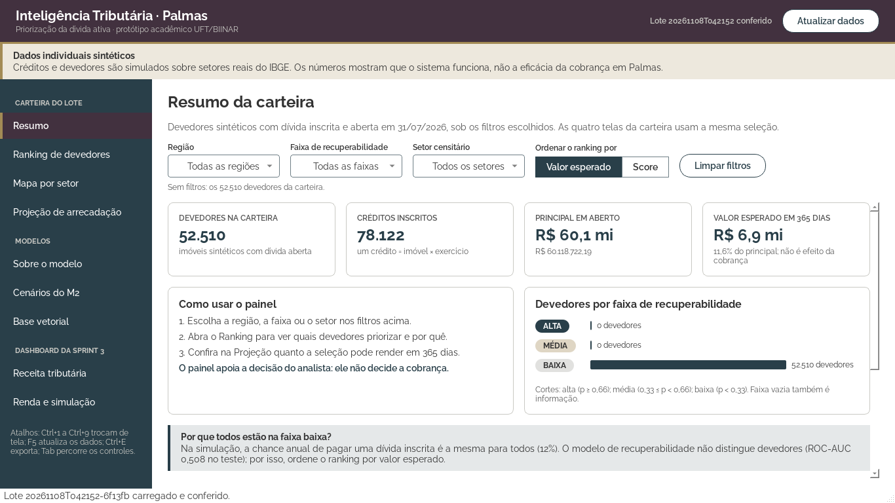
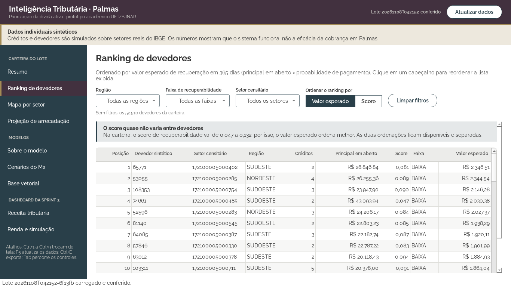
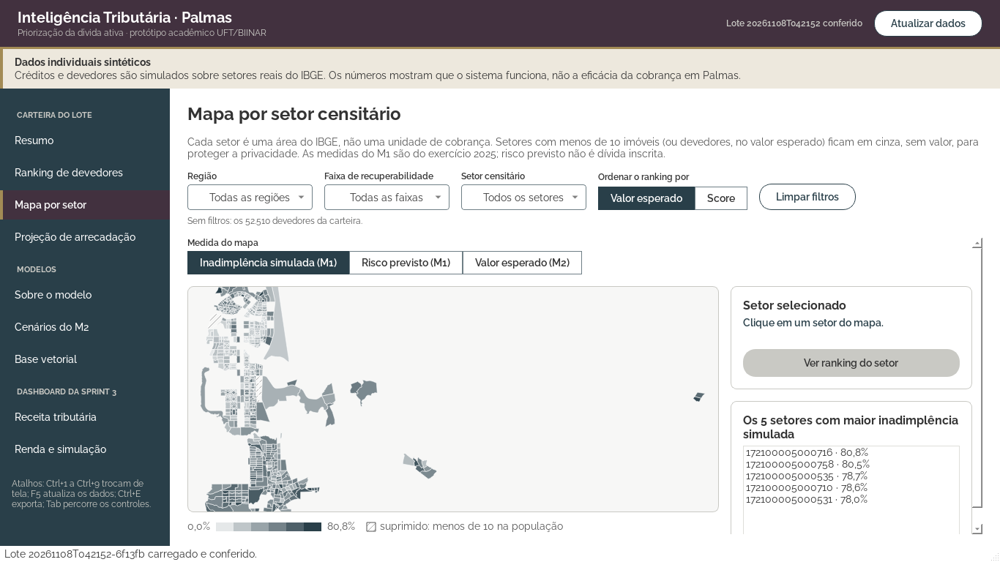
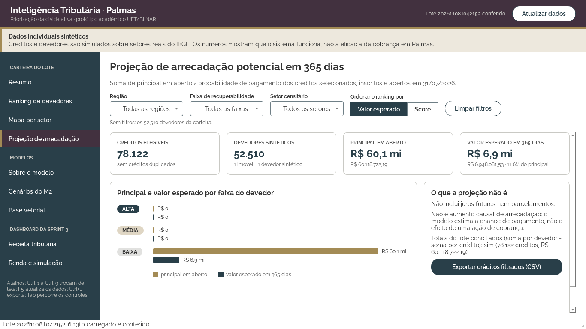
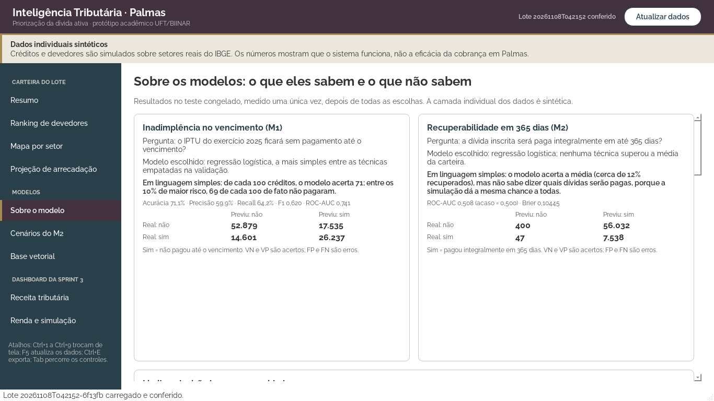

# Componente A — MVP do Sistema de Inteligência Tributária (Consolidado em `/docs`)

**Universidade Federal do Tocantins (UFT) — BIINAR — Eixo II — Projeto Integrador (2026/2)**  
**Equipe:** Grupo 1 | **Componente do Portfólio:** Componente A — MVP Técnico, Pipeline e Interfaces Auditáveis  
**Pacote de Modelos Homologado no Lote:** `sprint4-v1` | **Governança Integrada:** Sprint 5 (E3 + E4)

---

## 1. Visão Sistêmica do MVP: Da Coleta Ética ao Painel Auditável

**O Produto Mínimo Viável (MVP) do Sistema de Inteligência Tributária integra engenharia de dados, modelagem preditiva sem vazamento temporal e interfaces gráficas acessíveis em um único fluxo auditável.** Em sistemas de apoio à decisão fazendária, a confiabilidade operacional exige que nenhuma tela exiba estimativas improvisadas ou desconectadas da base verificada; cada indicador precisa ser rastreável desde a coleta pública até o lote imutável assinado criptograficamente. Especificamente na arquitetura construída pelo Grupo 1 ao longo das Sprints 2 a 5, o fluxo percorre cinco estágios rigorosamente encadeados: (1) coleta ética automatizada de sete fontes oficiais com verificação de `robots.txt`, atraso mínimo de `1 segundo` entre requisições, validação TLS e manifesto `SHA-256`; (2) persistência relacional em MySQL 8.4 modelada na Terceira Forma Normal (3FN) com separação explícita entre receitas reais agregadas e camada operacional sintética (`origem_dado = 'SINTETICO'`); (3) reconstrução de fotografias temporais em $t_0$ e treinamento reprodutível do pacote `sprint4-v1` (**M1** e **M2**); (4) filtragem determinística dos beneficiários do **IPTU Social** e publicação atômica do lote; e (5) visualização somente leitura no **Painel Principal em Qt** (padrão `gov.br DS` e `WCAG 2.2`) e no **Painel Reserva em Streamlit**. Dessa maneira, garante-se coerência matemática exata entre banco, modelos, painéis e relatórios éticos.

---

## 2. Regras de Negócio Compartilhadas, Integridade por SHA-256 e Conciliação em Centavos

**As duas interfaces gráficas do MVP operam exclusivamente em modo de leitura sobre uma camada única de regras de negócio protegida por verificação criptográfica prévia.** Na engenharia de software para o setor público, permitir que uma interface reajuste modelos ou recalcule escores em tempo de interação destruiria a reprodutibilidade e a trilha de auditoria exigidas pelos órgãos de controle. Por esse motivo, tanto a aplicação desktop em Qt (`app/qt`) quanto a aplicação web de contingência em Streamlit (`app/painel_sprint4.py`) consomem exatamente o mesmo módulo `pipeline/ml/painel.py`, que antes de exibir qualquer número confere em sequência: o ponteiro atômico `ativo.json`, o esquema estrutural do `manifesto.json`, o hash `SHA-256` dos sete arquivos do lote e os hashes do pacote `sprint4-v1` — substituindo toda a tela por mensagem clara de bloqueio caso haja qualquer divergência ou adulteração. Na carteira demonstrativa congelada em `31/07/2026` (lote `20261108T042152-6f13fb`), todos os valores monetários são conciliados em centavos inteiros (`concilia: true`), conforme sintetizado na tabela abaixo.

| Indicador Auditado do Lote Demonstrativo (`31/07/2026`) | Valor Verificado | Regra de Integridade e Transparência Aplicada |
|---|---:|---|
| **Devedores sintéticos na carteira** | `52.510` | Premissa explícita de simulação: `1` imóvel tributável = `1` contribuinte sintético (zero dado pessoal). |
| **Créditos inscritos em dívida ativa e abertos** | `78.122` | Conciliação exata entre tabela de créditos (`creditos_m2`) e agregação por devedor (`devedores_m2`). |
| **Principal total em aberto** | `R$ 60.118.722,19` | Aritmética exata em centavos inteiros sem erro de ponto flutuante. |
| **Valor estatístico esperado em 365 dias** | `R$ 6.948.081,53` (`11,56%`) | Soma de `principal × probabilidade M2`; acompanhado do quadro *"O que a projeção não é"* (não mede efeito causal). |
| **Distribuição nas faixas de recuperabilidade (M2)** | Baixa (`< 0,33`): `52.510` · Média: `0` · Alta: `0` | Zero explícito nas faixas Média e Alta, expondo com honestidade a ausência de sinal discriminativo do M2. |
| **Polígonos territoriais no mapa coroplético** | `635` setores com geometria | Supressão visual automática (cinza hachurado) em setores com menos de `10` imóveis para proteção territorial. |
| **Salvaguarda de governança da Sprint 5 (E3 + E4)** | `31.089` imóveis protegidos no cadastro sintético | Dupla trava determinística (`excluir_protegidos` e `validar_lista_cobranca`) + bloqueio de ação punitiva automática. |

---

## 3. Design Centrado no Serviço Público (`gov.br DS`), Acessibilidade WCAG 2.2 e Telas do MVP

**A interface visual do MVP foi projetada previamente no Figma sob os padrões do Governo Digital (`@govbr-ds/core`), assegurando acessibilidade verificada pela norma WCAG 2.2 e avaliação pelas dez heurísticas de Nielsen.** Para evitar que o analista fazendário interprete probabilidades como certezas jurídicas, cinco princípios orientaram o desenho de todas as telas: linguagem simples, aviso permanente de dados sintéticos, primazia da decisão humana (*"o painel apoia a decisão do analista: ele não decide a cobrança"*), operação completa por teclado com foco visível e contraste mínimo auditado automaticamente (`≥ 4,5:1` nos 20 pares de texto e `≥ 3,0:1` nos 8 pares gráficos). Abaixo apresentam-se as cinco telas nucleares da carteira verificada no Painel Principal Qt, preservadas em [`figuras/mvp/`](figuras/mvp/).

### 3.1 Tela 1 — Resumo Executivo da Carteira e Limites Operacionais
**A tela inicial contextualiza os quatro macroindicadores da carteira ao lado do aviso fixo de dados sintéticos e do alerta explícito sobre a limitação do modelo M2.** Antes de permitir qualquer filtragem operacional, a interface apresenta a distribuição real nas três faixas de recuperabilidade (com `0` explícito nas faixas Média e Alta) e instrui o servidor sobre o papel estritamente auxiliar da ferramenta.



### 3.2 Tela 2 — Ranking de Devedores e Inspeção Auditável de Créditos
**A tela de ranqueamento permite ordenar os registros elegíveis por valor esperado ou por escore, abrindo os créditos subjacentes de cada imóvel em um clique para viabilizar a explicação administrativa (Art. 20 da LGPD).** Os filtros superiores (região, faixa e setor) propagam-se de forma sincronizada entre todas as abas da carteira, impedindo leituras contraditórias na exportação operacional.



### 3.3 Tela 3 — Mapa Coroplético Territorial com Supressão de Pequenos Grupos
**A visualização espacial projeta a inadimplência simulada e o risco previsto pelo M1 sobre os 635 setores censitários de Palmas, aplicando hachura de supressão onde há menos de 10 imóveis.** Essa regra de privacidade territorial previne a singularização visual de imóveis isolados em setores pouco habitados e permite transitar diretamente do setor selecionado para a tabela filtrada.



### 3.4 Tela 4 — Projeção Financeira em 365 Dias e Quadro "O Que a Projeção Não É"
**A tela de projeção confronta o principal em aberto com o retorno estatístico esperado em 365 dias e previne interpretações causais equivocadas por meio de quadro explicativo dedicado.** Todo subconjunto filtrado mantém conciliação contábil exata em centavos entre os créditos individuais e o somatório exibido nos cartões.



### 3.5 Tela 5 — Sobre o Modelo: Transparência Técnica e Cidadã na Própria Interface
**A aba institucional incorpora um resumo direto do Model Card dentro do próprio software, expondo matrizes de confusão, comparação com preditores constantes e limites éticos de M1 e M2.** Adicionalmente, o painel completo conta com quatro telas analíticas isoladas do lote (*Cenários do M2*, *Base Vetorial*, *Receita Tributária Real* e *Renda Censitária vs. Simulação*), sempre sinalizadas por tarja própria para evitar confusão entre dados reais agregados e simulações.



---

## 4. Integração com a Camada de Governança da Sprint 5 e Execução

**A revisão da Sprint 5 acopla formalmente as travas éticas e jurídicas do IPTU Social e do Art. 20 da LGPD ao fluxo operacional do MVP por meio da ponte `codigo/pipeline_governado_e4.py`.** Enquanto a árvore completa da Sprint 4 executa as interfaces gráficas sobre o lote congelado, o módulo governado deste portfólio demonstra e testa em tempo real as quatro camadas exigidas pela governança pública: auditoria cadastral com falha fechada, exclusão dos `31.089` imóveis protegidos antes e depois do ranqueamento, bloqueio de uso individual do M2 e geração de notificação explicativa em linguagem cidadã com garantia de atendimento presencial gratuito em até 15 dias. Os comandos abaixo sintetizam a execução tanto da verificação governada neste diretório quanto dos painéis interativos na árvore integrada do repositório da equipe.

```bash
# 1. Neste diretório de Portfólio Revisado (Sprint 5 — Governança, IPTU Social, Fairness e Validador):
python -m pytest -v
python codigo/auditoria_fairness_e4.py
python codigo/verificar_portfolio_e4.py

# 2. Na árvore integrada do repositório da equipe (execução ao vivo dos painéis do MVP):
python -m pip install -c requirements.lock -r requirements-interface.txt
python -m app.qt                        # Interface principal Desktop (Qt / gov.br DS / WCAG 2.2)
streamlit run app/painel_sprint4.py     # Interface web de contingência (Streamlit)
```
