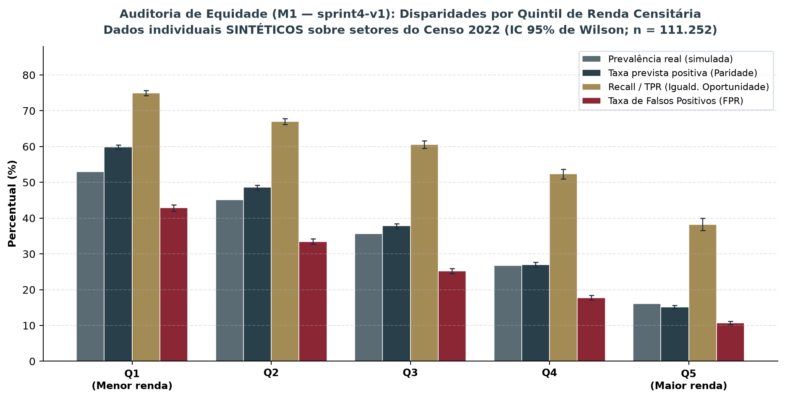
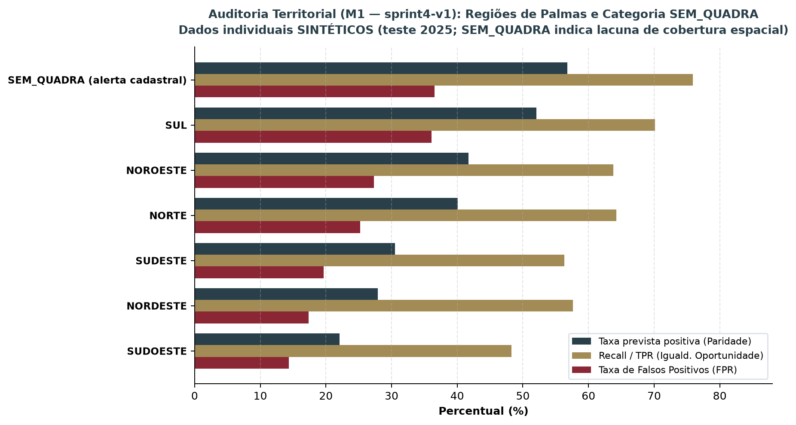
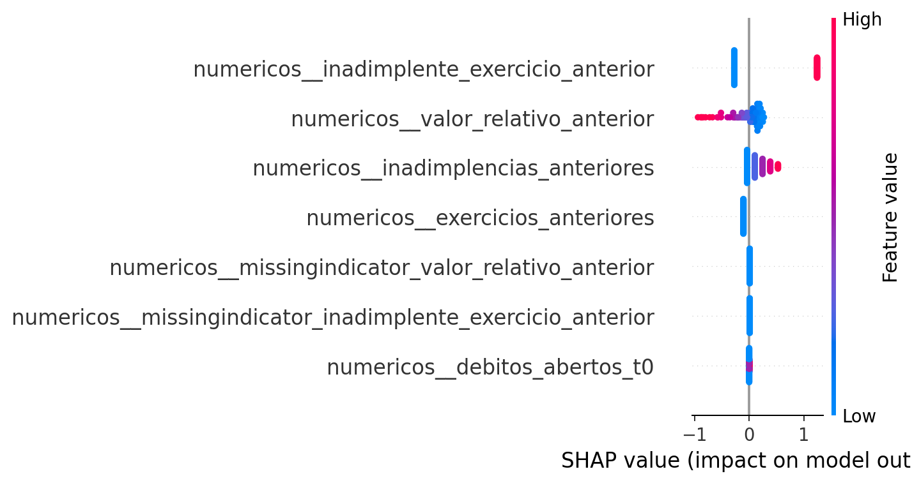
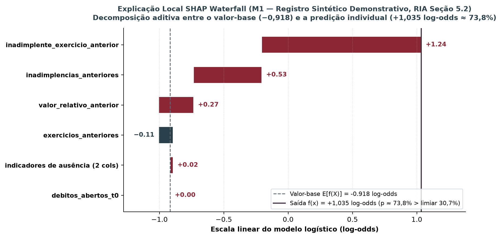

# Relatório de Impacto Algorítmico (RIA) — Sprint 5 / E2

**Projeto Integrador II — BIINAR/UFT — 2026/2 — Grupo 1**  
**Sistema avaliado:** Modelos `M1` (inadimplência no vencimento) e `M2` (recuperabilidade em 365 dias), pacote congelado `sprint4-v1`  
**Base avaliada:** Créditos e imóveis sintéticos, associados a agregados públicos de setores censitários de Palmas/TO (Censo 2022/IBGE e GeoPalmas)  
**Versão revisada em `/docs`:** 1.1 — 25/11/2026 (Quatro seções revisadas + Integração formal do E3 e auditoria estatística E4)

> [!CAUTION]
> **Aviso de Escopo e Vedação Operacional:** **Este relatório avalia um experimento estritamente acadêmico conduzido sobre registros individuais sintéticos.** Em termos regulatórios gerais, métricas obtidas em simulação comprovam o funcionamento lógico do pipeline, mas não atestam validade jurídica, acurácia empírica nem equidade sobre contribuintes reais. Especificamente para a Prefeitura de Palmas, os modelos `M1` e `M2` **não devem ser utilizados** para decidir cobrança automática, inscrição em dívida ativa, protesto, execução fiscal, restrição de direitos ou priorização coercitiva de cidadãos.

---

## 1. Resumo Executivo

**Este Relatório de Impacto Algorítmico (RIA) examina sistematicamente os riscos de privacidade, discriminação indireta, opacidade decisória e impactos sociais associados aos modelos de aprendizado de máquina desenvolvidos para análise tributária de IPTU.** Na governança contemporânea de dados públicos, a avaliação prévia de impacto constitui instrumento preventivo indispensável para confrontar ganhos analíticos com direitos fundamentais antes de qualquer implantação administrativa. No teste congelado de `2025` ($n = 111.252$), o modelo **M1** (ausência de pagamento até o vencimento, limiar `0,3068558` definido na validação de 2024) alcançou *Average Precision* de `0,606`, `ROC-AUC` de `0,741`, escore de Brier de `0,191`, acurácia de `71,1%`, precisão de `59,9%`, recall de `64,2%` e `F1` de `0,620`, mas exibiu diferenças substanciais nas taxas de classificação positiva, sensibilidade e falsos positivos entre quintis de renda e regiões de Palmas. Em contrapartida, o modelo **M2** (pagamento integral de dívida inscrita em 365 dias) obteve `ROC-AUC` de `0,508` e Brier de `0,104446` (praticamente idêntico ao preditor constante `0,104451`), classificando `99,3%` da carteira como positiva e demonstrando ausência de capacidade discriminativa útil para orientar decisões individuais.

**A auditoria de interpretabilidade e as travas programáticas de proteção social demonstram como mecanismos técnicos de transparência e exclusão legal devem ser subordinados à supervisão humana e à conformidade com a LGPD.** Aplicada ao modelo M1 por meio de [`codigo/analise_shap_m1.py`](../codigo/analise_shap_m1.py), a decomposição **SHAP** identificou `inadimplente_exercicio_anterior` como o atributo de maior contribuição média absoluta (`0,630531`), seguido por `valor_relativo_anterior` (`0,208775`) e `inadimplencias_anteriores` (`0,162944`), enquanto o caso individual analisado registrou probabilidade estimada de `73,8%` impulsionada pelo histórico pregresso — evidenciando comportamento estatístico do modelo, e não causalidade nem suficiência jurídica. Paralelamente, a integração com o entregável **E3** ([`codigo/protecao_iptu_social.py`](../codigo/protecao_iptu_social.py)) comprovou por testes automatizados (`pytest`) a exclusão determinística de `31.089` imóveis sintéticos amparados pelo **IPTU Social** (idosos, aposentados, pensionistas e pessoas com deficiência de baixa renda) por meio de travas externas de entrada e saída. Conclui-se executivamente que os artefatos cumprem seu propósito científico de demonstrar métodos e salvaguardas em ambiente acadêmico, mas não autorizam implantação real sem dados lícitos e representativos, base legal formalizada, RIPD (art. 38 da LGPD), revisão humana qualificada, canal presencial gratuito de contestação e monitoramento contínuo de equidade.

---

## 2. Objetivo, Escopo e Metodologia de Auditoria

**O objetivo metodológico deste RIA consiste em mapear todo o ciclo de tratamento de dados e medir empiricamente como as predições afetam diferentes estratos socioeconômicos e territórios de Palmas.** Em consonância com o *NIST AI Risk Management Framework 1.0* (2023) e com as diretrizes nacionais de autoavaliação ética no setor público, auditar um sistema sociotécnico requer cruzar os contratos formais de engenharia com os efeitos distributivos das suas saídas. Especificamente nesta avaliação, foram inspecionados: a ficha técnica e os metadados de [`metadata_sprint4_v1.json`](dados_auditoria/metadata_sprint4_v1.json) e [`feature_contract_sprint4_v1.json`](dados_auditoria/feature_contract_sprint4_v1.json); as métricas globais ([`metrics_sprint4_v1.json`](dados_auditoria/metrics_sprint4_v1.json)) e desagregadas ([`metricas_subgrupos.csv`](dados_auditoria/metricas_subgrupos.csv)); a reconstrução temporal sem vazamento da fotografia de 2025 (`SPRINT-4/E1/codigo/dados.py`); a rotina de interpretabilidade [`codigo/analise_shap_m1.py`](../codigo/analise_shap_m1.py); os cálculos estendidos de intervalos de confiança de Wilson e razão de impacto em [`codigo/auditoria_fairness_e4.py`](../codigo/auditoria_fairness_e4.py); e os módulos de exclusão do IPTU Social ([`codigo/protecao_iptu_social.py`](../codigo/protecao_iptu_social.py)).

**O protocolo experimental auditado respeita separação cronológica estrita sobre uma carteira sintética construída a partir da malha censitária oficial do município.** Na modelagem do **M1**, os exercícios de `2021` a `2023` compuseram o treinamento, `2024` a validação (escolha de hiperparâmetros e limiar) e `2025` o teste congelado, observando cada crédito na premissa temporal $t_0 = \text{1º de janeiro}$ para prever ausência de pagamento até `10 de março`; já o **M2** avaliou fotografias históricas próprias de créditos inscritos em dívida ativa com horizonte de observação de `365` dias. Ao todo, a base analítica abrange `556.260` créditos sintéticos correspondentes a `111.252` imóveis simulados na Sprint 3 (`origem_dado = 'SINTETICO'`), combinados a agregados socioeconômicos públicos de `733` setores censitários do Censo Demográfico 2022 do IBGE e à malha de quadras do GeoPalmas. Dessa forma, garante-se reprodutibilidade integral da auditoria sem exposição de informações fiscais reais.

---

## 3. Seção 1 do Edital — Mapeamento de Dados Pessoais/Sensíveis, Base Legal, Armazenamento e Retenção (LGPD)

### 3.1 Inventário de Dados e Privacidade: Categorias Tratadas

**O inventário informacional do projeto separa rigorosamente identificadores sintéticos de simulação, atributos financeiros simulados e variáveis socioeconômicas agregadas de domínio público.** Nos termos do artigo 5º, incisos I e II, da Lei nº 13.709/2018 (LGPD), a correta qualificação jurídica de cada campo constitui pré-requisito para aferir riscos de reidentificação e definir o regime protetivo aplicável. No experimento examinado, nenhum registro individual refere-se a contribuinte real identificado ou identificável, e a camada adicional do **IPTU Social (E3)** armazena exclusivamente o identificador numérico sintético do imóvel (`id_imovel`) e marcadores binários (`0/1`) gerados por sorteio independente (`SEMENTE = 20261125`). Ainda assim, a tabela a seguir documenta a natureza atual de cada categoria e sua requalificação jurídica imediata caso o sistema viesse a operar sobre cadastros reais da Sefin Palmas.

| Categoria de Dados | Elementos Encontrados no Projeto | Natureza no Experimento Atual | Requalificação em Eventual Operação Real (LGPD) |
|---|---|---|---|
| **Identificadores técnicos** | `id_credito`, `id_imovel` (valores sintéticos `1..111252`) | Rastreabilidade interna da simulação; sem vínculo com CPFs ou inscrições imobiliárias reais. | **Dado pessoal comum (art. 5º, I)** sempre que vinculado direta ou indiretamente a proprietário ou possuidor pessoa natural. |
| **Histórico tributário** | `inadimplente_exercicio_anterior`, `inadimplencias_anteriores`, `exercicios_anteriores`, `debitos_abertos_t0`, `idade_divida_dias`, `dias_desde_inscricao` | Eventos simulados reconstruídos em $t_0$ para predição nos modelos M1 e M2. | **Dado pessoal comum (art. 5º, I)** protegido adicionalmente por **sigilo fiscal (CTN, art. 198)**. |
| **Valores financeiros relativos** | `valor_relativo_anterior` (M1), `valor_relativo_credito` (M2) e `principal_centavos` | Valores sintéticos calibrados pela distribuição agregada municipal. | **Dado pessoal patrimonial (art. 5º, I)** quando associado a imóvel de pessoa física. |
| **Agregados socioeconômicos** | `renda_media`, `quintil_renda` e densidade por setor censitário (IBGE Censo 2022) | Estatísticas públicas agregadas por setor; **não entram no contrato do M1/M2**, servindo à auditoria de equidade. | Agregado estatístico público; contudo, pode operar como *proxy* socioeconômico indireto (art. 6º, IX). |
| **Dados territoriais** | `cd_setor`, `quadra_principal` e `regiao` (`6` regiões + `SEM_QUADRA`) | Agrupamento espacial para mapas (com supressão `< 10` imóveis) e auditoria territorial. | Pode facilitar reidentificação indireta se combinado a vetores granulares em setores pequenos (art. 12). |
| **Elegibilidade ao IPTU Social (E3)** | Indicadores sintéticos em `protegidos_iptu_social.csv` (`idoso`, `aposentado`, `pensionista`, `pcd_baixa_renda`, `protegido_iptu_social`) | Simulação apartada sem dados reais; a trava operacional consome apenas `set[id_imovel]`. | O motivo de isenção por **deficiência constitui dado pessoal sensível (art. 5º, II, e art. 11)**, exigindo segregação estrita para que a cobrança receba apenas o bloqueio binário de inexigibilidade. |

### 3.2 Distinção entre Dados Sintéticos, Dados Pessoais e Risco de Discriminação Indireta

**A inexistência de dados pessoais reais e de atributos sensíveis explícitos na base acadêmica não elimina o dever de auditar riscos de reidentificação futura nem o perigo de discriminação indireta.** Na dogmática contemporânea de proteção de dados, identificadores sintéticos não equivalem a prova de anonimização irreversível (LGPD, art. 12) de um futuro cadastro municipal, pois a combinação de localização geográfica, valor venal relativo e sequência histórica de pagamentos em setores pouco adensados permitiria individualizar imóveis reais. Ademais, mesmo quando dados de renda individual e categorias sensíveis do art. 5º, II (raça, etnia, saúde ou deficiência) estão ausentes do modelo, variáveis patrimoniais e territoriais atuam como substitutos estatísticos (*proxies*) capazes de produzir impactos adversos desproporcionais sobre populações vulneráveis (art. 6º, IX). Por conseguinte, qualquer futura integração com sistemas da Sefin exigiria segregação rigorosa entre a base cadastral de isenções sociais (sob tutela reforçada do art. 11 quando envolver saúde/deficiência) e o fluxo analítico tributário.

### 3.3 Finalidade, Adequação, Necessidade e Minimização (Art. 6º, I, II e III)

**O respeito aos princípios da finalidade, adequação e necessidade exige delimitar estritamente o propósito do modelo e justificar cada variável mantida no contrato preditivo.** Enquanto a finalidade atual restringe-se à pesquisa acadêmica e demonstração metodológica, uma eventual adoção administrativa teria de fixar propósito público específico, legítimo e ostensivamente informado — como orientar campanhas educativas pré-vencimento —, vedando o desvio de finalidade (*function creep*) para restrições automáticas de direitos. Sob a regra de minimização (art. 6º, III), o contrato do **M1** limita-se a cinco variáveis estritamente históricas e o do **M2** a seis variáveis de carteira aberta, mantendo `renda_media`, `quintil_renda`, `cd_setor` e `regiao` fora da matriz preditora, ao passo que a trava do **IPTU Social (E3)** recebe apenas o conjunto numérico de `id_imovel` protegidos sem expor se o titular é idoso ou pessoa com deficiência. Ainda assim, como `valor_relativo_anterior` reflete indiretamente o padrão socioeconômico do território, a minimização de colunas deve ser acompanhada por controles permanentes sobre o uso da saída.

### 3.4 Hipóteses Legais Aplicáveis ao Poder Público (Arts. 7º, 11 e 23 da LGPD)

**A definição da base legal para eventual operação real compete institucionalmente ao Poder Público controlador, observando o regime estrito dos artigos 7º, 11 e 23 da LGPD.** Como o presente experimento processa apenas registros sintéticos e estatísticas públicas do IBGE, ele não depende nem constitui prova prévia de autorização para tratar cadastros fiscais reais. Caso a Prefeitura de Palmas decida homologar ferramenta análoga sobre dados reais de contribuintes, o enquadramento jurídico deverá ser formalizado pela Sefin (Controladora, art. 5º, VI) em conjunto com a Procuradoria Municipal e o Encarregado pelo Tratamento de Dados (art. 41), descartando-se o consentimento (art. 7º, I) em razão da compulsoriedade tributária (BIONI, 2021). As hipóteses juridicamente pertinentes a examinar são o **cumprimento de obrigação legal ou regulatória pelo controlador** (art. 7º, II, c/c Código Tributário Nacional e LC Municipal nº 285/2013) e o **tratamento e uso compartilhado necessários à execução de políticas públicas previstas em leis e regulamentos** (art. 7º, III, c/c arts. 23 e 26), aplicando-se o **art. 11, II, "a" ou "b"**, exclusivamente na camada cadastral segregada que afere isenção de pessoa com deficiência para fins de proteção do IPTU Social.

### 3.5 Armazenamento, Segurança da Informação e Política de Retenção (Arts. 15, 16 e 46)

**A governança do armazenamento e do descarte deve impedir tanto a exposição indevida de registros individualizados quanto a retenção perpétua desvinculada de finalidade legal.** No escopo acadêmico atual, o repositório público versiona apenas código-fonte, documentação e tabelas sintéticas ou agregadas autorizadas, submetidas à varredura automatizada contra padrões de CPF, CNPJ e credenciais ([`codigo/verificar_portfolio_e4.py`](../codigo/verificar_portfolio_e4.py)). Antes de qualquer operação administrativa real sobre dados pessoais, a instituição deverá implantar plano formal de segurança e temporalidade contemplando, no mínimo:

- **Infraestrutura soberana e controle de acesso (art. 46):** hospedagem em ambiente institucional controlado pela Administração (*on-premise* ou nuvem governamental auditada), autenticação forte, controle de acesso baseado em função (*RBAC*) e registro imutável de logs de consulta e inferência (art. 37);
- **Segregação e criptografia:** separação física e lógica entre identificadores civis diretos (nome, CPF, endereço) e matrizes analíticas pseudonimizadas — recordando que pseudonimização não equivale a anonimização (art. 13, § 3º) — com criptografia em repouso e em trânsito (TLS) e verificação de integridade por SHA-256;
- **Tabela de temporalidade e expurgo (arts. 15 e 16):** vinculação estrita do prazo de guarda dos escores e lotes analíticos ao ciclo administrativo da respectiva competência tributária e aos prazos prescricionais/decadenciais do CTN (art. 174 — 5 anos) e de controle externo (TCE-TO), seguida de eliminação segura ou anonimização comprovada ao término da finalidade;
- **Vedação absoluta de publicação externa:** proibição expressa de enviar dados reais, chaves de pseudonimização (`PSEUDONIMO_SAL`), logs individuais ou explicações que revelem dados de terceiros a repositórios externos como o GitHub.

---

## 4. Seção 2 do Edital — Análise de *Fairness* (Equidade Algorítmica), Discussão dos Vieses e Mitigação

### 4.1 Critérios Formais de Equidade e Rigor Estatístico Adotados

**A auditoria de justiça algorítmica aplica múltiplos critérios complementares de equidade de grupo acompanhados de intervalos de confiança e verificação algébrica de impossibilidade.** Na literatura especializada (VERMA; RUBIN, 2018; MITCHELL et al., 2021; MEHRABI et al., 2022), nenhuma métrica isolada captura todas as dimensões morais e jurídicas da não discriminação (LGPD, art. 6º, IX), pois um modelo pode exibir precisão semelhante entre grupos e ainda assim concentrar falsos positivos ou falsos negativos em populações vulneráveis. Por esse motivo, avaliaram-se formalmente sobre o teste congelado de `2025` os dois testes exigidos pelo edital — **Paridade Demográfica** (diferença e razão entre as taxas de classificação positiva $P(\hat{Y}=1 \mid G=g)$, aferida também pela regra prática dos quatro quintos de FELDMAN et al., 2015) e **Igualdade de Oportunidade** (diferença entre as taxas de verdadeiros positivos $\text{TPR} = P(\hat{Y}=1 \mid Y=1, G=g)$, de HARDT et al., 2016) — acrescidos da **Taxa de Falsos Positivos** ($\text{FPR} = P(\hat{Y}=1 \mid Y=0, G=g)$), da **Prevalência Real** ($p_g$), dos **Intervalos de Confiança de 95% de Wilson** (BROWN et al., 2001) e da verificação exata da **Identidade de Chouldechova (2017)** ([`dados_auditoria/auditoria_fairness_e4.csv`](dados_auditoria/auditoria_fairness_e4.csv)).

### 4.2 Resultados do M1 por Quintil de Renda Censitária

**O modelo M1 apresenta gradiente monotônico e estatisticamente significativo de seleção positiva, recall e falsos positivos em desfavor dos setores censitários de menor renda.** A conferência documental realizada nos parâmetros do gerador oficial ([`metadata_sprint4_v1.json`](dados_auditoria/metadata_sprint4_v1.json): `beta_renda = -0.5` e `elasticidade_valor_renda = 1.0`) confirma que o código **`1` (`Q1`) representa o quintil de menor renda média do responsável pelo domicílio** (onde a simulação impôs maior vulnerabilidade ao atraso: prevalência `52,93%`) e o código **`5` (`Q5`) representa o quintil de maior renda** (prevalência `16,14%`). Conforme detalhado na tabela e na figura abaixo, a diferença de **paridade demográfica** entre `Q1` e `Q5` atinge **`44,72 pontos percentuais`** (`59,86%` contra `15,13%`; razão de exposição de **`3,96×`** e razão dos quatro quintos `Q5/Q1 = 0,253 < 0,80`); a diferença de **igualdade de oportunidade ($\text{TPR}$)** é de **`36,73 p.p.`** (`74,97%` contra `38,24%`); e a diferença na **taxa de falsos positivos ($\text{FPR}$)** alcança **`32,17 p.p.`** (`42,86%` contra `10,69%`, isto é, **`4,01×`** mais alarmes falsos sobre contribuintes pontuais residentes em setores de menor renda).

| Quintil de Renda (`M1`, 2025) | $n$ | Prevalência ($p_g$) | Taxa Prevista Positiva [IC 95% Wilson] | Precisão ($\text{PPV}$) | Recall / TPR [IC 95% Wilson] | FPR [IC 95% Wilson] | FPR Chouldechova |
|---|---:|---:|---:|---:|---:|---:|---:|
| **1 (Menor renda)** | `24.866` | `52,93%` | `59,86%` [59,25%; 60,46%] | `66,29%` | `74,97%` [74,23%; 75,70%] | `42,86%` [41,97%; 43,76%] | `42,86%` |
| **2** | `25.459` | `45,15%` | `48,60%` [47,98%; 49,21%] | `62,26%` | `67,01%` [66,15%; 67,87%] | `33,44%` [32,66%; 34,22%] | `33,44%` |
| **3** | `21.673` | `35,67%` | `37,85%` [37,21%; 38,50%] | `57,08%` | `60,56%` [59,47%; 61,65%] | `25,25%` [24,54%; 25,98%] | `25,25%` |
| **4** | `19.940` | `26,75%` | `27,03%` [26,42%; 27,65%] | `51,82%` | `52,36%` [51,02%; 53,70%] | `17,78%` [17,17%; 18,41%] | `17,78%` |
| **5 (Maior renda)** | `19.314` | `16,14%` | `15,13%` [14,64%; 15,65%] | `40,78%` | `38,24%` [36,55%; 39,96%] | `10,69%` [10,22%; 11,17%] | `10,69%` |

### 4.3 Resultados do M1 por Região Geográfica e Categoria Cadastral

**A auditoria espacial confirma variações expressivas entre as macrorregiões urbanas de Palmas e expõe um alerta crítico de qualidade de dados na categoria `SEM_QUADRA`.** Entre as seis regiões administrativas mapeadas pelo GeoPalmas, a taxa de classificação positiva varia de `22,06%` na região **SUDOESTE** a `52,06%` na região **SUL** — amplitude de **`30,00 p.p.`** e razão dos quatro quintos de `0,424 < 0,80` —, enquanto a taxa de falsos positivos oscila de `14,36%` (`SUDOESTE`) a `36,10%` (`SUL`, diferença de **`21,74 p.p.`**) e o recall varia de `48,28%` a `70,11%`. Paralelamente, os `5.078` créditos enquadrados em **`SEM_QUADRA`** — que não representam uma região geográfica, mas a ausência de associação cartográfica com quadras oficiais — concentram a maior taxa prevista positiva (`56,81%`) e a maior taxa de falsos positivos (`36,55%`) de toda a tabela. Esse achado comprova que lacunas de cobertura cadastral (Pilar 2 da Governança Pública) convertem-se diretamente em maior exposição a erros algorítmicos caso não sejam tratadas antes do uso.

| Região / Categoria (`M1`, 2025) | $n$ | Prevalência | Taxa Prevista Positiva [IC 95% Wilson] | Recall / TPR [IC 95% Wilson] | FPR [IC 95% Wilson] | Precisão |
|---|---:|---:|---:|---:|---:|---:|
| **SUDOESTE** | `14.728` | `22,70%` | `22,06%` [21,40%; 22,74%] | `48,28%` [46,59%; 49,97%] | `14,36%` [13,73%; 15,02%] | `49,68%` |
| **NORDESTE** | `10.737` | `26,06%` | `27,88%` [27,04%; 28,73%] | `57,65%` [55,81%; 59,47%] | `17,38%` [16,56%; 18,23%] | `53,89%` |
| **SUDESTE** | `27.122` | `29,68%` | `30,53%` [29,98%; 31,08%] | `56,35%` [55,26%; 57,43%] | `19,63%` [19,07%; 20,20%] | `54,78%` |
| **NORTE** | `1.077` | `38,16%` | `40,11%` [37,22%; 43,07%] | `64,23%` [59,49%; 68,72%] | `25,23%` [22,08%; 28,66%] | `61,11%` |
| **NOROESTE** | `13.552` | `39,36%` | `41,69%` [40,86%; 42,52%] | `63,82%` [62,52%; 65,10%] | `27,33%` [26,38%; 28,30%] | `60,25%` |
| **SUL** | `38.958` | `46,95%` | `52,06%` [51,57%; 52,56%] | `70,11%` [69,44%; 70,77%] | `36,10%` [35,45%; 36,75%] | `63,22%` |
| **`SEM_QUADRA`** | `5.078` | `51,46%` | `56,81%` [55,45%; 58,17%] | `75,93%` [74,25%; 77,53%] | `36,55%` [34,67%; 38,47%] | `68,77%` |

### 4.4 Diagnóstico do M2 — Ausência de Discriminação Útil e Taxas Extremas

**A avaliação desagregada do modelo M2 ratifica que seu classificador opera de modo quase constante, gerando taxas extremas de falsos positivos em todos os estratos analisados.** Nos cinco quintis de renda, a taxa prevista positiva do M2 varia de `93,74%` (`Q5`) a `99,94%` (`Q1`), com `ROC-AUC` estagnada entre `0,494` e `0,515`; nas regiões, a taxa de falsos positivos situa-se entre `96,71%` (`SUDOESTE`) e `99,95%` (`SUL`). Esse comportamento reflete o resultado global (`ROC-AUC = 0,508`, `AP = 0,122` frente à prevalência de `0,118` e `Brier = 0,104446` igual ao constante `0,104451`), demonstrando que o recall de `99,4%` foi obtido à custa de `56.032` falsos positivos em `64.017` créditos (alocando `100%` dos casos na Faixa Baixa `< 0,33`). Por conseguinte, o M2 não possui utilidade discriminativa e deve permanecer bloqueado fora de qualquer fluxo decisório.

### 4.5 Discussão Honesta das Fontes de Viés e Estratégia de Mitigação Adotada

**A origem matemática e sociotécnica das disparidades do M1 reside na interação entre variáveis *proxy* correlacionadas ao território e o teorema da impossibilidade sob prevalências desiguais.** Embora renda e região não integrem as cinco variáveis do contrato do M1, o atributo `valor_relativo_anterior` e a memória acumulada de inadimplência capturam a desigualdade estrutural parametrizada na simulação; além disso, como comprovado exatamente na última coluna da Seção 4.2 ($\text{FPR}_g = \frac{p_g}{1-p_g}\frac{1-\text{PPV}_g}{\text{PPV}_g}\text{TPR}_g$, erro máximo `< 10⁻⁶`), a diferença entre as taxas-base de `Q1` (`52,93%`) e `Q5` (`16,14%`) impede que um limiar único produza taxas iguais de falsos positivos e falsos negativos (CHOULDECHOVA, 2017; KLEINBERG et al., 2017). Do ponto de vista jurídico e ético, **não se recomenda "corrigir" artificialmente essa disparidade aplicando limiares matemáticos secretos por quintil ou bairro**, pois tal medida criaria tratamento fiscal diferenciado sem amparo legal expresso (LIPTON et al., 2018). A mitigação responsável adotada neste portfólio atua em quatro frentes concretas: (1) **exclusão determinística prévia do IPTU Social (E3)** para proteger os hipossuficientes isentos; (2) **proibição absoluta de uso punitivo automático**, restringindo o M1 a comunicações educativas onde um falso positivo representa apenas um lembrete amigável e não uma sanção; (3) **saneamento cadastral obrigatório** dos registros `SEM_QUADRA` antes da operação; e (4) **supervisão humana qualificada** com auditoria contínua de subgrupos.

---

## 5. Seção 3 do Edital — Direito à Explicação (Art. 20 da LGPD) e Interpretabilidade com SHAP

### 5.1 Explicabilidade Global do M1 por SHAP Linear

**A aplicação do método SHAP (*SHapley Additive exPlanations*) explicita de forma aditiva e reproduzível o peso de cada atributo histórico na formação das previsões do modelo M1.** Conforme implementado em [`codigo/analise_shap_m1.py`](../codigo/analise_shap_m1.py) (executado com `SHAP 0.54.1` e `scikit-learn 1.9.1`), empregou-se o `LinearExplainer` — matematicamente apropriado à regressão logística — preservando o pipeline completo de imputação, indicadores de ausência e padronização sobre uma amostra de referência de `100` registros do treinamento (`2021–2023`) e `100` registros explicados do teste de `2025`. Na amostra avaliada, `inadimplente_exercicio_anterior` dominou a importância média absoluta (`0,630531`), seguido por `valor_relativo_anterior` (`0,208775`) e `inadimplencias_anteriores` (`0,162944`), conforme detalhado na tabela e no gráfico *summary* a seguir. Cumpre enfatizar que esses valores expressam deslocamentos na escala linear do modelo (*log-odds*) sobre variáveis padronizadas, descrevendo como o algoritmo combina seus insumos, e jamais relações causais no mundo real.

| Atributo Transformado no Pipeline (`prep`) | Importância Média Absoluta SHAP (*log-odds*) | Direção Predominante Observada na Amostra |
|---|---:|---|
| `inadimplente_exercicio_anterior` | `0,630531` | Presença de atraso anterior eleva fortemente o *log-odds* de risco. |
| `valor_relativo_anterior` | `0,208775` | Valores relativos mais altos associam-se predominantemente a contribuições negativas (menor risco). |
| `inadimplencias_anteriores` | `0,162944` | Maior contagem acumulada de atrasos eleva progressivamente a pontuação. |
| `exercicios_anteriores` | `0,106060` | Histórico mais longo sem atraso proporcional reduz moderadamente a pontuação. |
| `missingindicator_inadimplente_exercicio_anterior` | `0,009488` | Efeito residual de imputação no primeiro exercício observado. |
| `missingindicator_valor_relativo_anterior` | `0,009488` | Efeito residual idêntico ao indicador de ausência do exercício anterior. |
| `debitos_abertos_t0` | `0,001375` | Contribuição marginal quase nula diante das demais colunas colineares de histórico. |

### 5.2 Exemplo Individual Real Avaliado (*Waterfall* Local)

**A decomposição local de um registro concreto demonstra como o histórico pregresso conduz a pontuação individual acima do limiar de corte e evidencia os limites de acionabilidade para o contribuinte.** Selecionado entre os `100` registros explicados do teste de `2025` como o caso de maior probabilidade prevista (sem publicar identificadores individuais na documentação pública, por boa prática de privacidade), o registro partiu do valor-base da referência (`-0,918` em *log-odds*) e atingiu a saída final de **`+1,035` em *log-odds***, correspondente a uma probabilidade logística de aproximadamente **`73,8%`** — superior ao limiar de classificação de **`30,69%`**. Conforme ilustrado na tabela e na figura *waterfall* abaixo, os acréscimos decisivos vieram de `inadimplente_exercicio_anterior` (`+1,24`), `inadimplencias_anteriores` (`+0,53`) e `valor_relativo_anterior` (`+0,27`), parcialmente atenuados por `exercicios_anteriores` (`-0,11`). Sob análise crítica, verifica-se que os fatores determinantes referem-se ao passado já consumado — algo que o cidadão não pode alterar retroativamente, salvo se houver erro cadastral ou pagamento não baixado —, reforçando que essa estimativa estatística jamais pode sustentar punição automática.

| Atributo no Registro Selecionado | Contribuição SHAP (*log-odds*) | Interpretação Funcional na Predição Individual |
|---|---:|---|
| `inadimplente_exercicio_anterior` | `+1,24` | Principal vetor de elevação da pontuação acima da linha de base. |
| `inadimplencias_anteriores` | `+0,53` | Segundo maior fator positivo pelo acúmulo histórico de atrasos. |
| `valor_relativo_anterior` | `+0,27` | Contribuiu positivamente neste imóvel específico (valor inferior à mediana). |
| `exercicios_anteriores` | `-0,11` | Reduziu parcialmente o escore em razão do tempo de histórico conhecido. |
| `indicadores de ausência` (duas colunas) | `~ +0,01` cada | Impacto residual desprezível. |
| `debitos_abertos_t0` | `~ 0,00` | Efeito praticamente nulo neste registro. |
| **Síntese (`base -0,918` → `saída +1,035`)** | **`p ≈ 73,8%`** | **Acima do limiar (`30,69%`): sinalização auxiliar sujeita a revisão humana.** |

### 5.3 Art. 20 da LGPD, Explicabilidade Cidadã e Procedimento Efetivo de Contestação

**O atendimento substancial ao artigo 20 da LGPD na Administração Pública exige traduzir contribuições técnicas em explicação compreensível ao cidadão e assegurar canal acessível, gratuito e tempestivo de revisão.** O artigo 20, *caput* e § 1º, da Lei nº 13.709/2018 garante ao titular o direito de solicitar a revisão de decisões tomadas unicamente com base em tratamento automatizado que afetem seus interesses, bem como de obter informações claras e adequadas sobre os critérios e procedimentos utilizados — dever reforçado, na esfera estatal, pela motivação obrigatória dos atos administrativos (Lei nº 9.784/1999, art. 50, I) e pelo contraditório constitucional (CF/88, art. 5º, LV; WACHTER et al., 2017; SELBST; POWLES, 2017; SILVA; SILVA, 2023). Embora a redação legal vigente do art. 20 não mencione literalmente a expressão "pessoa natural", no serviço público a revisão humana qualificada é indispensável para aferir fatos supervenientes, quitações recentes e hipóteses legais de isenção. Para operacionalizar esse direito, a função `gerar_explicacao_cidada_art20()` ([`codigo/pipeline_governado_e4.py`](../codigo/pipeline_governado_e4.py)) converte o exemplo SHAP acima em notificação clara e vinculada a seis garantias procedimentais:

1. **Transparência ativa de uso:** informar ostensivamente quando houver emprego de modelo auxiliar e qual sua estrita finalidade educativa/preventiva;
2. **Explicação funcional sem jargão nem exposição de terceiros:** apresentar em linguagem simples os fatores que pesaram no cálculo (ex.: registro de atraso no exercício anterior), sem expor *log-odds* brutos nem dados comparativos de vizinhos;
3. **Direito de retificação imediata (art. 18, III):** permitir a comprovação de pagamentos já efetuados, desatualizações cadastrais ou enquadramento no IPTU Social, com recálculo imediato na origem;
4. **Canal híbrido e presencial gratuito (arts. 18, § 5º, e 19, II):** assegurar protocolo oral ou escrito no balcão presencial da Sefin / Resolve Palmas (sem exigir aplicativo, internet ou biometria) e por meio eletrônico, com resposta fundamentada em até **15 dias**;
5. **Trilha completa de auditoria:** registrar versão do modelo, limiar vigente, dados consultados, servidor revisor e decisão administrativa adotada;
6. **Não automatismo decisório:** garantir que nenhuma inscrição, cobrança coercitiva ou restrição ocorra sem verificação administrativa humana dos fatos.

---

## 6. Seção 4 do Edital (Parte I) — Impactos Sociais Potenciais e Proteção do IPTU Social (E3)

### 6.1 Riscos Socioterritoriais e Assimetria das Consequências de Erro

**A implantação desgovernada de escores preditivos na administração tributária acarretaria riscos graves de sobre-exposição de bairros vulneráveis, constrangimento por falsos positivos e automação de falhas cadastrais.** Em políticas fiscais urbanas, o impacto social de um algoritmo não decorre apenas da sua acurácia média, mas da natureza e da severidade da medida administrativa acoplada ao escore: um lembrete educativo pré-vencimento possui risco proporcional baixo, ao passo que direcionar fiscalização punitiva, protesto em cartório ou execução judicial com base num modelo que registra `42,86%` de falsos positivos em `Q1` e `36,55%` em `SEM_QUADRA` produziria discriminação indireta sistemática e inversão ilegal do ônus da prova contra os contribuintes mais pobres. Adicionalmente, o uso indevido do modelo **M2** geraria desperdício administrativo em larga escala ao rotular `99,3%` da carteira como recuperável sem qualquer critério real de priorização, enquanto barreiras puramente digitais de atendimento excluiriam justamente idosos e cidadãos sem conectividade (HELSPER, 2012).

### 6.2 Salvaguarda Implementada no Código: Proteção Formal do IPTU Social (Integração E3)

**Para blindar os grupos hipervulneráveis contra qualquer efeito adverso da triagem preditiva, o projeto implementou e comprovou por testes automatizados a exclusão determinística dos beneficiários do IPTU Social.** Integrando formalmente as entregas e premissas documentadas pelo entregável **E3** ([`PROTECAO_IPTU_SOCIAL_E3.md`](PROTECAO_IPTU_SOCIAL_E3.md)), o mecanismo retira integralmente **idosos, aposentados, pensionistas e pessoas com deficiência (PcD) de baixa renda** antes e depois do processamento da carteira, obedecendo às seguintes características e limites transparentes:

- **Origem sintética apartada e minimização LGPD:** como a base da Sprint 3 não possui atributos demográficos individuais (idade, aposentadoria, pensão, deficiência ou renda familiar), [`codigo/gerar_protegidos_iptu_social.py`](../codigo/gerar_protegidos_iptu_social.py) gera uma tabela sintética independente com semente própria (`SEMENTE = 20261125`), guardando apenas `id_imovel` e indicadores binários (`0/1`), sem nenhum dado pessoal ou sensível exposto na fila operacional;
- **Premissas declaradas de simulação:** as taxas parametrizadas — cerca de `14%` idosos, `10%` aposentados, `4%` pensionistas e `3%` PcD de baixa renda, resultando em **`31.089` imóveis protegidos (`27,94%` de `111.252`)** — constituem premissas de teste de software, e **não estatísticas oficiais de Palmas**;
- **Dupla trava verificada por `pytest`:** [`codigo/protecao_iptu_social.py`](../codigo/protecao_iptu_social.py) aplica `excluir_protegidos()` na entrada e `validar_lista_cobranca()` na saída (que dispara `ProtegidoNaListaError` sob sabotagem), com `100%` de aprovação nos testes automatizados ([`tests/test_protecao_iptu_social.py`](../tests/test_protecao_iptu_social.py) e [`tests/test_portfolio_governado_e4.py`](../tests/test_portfolio_governado_e4.py));
- **Limitação e requisito para uso real:** o teste certifica a eficácia do mecanismo computacional de bloqueio, mas não a identificação de beneficiários reais; antes de eventual uso na Sefin, é obrigatório obter o cadastro oficial de isenções, acoplar as travas diretamente ao gerador físico de lotes do pipeline e conferir o corte legal exato de baixa renda aplicável a PcD na legislação municipal de Palmas (LC nº 285/2013).

---

## 7. Seção 4 do Edital (Parte II) — Recomendações de Uso Responsável, Governança e Auditoria

### 7.1 Condições Eliminatórias Anteriores a Qualquer Uso Institucional Real

**A eventual homologação futura de modelos preditivos pela Prefeitura de Palmas subordina-se ao cumprimento prévio e cumulativo de requisitos jurídicos, cadastrais e estatísticos eliminatórios.** Em conformidade com a LGPD (arts. 6º, 23, 38, 41 e 46) e o *NIST AI RMF 1.0*, nenhuma linha de predição gerada sobre dados sintéticos pode migrar para produção sem que o ente público cumpra sete condições prévias: (1) vedar o uso operacional dos modelos atuais treinados com dados simulados; (2) instituir ato normativo definindo finalidade pública estrita, competência administrativa e base legal aplicável; (3) elaborar e publicar o Relatório de Impacto à Proteção de Dados Pessoais (RIPD, art. 38) com parecer jurídico e participação do Encarregado (DPO, art. 41); (4) sanear a cobertura cartográfica (`SEM_QUADRA`) e integrar a base oficial e atualizada de isenções do IPTU Social; (5) reavaliar necessidade e proporcionalidade de cada variável preditora e de seus efeitos *proxy*; (6) executar validação temporal prospectiva em exercícios reais posteriores ao treinamento; e (7) fixar em norma os critérios formais de aprovação, suspensão cautelar e descontinuação do sistema.

### 7.2 Salvaguardas Operacionais, Monitoramento de Equidade e Matriz de Responsabilidades

**Durante eventual operação homologada, a governança permanente deve combinar restrição estrita de finalidade, auditorias periódicas de subgrupos com gatilhos de suspensão e atribuição nominal de responsabilidades.** No plano operacional cotidiano, o **M1** deve limitar-se a insumo auxiliar para ações preventivas e educativas sob supervisão humana efetiva, mantendo-se o **M2** interditado para priorização individual e garantindo-se canal presencial e digital gratuito de explicação, correção e contestação em até 15 dias. No plano de **auditoria contínua**, a equipe técnica e o controle interno devem recalcular semestralmente (e a cada mudança de dados, variáveis, limiar ou finalidade) a paridade demográfica, o $\text{TPR}$, o $\text{FPR}$, a precisão e a calibração com intervalos de confiança de 95% por faixa de renda e região, suspendendo imediatamente o modelo caso surjam intrusos protegidos pelo IPTU Social ou degradação acentuada de equidade. Por fim, nenhuma responsabilidade decisória pode ser atribuída abstratamente "ao algoritmo": o ato institucional deve identificar nominalmente a unidade fazendária proprietária da finalidade, o Controlador (Município/Sefin), o Encarregado pelo Tratamento de Dados (DPO), a equipe técnica mantenedora, a instância de validação independente, os servidores revisores e a ouvidoria responsável pelo atendimento ao cidadão.

---

## 8. Limitações Metodológicas Declaradas

**A transparência científica exige enumerar explicitamente as nove limitações metodológicas e regulatórias que circunscrevem as conclusões deste relatório.** Reconhecer os limites do experimento previne leituras extrapoladas e orienta com precisão as etapas futuras de pesquisa ou homologação institucional:

1. **Dados individuais sintéticos:** os `556.260` créditos, `111.252` imóveis e `31.089` registros do IPTU Social são simulados; apenas os agregados censitários (IBGE), cartográficos (GeoPalmas) e macrofiscais são reais.
2. **Ausência de validade comportamental externa:** as métricas medem a capacidade dos modelos de recuperar o mecanismo matemático da simulação, não o comportamento real de pagamento dos contribuintes de Palmas.
3. **Premissa temporal de $t_0$:** a data de `1º de janeiro` adotada no M1 constitui convenção do protocolo experimental, pois a base simulada não contém carimbo real de notificação do lançamento.
4. **Dependência paramétrica dos quintis:** a orientação `Q1 = menor renda` e `Q5 = maior renda`, bem como a magnitude do gradiente de inadimplência entre eles, decorre diretamente do parâmetro `beta_renda = -0.5` fixado na Sprint 3.
5. **Escopo não causal das disparidades:** as métricas de *fairness* e os intervalos de Wilson descrevem disparidades preditivas e de erro na amostra de teste, sem substituir investigação causal sobre determinantes socioeconômicos reais.
6. **Amostragem demonstrativa do SHAP:** a rotina `analise_shap_m1.py` utiliza amostras reprodutíveis de `100` registros (`random_state=42`) para demonstração técnica de explicabilidade, na escala de *log-odds* do pré-processador.
7. **Não causalidade da explicação SHAP:** contribuições aditivas SHAP revelam o peso algébrico interno da regressão logística, não constituindo prova causal nem motivação jurídica autossuficiente.
8. **Escopo restrito ao pacote `sprint4-v1` e ponte externa do E3:** este relatório audita exclusivamente o pacote congelado `sprint4-v1`; as travas do IPTU Social operam fora do estimador `.joblib` (integradas via [`codigo/pipeline_governado_e4.py`](../codigo/pipeline_governado_e4.py)) e ainda dependem de conexão ao cadastro real da Sefin e ao corte legal da LC nº 285/2013.
9. **Condicionalidade jurídica da base legal e da retenção:** a definição conclusiva da hipótese legal e dos prazos oficiais de guarda depende de ato administrativo próprio do Município de Palmas diante de um fluxo real de dados pessoais.

---

## 9. Conclusão

**A auditoria consolidada neste Relatório de Impacto Algorítmico comprova que rigor estatístico, proteção legal de vulneráveis e honestidade intelectual são condições indissociáveis para qualquer aplicação pública de Inteligência Artificial.** No plano empírico do experimento, demonstrou-se que o modelo **M1** possui sinal discriminativo moderado (`ROC-AUC = 0,741`), mas projeta taxas de seleção e de falsos positivos quase quatro vezes superiores sobre os setores de menor renda (`Q1`) em comparação aos de maior renda (`Q5`), confirmando que a retirada da renda direta não impede efeitos indiretos por variáveis *proxy* nem supera o limite matemático imposto por prevalências desiguais. Simultaneamente, a análise expôs sem retoques a ausência de utilidade discriminativa do **M2** (`ROC-AUC = 0,508`), estruturou a explicabilidade técnica e cidadã exigida pelo **Art. 20 da LGPD** com **SHAP** e canal presencial gratuito, e validou por testes automatizados a dupla trava que exclui integralmente os beneficiários do **IPTU Social (E3)**. Conclui-se, portanto, que os modelos devem permanecer estritamente como artefatos acadêmicos auditáveis até que todas as salvaguardas jurídicas, cadastrais e humanas aqui estabelecidas sejam institucionalmente implementadas.

---

## 10. Referências Normativas e Científicas

- **BRASIL.** *Constituição da República Federativa do Brasil de 1988*. Arts. 5º, LV e LXXIX (EC nº 115/2022), 37 e 150, II.
- **BRASIL.** *Lei nº 13.709, de 14 de agosto de 2018* (Lei Geral de Proteção de Dados Pessoais — LGPD), especialmente arts. 5º, 6º, 7º, 9º, 11, 12, 13, 15, 16, 18, 19, 20, 23, 26, 37, 38, 41 e 46. Disponível em: <https://www.planalto.gov.br/ccivil_03/_ato2015-2018/2018/lei/l13709.htm>.
- **BRASIL.** *Lei nº 9.784, de 29 de janeiro de 1999* (Processo Administrativo Federal, art. 50, I).
- **BAROCAS, Solon; SELBST, Andrew D.** Big Data's Disparate Impact. *California Law Review*, v. 104, n. 3, p. 671–732, 2016. DOI: `10.15779/Z38BG31`.
- **BIONI, Bruno Ricardo.** *Proteção de Dados Pessoais: a função e os limites do consentimento*. 2. ed. São Paulo: Forense, 2021.
- **BROWN, Lawrence D.; CAI, T. Tony; DASGUPTA, Anirban.** Interval Estimation for a Binomial Proportion. *Statistical Science*, v. 16, n. 2, p. 101–133, 2001. DOI: `10.1214/ss/1009213286`.
- **CHOULDECHOVA, Alexandra.** Fair Prediction with Disparate Impact: A Study of Bias in Recidivism Prediction Instruments. *Big Data*, v. 5, n. 2, p. 153–163, 2017. DOI: `10.1089/big.2016.0047`.
- **FELDMAN, Michael et al.** Certifying and Removing Disparate Impact. *Proceedings of the 21st ACM SIGKDD*, p. 259–268, 2015. DOI: `10.1145/2783258.2783311`.
- **HARDT, Moritz; PRICE, Eric; SREBRO, Nathan.** Equality of Opportunity in Supervised Learning. *NeurIPS*, v. 29, 2016. DOI: `10.48550/arXiv.1610.02413`.
- **HELSPER, Ellen Johanna.** A Corresponding Fields Model for the Links Between Social and Digital Exclusion. *Communication Theory*, v. 22, n. 4, p. 403–426, 2012. DOI: `10.1111/j.1468-2885.2012.01416.x`.
- **IBGE.** *Censo Demográfico 2022 — Agregados por Setores Censitários*. Disponível em: <https://ftp.ibge.gov.br/Censos/Censo_Demografico_2022/Agregados_por_Setores_Censitarios/>.
- **KLEINBERG, Jon; MULLAINATHAN, Sendhil; RAGHAVAN, Manish.** Inherent Trade-Offs in the Fair Determination of Risk Scores. *LIPIcs (ITCS 2017)*, v. 67, art. 43, 2017. DOI: `10.4230/LIPIcs.ITCS.2017.43`.
- **LIPTON, Zachary C.; CHOULDECHOVA, Alexandra; MCAULEY, Julian.** Does Mitigating ML's Impact Disparity Require Treatment Disparity? *NeurIPS*, v. 31, 2018. DOI: `10.48550/arXiv.1711.07076`.
- **LUNDBERG, Scott M.; LEE, Su-In.** A Unified Approach to Interpreting Model Predictions. *Advances in Neural Information Processing Systems (NeurIPS)*, v. 30, 2017. DOI: `10.48550/arXiv.1705.07874`.
- **MEHRABI, Ninareh et al.** A Survey on Bias and Fairness in Machine Learning. *ACM Computing Surveys*, v. 54, n. 6, 2022. DOI: `10.1145/3457607`.
- **MITCHELL, Margaret et al.** Model Cards for Model Reporting. *Proceedings of ACM FAT\**, p. 220–229, 2019. DOI: `10.1145/3287560.3287596`.
- **NIST.** *Artificial Intelligence Risk Management Framework (AI RMF 1.0)*. 2023. DOI: `10.6028/NIST.AI.100-1`.
- **SILVA, Roseli Rêgo Santos Cunha; SILVA, Neide Costa da.** A visão dos tribunais sobre a revisão das decisões automatizadas à luz do art. 20 da LGPD. *Revista Vertentes do Direito (UFT)*, v. 10, n. 2, p. 584–612, 2023. DOI: `10.20873/uft.2359-0106.2023.v10n2.p584-612`.
- **WACHTER, Sandra; MITTELSTADT, Brent; RUSSELL, Chris.** Counterfactual Explanations Without Opening the Black Box. *Harvard Journal of Law & Technology*, v. 31, n. 2, 2018. DOI: `10.2139/ssrn.3063289`.
- **Artefatos internos auditados:** [`MODEL_CARD.md`](MODEL_CARD.md), [`PROTECAO_IPTU_SOCIAL_E3.md`](PROTECAO_IPTU_SOCIAL_E3.md), [`E4_PORTFOLIO_GOVERNANCA_ETICA.md`](E4_PORTFOLIO_GOVERNANCA_ETICA.md), [`metadata_sprint4_v1.json`](dados_auditoria/metadata_sprint4_v1.json), [`feature_contract_sprint4_v1.json`](dados_auditoria/feature_contract_sprint4_v1.json), [`metrics_sprint4_v1.json`](dados_auditoria/metrics_sprint4_v1.json) e [`metricas_subgrupos.csv`](dados_auditoria/metricas_subgrupos.csv).

---

## Anexo A — Reprodução Técnica da Análise SHAP e Auditoria Estendida

**A reprodução computacional das análises de interpretabilidade e de equidade encontra-se integralmente automatizada nos scripts versionados na pasta `codigo/`.** Para reexecutar a decomposição SHAP do modelo M1 sobre a árvore completa da Sprint 4, o script [`codigo/analise_shap_m1.py`](../codigo/analise_shap_m1.py) reconstrói a fotografia de teste de 2025 na ordem contratual dos cinco atributos, carrega `inadimplencia.joblib` (`sprint4-v1`), extrai a referência de `100` observações do treino (`2021–2023`) e salva os gráficos em [`docs/figuras/`](figuras/). Complementarmente, [`codigo/auditoria_fairness_e4.py`](../codigo/auditoria_fairness_e4.py) recalcula de modo autônomo os intervalos de confiança de 95% de Wilson, as razões de impacto dos quatro quintos e a identidade exata de Chouldechova sobre [`metricas_subgrupos.csv`](dados_auditoria/metricas_subgrupos.csv), garantindo transparência e auditabilidade integral perante a banca examinadora.
